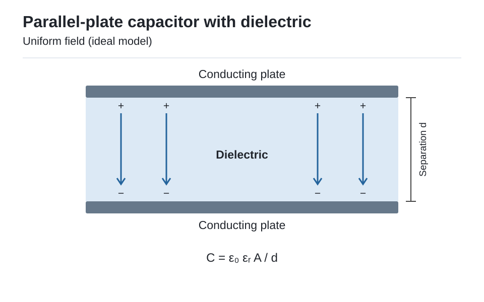

# M19-L2 – Dielectrics and insulating materials {#L2}

**Course area:** M19 – Bachelor: Materials and component technology

**Level:** Bachelor · Foundations

**Prerequisites:** [M4-L1](M4-L1.md).

**Learning objective:** Distinguish permittivity, electric field stress and limitations of ideal insulation models.

## Polarisation and material parameters {#S1}

An insulator separates conducting parts. A dielectric also responds to an electric field through polarisation. Bound charges undergo small displacements; dipoles in polar molecules may reorient. These effects alter the relationship between electric flux density $D$ and field strength $E$. In a linear isotropic model, $D=\varepsilon_0\varepsilon_r E$. Relative permittivity $\varepsilon_r$ is dimensionless. High permittivity does not automatically imply high dielectric strength: the former characterises field response, the latter the limit of insulating behaviour under specified conditions.

## Parallel-plate model and energy {#S2}

For two large parallel plates of area $A$, with separation $d$ small relative to their dimensions and a homogeneous filling material, approximately

$$C=\varepsilon_0\varepsilon_r A/d,\quad E=U/d,\quad Q=CU,\quad W=CU^2/2.$$

The model neglects fringing fields. At fixed voltage a dielectric increases capacitance and stored field energy; at fixed charge voltage and field energy decrease, since $W=Q^2/(2C)$. The electrical source and mechanical work must be included in an energy balance. Distinguishing boundary conditions is more important than making a blanket statement about the effect of insulation.

*Figure: Uniform field (ideal model).*

## Worked example: capacitance and field {#S3}

For $A=0.002\,\mathrm{m^2}$, $d=0.0005\,\mathrm m$ and a hypothetical filling with $\varepsilon_r=4$, using $\varepsilon_0\approx8.854\cdot10^{-12}\,\mathrm{F/m}$ yields 141.7 pF. At 20 V, $E=40\,\mathrm{kV/m}$, $Q=2.83\,\mathrm{nC}$ and $W=28.3\,\mathrm{nJ}$. Without filling, capacitance is approximately 35.4 pF. If the charge of the original empty capacitor is held constant instead, the voltage drops from 20 V to 5 V after insertion. All values are model results, not real insulation ratings.

## Selection and failure mechanisms {#S4}

Ceramics, polymers, glasses and insulating liquids meet different requirements for cooling, mechanical strength, electrical loss and manufacture. Real component properties vary with frequency, temperature and moisture. Contamination, voids and sharp conducting edges can cause local field peaks. A large average margin in a calculation therefore cannot replace an evaluation of actual field distribution and material data. For alternating fields, dielectric losses and thermal balance also matter. Breakdown is a failure of insulation, whereas increased leakage current can occur without complete breakdown. Practical insulation tests belong in qualified laboratories; this lesson is calculation-only.

## Self-assessment {#S5}

### Exercises

1. How does $C$ change if $d$ doubles with all other parameters fixed?
2. Calculate the filled capacitor’s field energy at 10 V.
3. Why must relative permittivity not be interpreted as dielectric strength?

::: {.lc-solutions data-lc-section="S5"}
1. $C$ is halved.
2. At 141.7 pF, $W=7.085$ nJ.
3. Permittivity describes polarisation; dielectric strength concerns field stress at failure. Both depend on conditions.
:::

## Sources {#S6}

- [OpenStax – Capacitor with a Dielectric](https://openstax.org/books/university-physics-volume-2/pages/8-4-capacitor-with-a-dielectric) · Equations 8.11–8.12, charge and energy boundary conditions · Last accessed: 2026-11-25 · Content verified: 2026-11-25
- [OpenStax – Capacitors and Capacitance](https://openstax.org/books/university-physics-volume-2/pages/8-1-capacitors-and-capacitance) · Equation 8.3, parallel-plate model and field · Last accessed: 2026-11-25 · Content verified: 2026-11-25
