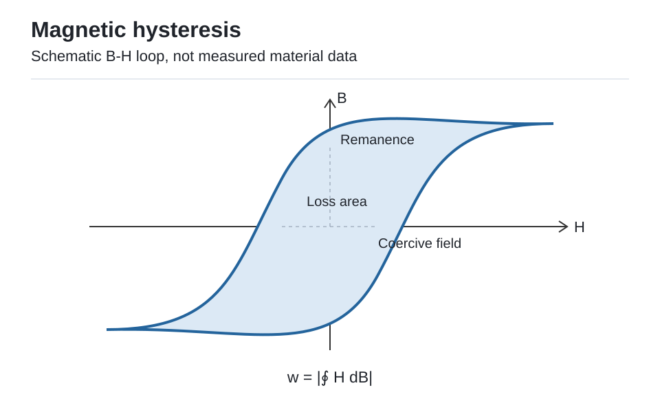

# M19-L3 – Magnetic materials and losses {#L3}

**Course area:** M19 – Bachelor: Materials and component technology

**Level:** Bachelor · Foundations

**Prerequisites:** [M4-L3](M4-L3.md).

**Learning objective:** Interpret magnetic characteristics and estimate hysteresis losses.

## Magnetisation and saturation {#S1}

A magnetic core guides flux and changes winding inductance. In a linear model $B=\mu H$; $B$ is measured in tesla, $H$ in A/m and $\mu$ in H/m. Ferromagnetic materials, however, are not linear across their entire operating range. As magnetisation increases, additional flux density per increment of field strength falls. Differential permeability $\mathrm dB/\mathrm dH$ decreases in saturation. In a coil this can reduce incremental inductance, so current can rise more rapidly for an applied voltage.

## Hysteresis and energy {#S2}

Flux density also depends on magnetic history. After returning to $H=0$, remanence $B_r$ may remain; the opposing field needed for $B=0$ characterises coercivity. For a complete quasistatic cycle, the magnitude of the enclosed area in the B-H diagram equals energy dissipated per core volume:

$$w_h=\left|\oint H\,\mathrm dB\right|,\qquad P_h=fV_c w_h.$$

$V_c$ is core volume and $f$ cycle frequency. The product A/m times T is J/m³. In a dynamically measured loop, other loss components may already contribute to the area; they must not then be added again.

*Figure: Schematic B-H loop, not measured material data.*

## Worked example: core losses {#S3}

A hypothetical core with $V_c=80\,\mathrm{cm^3}=8\cdot10^{-5}\,\mathrm{m^3}$ has a quasistatic loop area of 120 J/m³ per cycle. At 50 Hz the model gives $P_h=50\cdot8\cdot10^{-5}\cdot120=0.48\,\mathrm W$. At 100 Hz it would be 0.96 W if the loop remained unchanged. Assuming a further 0.35 W of eddy-current loss and 1.2 W of winding loss, total loss at the first operating point is 2.03 W. These invented values illustrate a separate loss balance.

## Material selection and eddy currents {#S4}

Soft magnetic materials with narrow hysteresis loops suit repeated magnetisation; hard magnetic materials are useful for permanent magnetisation. In conducting core material, time-varying flux density induces currents. Insulated laminations interrupt large current paths; high-resistivity ferrites can reduce eddy-current loss at higher frequencies. Materials also differ in saturation flux density, temperature dependence, mechanical properties and cost. Actual selection needs characteristics for frequency, temperature, flux swing and bias, together with thermal analysis. A static B-H curve alone does not predict all losses.

## Self-assessment {#S5}

### Exercises

1. What is the unit of loop area?
2. What is $P_h$ at 25 Hz in the example?
3. Why might ferrite be unsuitable despite low eddy-current loss?

::: {.lc-solutions data-lc-section="S5"}
1. J/m³ per cycle.
2. 0.24 W assuming the same loop.
3. For example because of insufficient permissible flux density, temperature limits or unsuitable geometry.
:::

## Sources {#S6}

- [Stanford EE152 – Magnetics](https://web.stanford.edu/class/ee152/docs/Magnetics_102114.pdf) · Magnetic Materials and Core Loss due to Hysteresis; PDF text reviewed, screenshot unavailable · Last accessed: 2026-11-25 · Content verified: 2026-11-25
