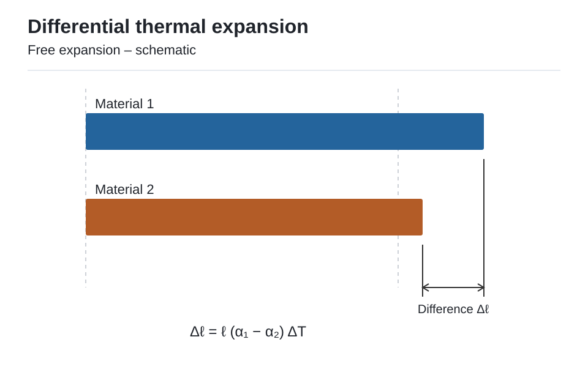

# M19-L4 – Packaging and interconnect technology, ageing {#L4}

**Course area:** M19 – Bachelor: Materials and component technology

**Level:** Bachelor · Foundations

**Prerequisites:** [M19-L1](M19-L1.md).

**Learning objective:** Model electrical, thermal and mechanical interconnect stresses and recognise diagnostic limits.

## Function of an interconnect {#S1}

An electrical interconnect is simultaneously a current path, thermal path and mechanical transition. Solder joints, press contacts, connectors and wire bonds have differing manufacturing and operating requirements. Low contact resistance alone does not demonstrate a reliable joint: geometry, surface condition, material combinations, temperature and mechanical load influence operation. In a model with resistance $R_c$ and current $I$, loss is $P=I^2R_c$. This power may be concentrated locally and alter interconnect properties.

## Thermal expansion and fatigue {#S2}

Two joined materials with differing linear expansion coefficients $\alpha_1$ and $\alpha_2$ would elongate differently if free to expand. A first estimate of their relative free length difference is

$$\Delta\varepsilon=(\alpha_1-\alpha_2)\Delta T,\qquad \Delta\ell=\ell\Delta\varepsilon.$$

In an actual assembly, geometry and compliance determine stresses, shear deformation or creep. Repeated thermal cycles can promote fatigue cracks. The free length difference is neither the actual local strain of a solder joint nor a lifetime equation; lifetime estimates require validated material and loading models.

*Figure: Free expansion – schematic.*

## Worked example: differential strain {#S3}

For two fictitious materials take $\alpha_1=18\cdot10^{-6}\,\mathrm{K^{-1}}$ and $\alpha_2=6\cdot10^{-6}\,\mathrm{K^{-1}}$. With $\ell=20$ mm and $\Delta T=60$ K, $\Delta\varepsilon=720\cdot10^{-6}=0.072\,\%$ and $\Delta\ell=14.4\,\mu\mathrm m$. A hypothetical contact with $R_c=5$ mΩ and $I=4$ A dissipates 0.08 W. If resistance increases to 15 mΩ, power rises to 0.24 W at the same current. Without a heat transfer model, this does not establish contact temperature.

## Ageing and verification {#S4}

Corrosion, mechanical fatigue, material migration and thermal overload are possible causes of loss of function. A suitable test plan separates electrical measurements, visual findings and mechanical or thermal evidence. Intermittent faults can escape a static resistance measurement. Load history and measurement conditions should therefore be recorded alongside reference values and measurement uncertainty. Accelerated ageing tests must represent the relevant failure mechanism; results cannot be transferred to a different environment without a model. This lesson addresses design and diagnostic principles, not work on energised installations.

## Self-assessment {#S5}

### Exercises

1. Calculate the free length difference at 30 K.
2. How does $P$ change if current doubles at the same contact resistance?
3. Why is a single resistance measurement insufficient evidence of lifetime?

::: {.lc-solutions data-lc-section="S5"}
1. 7.2 µm.
2. Power increases by a factor of four.
3. It only measures the present condition under specified circumstances; cyclic fatigue, environmental effects and intermittent failures remain unaccounted for.
:::

## Sources {#S6}

- [NASA Safety and Mission Assurance – Workmanship](https://sma.nasa.gov/sma-disciplines/workmanship) · PCB materials, thermal expansion and cyclic solder-joint stress, paragraphs 780–782 in retrieved text · Last accessed: 2026-11-25 · Content verified: 2026-11-25
