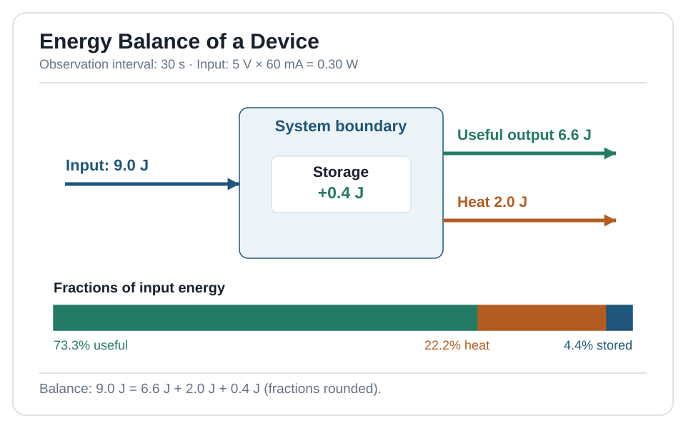

# M2-L1 – Quantities, Units and Physical Balances {#L1}

**Course area:** M2 – Bachelor: Mathematical, Physical and Computational Foundations

**Level:** Bachelor

**Prerequisites:** [Charge, current, voltage and power](M1-L1.md), powers of ten and basic arithmetic.

**Learning objective:** Convert quantities into consistent SI units, check the dimensions of terms and determine an unknown quantity from an energy balance.

## Numerical Value, Unit and Dimension {#S1}

A measured value such as $470\,\mathrm{\mu F}$ consists of a numerical value and a unit. Substituting $470\,\mathrm{\mu F}=4.70\cdot10^{-4}\,\mathrm F$ gives the same physical quantity. The number alone, however, depends on the choice of unit. For a resistance of $2.2\,\mathrm{k\Omega}$, the expected value in a purely numerical SI model is $2200$. Entering $2.2$ instead gives a resistance one thousand times too small.

Dimensional symbols describe the nature of a quantity. For energy $W$, $[W] = \mathrm{M L^2 T^{-2}}$, where $\mathrm M$ denotes mass, $\mathrm L$ length and $\mathrm T$ time. The SI unit is the joule, with $\mathrm J=\mathrm{kg\,m^2\,s^{-2}}$. Power $P=\mathrm d W/\mathrm d t$ accordingly has the unit $\mathrm W=\mathrm{J/s}$. In what follows, italic $W$ denotes energy, while upright $\mathrm W$ denotes the unit of power, the watt.

## Dimensional Checks in Calculations {#S2}

A common physical unit allows us to compare terms written using different symbols. For a resistor, $P=U I=U^2/R$. Using $\mathrm{\Omega} = \mathrm{V/A}$ gives $\mathrm{V^2/\Omega}=\mathrm{V\,A}=\mathrm W$. The numerical value still depends on the quantities substituted. A dimensional check identifies $P=U/R$, for example, as incorrect, since $\mathrm{V/\Omega}=\mathrm A$ denotes a current.

Only terms with the same dimension may be added. Adding two energies in joules and millijoules also requires conversion to a common unit. The arguments of exponential functions must be dimensionless. In $\exp(-t/\tau)$, the time constant $\tau$ must therefore have the same dimension as $t$. A dimensionally correct expression can nevertheless be physically wrong. Both $P=UI$ and $P=2UI$, for instance, have the unit watt. The applicable model determines which relation holds.

## Energy Flow and Storage {#S3}

First choose a system boundary and count energy entering and leaving as positive magnitudes. For an electrical test model with energy storage, useful output and heat dissipation, we have

$$
\Delta W_\mathrm{stored}=W_\mathrm{in}-W_\mathrm{useful}-W_\mathrm{heat}.
$$

Under the usual passive sign convention for a single component, $p=ui$ is positive when the current enters the positive voltage terminal. Temporarily negative power in an energy-storage component may indicate the return of previously absorbed energy. An instantaneous power balance and an energy balance over a time interval therefore answer different questions.

## Worked Example {#S4}

A simplified device draws, over $30\,\mathrm s$, a constant $5\,\mathrm V$ and $60\,\mathrm{mA}$. During this time it delivers $6.6\,\mathrm J$ to the output and increases its stored energy by $0.4\,\mathrm J$. Determine the input energy and the heat released. After converting the current, we obtain

$$
P_\mathrm{in}=5\,\mathrm V\cdot0.060\,\mathrm A=0.30\,\mathrm W,\qquad
W_\mathrm{in}=0.30\,\mathrm W\cdot30\,\mathrm s=9.0\,\mathrm J.
$$

The heat released is $9.0\,\mathrm J-6.6\,\mathrm J-0.4\,\mathrm J=2.0\,\mathrm J$. The output receives $6.6/9.0\approx73.3\,\%$ of the input energy. The stored $0.4\,\mathrm J$ is accounted for separately over this interval. The mean thermal power is approximately $66.7\,\mathrm{mW}$. Its magnitude is consistent with the input power of $300\,\mathrm{mW}$.

{alt="Device energy balance with 9 joules of input energy, 6.6 joules of useful energy, 2 joules of heat released and a 0.4-joule increase in stored energy."}

The balance diagram distinguishes energy flows across the system boundary from the change in stored energy. The lower bar shows the fractions of the input over the entire time interval.

## Exercise and Solution {#S5}

**Exercise.** In the ideal model, a capacitor of capacitance $470\,\mathrm{\mu F}$ is charged to $9\,\mathrm V$. How much energy is stored in its field according to $W_C=\tfrac12 C U^2$? Check the dimension of the formula. Also convert $0.20\,\mathrm{Wh}$ into joules.

**Solution.** We have $\mathrm F=\mathrm{C/V}$ and hence $\mathrm{F\,V^2}=\mathrm{C\,V}=\mathrm J$. The field energy is $\tfrac12\cdot470\cdot10^{-6}\,\mathrm F\cdot(9\,\mathrm V)^2=0.019035\,\mathrm J$, or approximately $19.0\,\mathrm{mJ}$. Since $1\,\mathrm h=3600\,\mathrm s$, $0.20\,\mathrm{Wh}$ corresponds to exactly $720\,\mathrm J$.

## Model Limitations and Further Learning {#S6}

For time-dependent quantities, integrate $p(t)$. The product of two separately averaged values does not generally yield mean power. Heat crossing the system boundary and internal energy stored in the device are distinct terms. Which contributions belong in the balance follows from the chosen boundary and observation period.

In [M2-L2](M2-L2.md), you apply the balance principle to currents and check a circuit solution using its residual.

## Sources {#S7}

- [BIPM, The International System of Units, 9th edition](https://www.bipm.org/en/publications/si-brochure/) · SI units, prefixes and quantity calculus. · Last accessed: 2026-11-25
- [OpenStax, University Physics Volume 2, § 8.3 – Energy Stored in a Capacitor](https://openstax.org/books/university-physics-volume-2/pages/8-3-energy-stored-in-a-capacitor) · Section 8.3 – field energy of an idealised capacitor. · Last accessed: 2026-11-25
