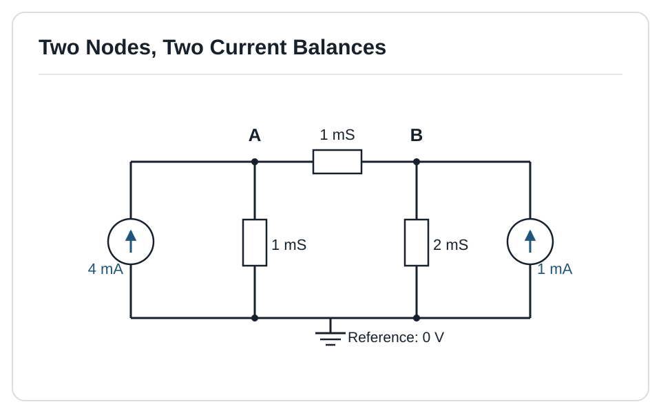

# M2-L2 – Systems of Linear Equations and Matrices {#L2}

**Course area:** M2 – Bachelor: Mathematical, Physical and Computational Foundations

**Level:** Bachelor

**Prerequisites:** [Kirchhoff’s laws and systematic circuit analysis](M1-L3.md) and [quantities and units](M2-L1.md). General concepts of linear maps are covered in [University Mathematics M1-L5](index.html?course=university_mathematics&module=M1&lesson=L5&syslang=en&doclang=en&theme=light).

**Learning objective:** Construct a system of linear equations from node balances, solve it by elimination and check the solution using the remaining current imbalance at each node.

## One Row per Node {#S1}

At a node of unknown potential, the balance requires that the sum of currents leaving through resistors equal the injected current. If a reference node is set to zero volts, a conductance $g$ to that reference contributes to the diagonal of the node’s matrix. If a branch connects two unknown nodes, each balance also contains the coefficient $-g$ multiplying the other node potential. The negative term follows directly from $i=g(v_1-v_2)$. Each row of the model thus represents a current balance rather than merely a calculation rule.

In this example, a conductance of $1\,\mathrm{mS}$ connects nodes A and B. From A to the reference there is a further conductance of $1\,\mathrm{mS}$, and from B to the reference one of $2\,\mathrm{mS}$. Two ideal sources inject $4\,\mathrm{mA}$ into A and $1\,\mathrm{mA}$ into B. We perform numerical calculations with conductances in millisiemens, voltages in volts and currents in milliamperes.

{alt="Two nodes A and B supplied by ideal sources and connected by a conductance of 1 mS. From A to the reference the conductance is 1 mS; from B to the reference it is 2 mS."}

## Matrix and Elimination {#S2}

In the order A, B, $Gv=b$ is

$$
\begin{pmatrix}2&-1\\-1&3\end{pmatrix}
\begin{pmatrix}v_A\\v_B\end{pmatrix}
=
\begin{pmatrix}4\\1\end{pmatrix}.
$$

The first row is $v_A+(v_A-v_B)=4$ and the second is $2v_B+(v_B-v_A)=1$. Add half the first row to the second. It then becomes $2.5v_B=3$. This yields $v_B=1.2\,\mathrm V$ and, by back-substitution, $v_A=2.6\,\mathrm V$. The first node equation gives $2.6+1.4=4$ in milliamperes. At the second node, $2.4\,\mathrm{mA}$ towards the reference and $-1.4\,\mathrm{mA}$ from B to A exactly balance the injected current of $1\,\mathrm{mA}$.

The choice of calculation order should be distinguished from circuit topology. The nodes can be reordered provided the columns of unknowns and the rows of balances are reordered consistently. In larger numerical models, the system is solved using a suitable factorisation. Explicitly calculating $G^{-1}$ is not necessary for this task.

## The Residual as an Error Indicator {#S3}

For an approximate vector $\hat v$, we measure the unbalanced injection using $r=b-G\hat v$. For $\hat v=(2.5,1.2)^\mathsf T\,\mathrm V$, we obtain

$$
r=\begin{pmatrix}4\\1\end{pmatrix}
-\begin{pmatrix}3.8\\1.1\end{pmatrix}
=\begin{pmatrix}0.2\\-0.1\end{pmatrix}\,\mathrm{mA}.
$$

At node A, the outward current is therefore $0.2\,\mathrm{mA}$ too small; at node B, the calculated outward current exceeds the injection by $0.1\,\mathrm{mA}$. The maximum norm $\|r\|_\infty=0.2\,\mathrm{mA}$ indicates the largest deviation in any row. For quantities on very different scales or an ill-conditioned system, this measure alone does not establish that the voltages are accurate. It checks whether the calculated voltages satisfy the stated model. A modelling error can remain even when the residual vanishes.

## Exercise and Solution {#S4}

**Exercise.** Reduce the conductance from B to the reference to $1\,\mathrm{mS}$. All other conductances and injected currents remain unchanged. Determine both potentials and check the current in the connecting branch.

**Solution.** In $G$, only the second diagonal entry changes from $3$ to $2$. From $2 v_A-v_B=4$ and $-v_A+2v_B=1$, we obtain $v_A=3\,\mathrm V$ and $v_B=2\,\mathrm V$. A current of $1\,\mathrm{mA}$ flows through the connection from A to B. At the second node, $2\,\mathrm{mA}$ flows to the reference while $1\,\mathrm{mA}$ arrives from A. The external injection of $1\,\mathrm{mA}$ closes the balance.

## Model Limitations and Further Learning {#S5}

The example uses resistive branches and establishes an unambiguous reference. A floating subcircuit without a potential reference can produce a singular node equation even when voltage differences are uniquely determined. Nonlinear components require additional modelling. Time-dependent storage elements couple the node equations to derivatives. [M2-L3](M2-L3.md) illustrates this transition.

## Sources {#S6}

- [MIT OpenCourseWare, 18.06SC – Elimination with Matrices](https://ocw.mit.edu/courses/18-06sc-linear-algebra-fall-2011/pages/ax-b-and-the-four-subspaces/elimination-with-matrices/) · elimination as an elementary row operation and matrix calculations. · Last accessed: 2026-11-25
- [OpenStax, University Physics Volume 2, § 10.3 – Kirchhoff’s Rules](https://openstax.org/books/university-physics-volume-2/pages/10-3-kirchhoffs-rules) · Section 10.3 – Kirchhoff’s current law and balance sign conventions. · Last accessed: 2026-11-25
