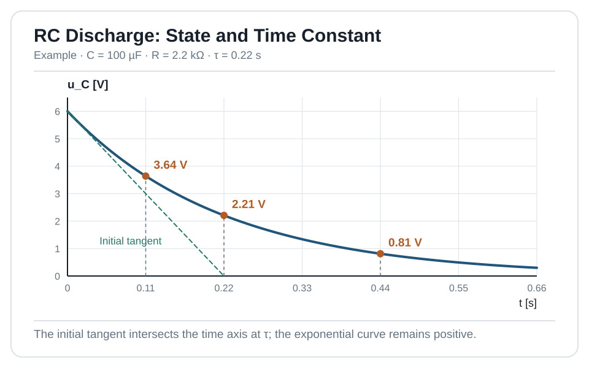

# M2-L3 – Calculus and Differential Equations for Time-Dependent Models {#L3}

**Course area:** M2 – Bachelor: Mathematical, Physical and Computational Foundations

**Level:** Bachelor

**Prerequisites:** [Capacitors, inductors and transient responses](M1-L5.md), slope and the exponential function. Further mathematical detail is available in [University Mathematics M1-L9](index.html?course=university_mathematics&module=M1&lesson=L9&syslang=en&doclang=en&theme=light).

**Learning objective:** Distinguish the instantaneous rate of change of a stored state from its accumulated change, and check a linear differential equation using its initial value and a balance.

## Derivative and Integral as Two Perspectives {#S1}

For an ideal capacitor of constant capacitance $C$, $q=Cu_C$. Under the passive sign convention, positive current counts as charge entering the positive terminal. The rate of change is $i_C=\mathrm d q/\mathrm d t=C\,\mathrm d u_C/\mathrm d t$. Multiplying the instantaneous voltage slope in $\mathrm{V/s}$ by $\mathrm F$ gives the unit ampere. The reverse calculation accumulates charge over a time window:

$$
u_C(t)=u_C(0)+\frac{1}{C}\int_0^t i_C(s)\,\mathrm d s.
$$

The initial value is necessary because the same current profile produces different state trajectories for different starting voltages. In a discretisation, weighted rectangles or trapezoids approximate the current integral. The differential equation, by contrast, contains the local rate of change. Large initial magnitudes of $i_C$ lead to more rapid changes, provided $C$ remains constant.

## Discharge through a Resistor {#S2}

A capacitor with initial voltage $u_0$ discharges through $R>0$. At the shared upper terminal, branch currents are defined downwards. Then $i_C+i_R=0$, where $i_R=u_C/R$. The balance gives

$$
\frac{\mathrm d u_C}{\mathrm d t} + \frac{1}{RC} u_C=0,
\qquad u_C(0)=u_0.
$$

Set $\tau=RC$. Multiplying by $\exp(t/\tau)$ turns the left-hand side into the derivative of $\exp(t/\tau)u_C(t)$. The product is therefore constant and initially equals $u_0$. The solution is $u_C(t)=u_0\exp(-t/\tau)$. This derivation avoids dividing by $u_C$. It therefore also holds for $u_0=0$ and for negative initial values.

As a check, differentiation gives $\mathrm d u_C/\mathrm d t=-u_C/\tau$. At $t=0$, the solution agrees with $u_0$. Since $\tau>0$, the state tends to zero as time increases. Each of these three checks covers a different possible source of error.

## Worked Example and Balance {#S3}

A capacitor of $100\,\mathrm{\mu F}$ with an initial voltage of $6\,\mathrm V$ discharges through $2.2\,\mathrm{k\Omega}$. The time constant is $0.22\,\mathrm s$. Initially, $i_C(0)=-6/2200\,\mathrm A\approx-2.73\,\mathrm{mA}$ flows in the passive reference direction. The current magnitude decreases with the voltage. After $0.11\,\mathrm s=\tau/2$, the voltage is around $3.64\,\mathrm V$.

By then, the charge change is $C(6\exp(-1/2)-6)\,\mathrm V\approx-236\,\mathrm{\mu C}$. Integrating $i_C(t)=-(u_0/R)\exp(-t/\tau)$ yields the same value, since $\tau/R=C$. With positive capacitor voltage and negative capacitor current, the field energy decreases. In the ideal branch, the same instantaneous power magnitude appears as power dissipated in the resistor. This balance offers a check in addition to differentiation.

{alt="Exponential discharge curve from 6 volts, with voltages marked after 0.11, 0.22 and 0.44 seconds, and the initial tangent."}

The initial tangent illustrates the initial rate of change. It intersects the time axis at one time constant; the actual discharge curve, however, reaches zero only in the limit.

## Exercise and Solution {#S4}

**Exercise.** Calculate the voltage in the example after $0.44\,\mathrm s$. How long does it take for the voltage to drop to half its initial value for the first time? What does the model predict for an initial voltage of $-6\,\mathrm V$?

**Solution.** After two time constants, $6\exp(-2)\,\mathrm V\approx0.812\,\mathrm V$ remains. The half-life is $\tau\ln 2\approx0.152\,\mathrm s$. For a negative initial value, the voltage remains negative at finite times and increases towards zero. Field energy depends on the square of the voltage. Its time evolution is therefore identical for initial values of $+6\,\mathrm V$ and $-6\,\mathrm V$.

## Model Limitations and Further Learning {#S5}

The exponential solution assumes constant values of $R$ and $C$. An additional source changes the equilibrium value. For constant source voltage, the deviation from the new equilibrium can then be chosen as the state. Leakage currents, dependence on temperature and voltage, and additional storage elements can alter the decay curve. In [M2-L4](M2-L4.md), you will learn a representation suited to continuous sinusoidal excitation.

## Sources {#S6}

- [OpenStax, University Physics Volume 2, § 10.5 – RC Circuits](https://openstax.org/books/university-physics-volume-2/pages/10-5-rc-circuits) · Section 10.5 – first-order differential equations, discharge and time constant. · Last accessed: 2026-11-25
