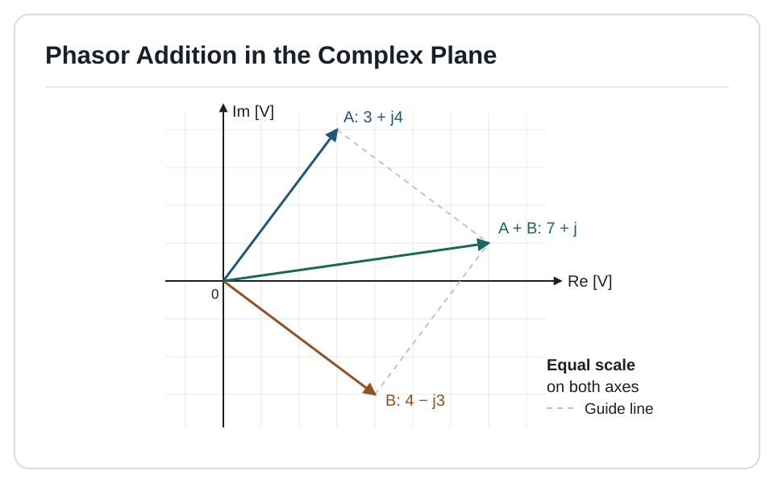

# M2-L4 – Complex Numbers, Sinusoidal Functions and Phasors {#L4}

**Course area:** M2 – Bachelor: Mathematical, Physical and Computational Foundations

**Level:** Bachelor

**Prerequisites:** Sine, cosine and [sinusoidal alternating current](M1-L6.md). For the mathematical foundations, see [University Mathematics M2-L5](index.html?course=university_mathematics&module=M2&lesson=L5&syslang=en&doclang=en&theme=light).

**Learning objective:** Represent an RMS phasor in Cartesian and polar form, add phasors and convert their phase difference into a time shift.

## Two forms of the same number {#S1}

In electrical engineering, the imaginary unit is usually written as $\mathrm j$ because $i$ denotes current. For $z=a+\mathrm j b$, we have $\mathrm j^2=-1$. The magnitude is $r=\sqrt{a^2+b^2}$. For $r>0$, we denote the angle relative to the positive real axis by $\varphi$ and write $z=r\exp(\mathrm j\varphi)$. By Euler's formula, $a=r\cos\varphi$ and $b=r\sin\varphi$.

For the reverse conversion, a quadrant-aware function such as Python's atan2 determines the angle from $b$ and $a$. The expression $\arctan(b/a)$ alone cannot distinguish between the first and third quadrants, for example. It also fails when $a=0$. The zero phasor has zero magnitude and no defined phase angle.

## Phasor and time-domain function {#S2}

We use cosine as the reference and store the RMS value as the magnitude of the phasor. From $X=X_\mathrm{eff}\exp(\mathrm j\varphi)$, at positive angular frequency $\omega=2\pi f$, we obtain

$$
x(t)=\sqrt{2}\operatorname{Re}\!\left(X\exp(\mathrm j\omega t)\right)
=\sqrt{2}X_\mathrm{eff}\cos(\omega t+\varphi).
$$

A positive phase difference $\varphi_A-\varphi_B$ means in this convention that A leads B. If the frequencies are equal, a phase difference of $\Delta\varphi$ corresponds to a time difference of magnitude $\lvert\Delta\varphi\rvert/\omega$. The timing is unique only modulo whole periods. When calculating with $\omega$ in radians per second, the angle must be expressed in radians. Degrees remain useful when presenting results.

## Adding phasors and comparing phases {#S3}

Two voltages of the same frequency have RMS phasors $U_A=(3+\mathrm j4)\,\mathrm V$ and $U_B=(4-\mathrm j3)\,\mathrm V$. Both magnitudes are $5\,\mathrm V$. A lies in the first quadrant and B in the fourth. Their phases are approximately $53.13^\circ$ and $-36.87^\circ$.

Cartesian form is convenient for addition. The sum is $(7+\mathrm j)\,\mathrm V$, with magnitude $\sqrt{50}\,\mathrm V\approx7.07\,\mathrm V$ and phase approximately $8.13^\circ$. Adding the magnitudes $5\,\mathrm V$ and $5\,\mathrm V$ directly would be correct only for identical phases. Polar form is useful for division because the magnitudes are divided and the angles subtracted. Here $U_A/U_B=\mathrm j$, and A leads B by $90^\circ$. At $50\,\mathrm{Hz}$, this corresponds to a quarter of a period, or $5\,\mathrm{ms}$.

{alt="Phasor A ends at 3 plus 4 j volts, B at 4 minus 3 j volts, and their sum at 7 plus j volts. A dashed parallelogram illustrates the addition."}

## Exercise and solution {#S4}

**Exercise.** Express $2\exp(\mathrm j135^\circ)\,\mathrm V$ in Cartesian form. A second RMS phasor has the same magnitude and phase $45^\circ$. Determine the sum phasor and the phase difference.

**Solution.** The two phasors are $(-\sqrt2+\mathrm j\sqrt2)\,\mathrm V$ and $(\sqrt2+\mathrm j\sqrt2)\,\mathrm V$. The real parts cancel and the sum is $\mathrm j2\sqrt2\,\mathrm V$. Its magnitude is $2\sqrt2\,\mathrm V$ and its phase is $90^\circ$. The first individual phasor also leads the second by $90^\circ$.

## Model limitations and further study {#S5}

Phasors combine amplitude and phase at a fixed frequency. Signal components of different frequencies are assigned separate phasors. Their time-domain functions are then added. A single phasor also does not include a DC component or a transient response. Here the complex plane represents signals and their timing. Spatial direction and spatial derivatives, by contrast, are covered in [M2-L5](M2-L5.md).

## Sources {#S6}

- [OpenStax, Precalculus 2e, § 8.5 – Polar Form of Complex Numbers](https://openstax.org/books/precalculus-2e/pages/8-5-polar-form-of-complex-numbers) · Section 8.5 – Cartesian and polar representations and division in polar form. · Last accessed: 2026-11-25
- [OpenStax, University Physics Volume 2, § 15.2 – Simple AC Circuits](https://openstax.org/books/university-physics-volume-2/pages/15-2-simple-ac-circuits) · Section 15.2 – sinusoidal quantities, RMS values and phase relationships. · Last accessed: 2026-11-25
