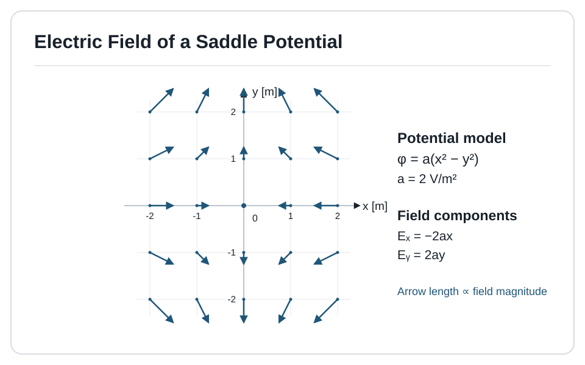

# M2-L5 – Vector Calculus and Spatial Derivatives {#L5}

**Course area:** M2 – Bachelor: Mathematical, Physical and Computational Foundations

**Level:** Bachelor

**Prerequisites:** Vector components and the dot product, as well as derivatives from [M2-L3](M2-L3.md). A vector field assigns a vector to each point in space. A scalar field assigns a single number to each point.

**Learning objective:** Calculate a field from a potential, interpret a field diagram and distinguish flux and circulation by their surface and line contributions respectively.

## From potential to directional arrow {#S1}

The gradient $\nabla\phi$ of a scalar field $\phi(x,y)$ consists of the partial derivatives $\partial\phi/\partial x$ and $\partial\phi/\partial y$. For each derivative, the other coordinate is held constant. The dot product $\nabla\phi\cdot\hat{\boldsymbol s}$ gives the local rate of change in the unit direction $\hat{\boldsymbol s}$. If $\nabla\phi\ne\boldsymbol 0$, the gradient points in the direction of steepest increase. At a regular level curve, it is perpendicular to the tangent.

In the electrostatic model, $\boldsymbol E=-\nabla\phi$ describes the electric field. The minus sign indicates that the potential decreases in the direction of the field. A potential in volts yields field components in volts per metre.

## Field diagram for a worked example {#S2}

Consider $\phi(x,y)=a(x^2-y^2)$ with $a=2\,\mathrm{V/m^2}$. Then

$$
\boldsymbol E(x,y)=(-2ax,\,2ay).
$$

At $x=2\,\mathrm m$, $y=1\,\mathrm m$, the field is $(-8,4)\,\mathrm{V/m}$, and its magnitude is $\sqrt{80}\,\mathrm{V/m}\approx8.94\,\mathrm{V/m}$. Along the horizontal axis, the arrows point towards the origin, and along the vertical axis they point away from it. At the origin, the gradient is zero.

{alt="Arrow grid of the field E equal to minus 4 x in the x direction and plus 4 y in the y direction. Arrows pointing towards the origin on the x-axis and outwards on the y-axis form a saddle pattern."}

## Flux and circulation {#S3}

Oriented **flux** through a surface sums the normal component of the field. In the simple case of a constant field $\boldsymbol F$ and a flat surface of area $A$, we have $\Phi=A\,\boldsymbol F\cdot\hat{\boldsymbol n}$. If the field is parallel to the surface, this contribution vanishes. A uniform electric field vector $(3,0,0)\,\mathrm{V/m}$ produces, through a surface of area $2\,\mathrm{m^2}$ with its normal in the positive $x$ direction, a flux of $6\,\mathrm{V\,m}$. Reversing the normal reverses the sign. The flux density, or field quantity, and its integrated flux have different units.

**Circulation** sums the tangential component along a closed, oriented curve. The integral is $\oint\boldsymbol F\cdot\mathrm d\boldsymbol r$. A purely radial contribution on a circle is perpendicular to the path there. A circulating field, by contrast, can produce a non-zero result.

For $\boldsymbol E=-\nabla\phi$, the integral along a path is the potential at the start minus the potential at the end. It therefore vanishes along a closed path. In the example, the divergence of $\boldsymbol E$ is also zero because $\partial E_x/\partial x=-2a$ and $\partial E_y/\partial y=2a$ cancel each other. This does not mean the field vectors are zero. It describes a local balance between outgoing and incoming contributions of the field.

## Exercise and solution {#S4}

**Exercise.** Calculate the circulation of the comparison field $\boldsymbol F=(-k y,k x)$ around the square from $(0,0)$ to $(L,L)$, traversed in the positive anticlockwise direction, with $k=1\,\mathrm{V/m^2}$ and $L=1\,\mathrm m$.

**Solution.** On the bottom edge, $F_x=0$; on the left edge, $F_y=0$. Travelling upwards along the right edge, $F_y=kL$, so the line integral gives $kL^2$. Along the top, the path goes to the left while $F_x=-kL$. The product of the field component and the directed displacement again yields $kL^2$. The sum is $2kL^2=2\,\mathrm V$. The comparison field is therefore not an electrostatic gradient field in this region.

## Model limitations and further study {#S5}

Arrow grids show values only at selected locations. Interpolation and arrow length must be consistent with the actual field definition. The scalar potential example treats an electrostatic region. Time-dependent magnetic flux can lead to electric field circulation and extends this model. Before studying field and wave models in M4, we examine the statistical description of measured values in [M2-L6](M2-L6.md).

## Sources {#S6}

- [OpenStax, Calculus Volume 3, § 4.6 – Directional Derivatives and the Gradient](https://openstax.org/books/calculus-volume-3/pages/4-6-directional-derivatives-and-the-gradient) · Section 4.6 – direction, gradient and level curves. · Last accessed: 2026-11-25
- [OpenStax, Calculus Volume 3, § 6.2 – Line Integrals](https://openstax.org/books/calculus-volume-3/pages/6-2-line-integrals) · Section 6.2 – integration along oriented curves. · Last accessed: 2026-11-25
- [OpenStax, Calculus Volume 3, § 6.5 – Divergence and Curl](https://openstax.org/books/calculus-volume-3/pages/6-5-divergence-and-curl) · Section 6.5 – local field balance and its relation to circulation. · Last accessed: 2026-11-25
