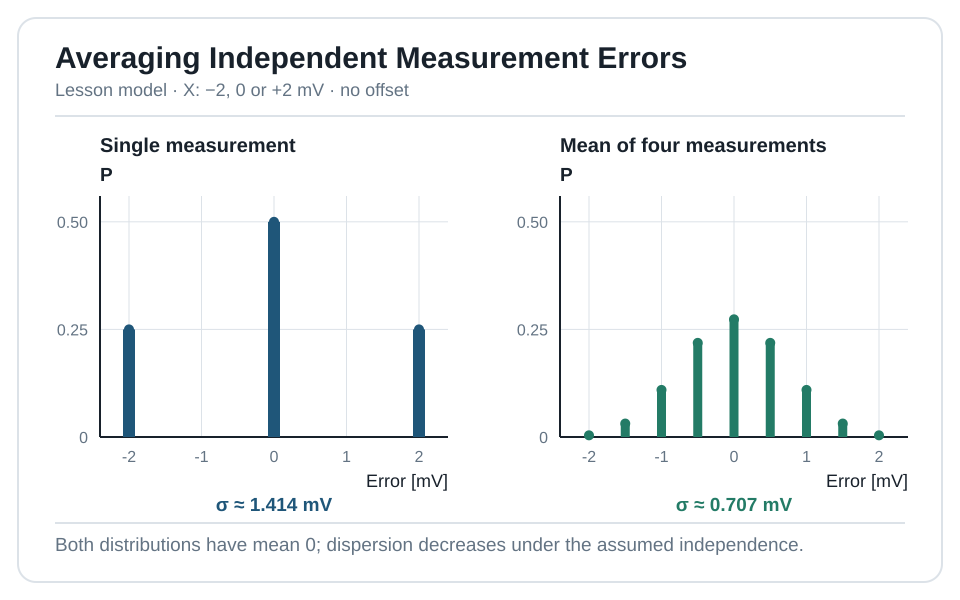

# M2-L6 – Probability and Statistical Modelling {#L6}

**Course area:** M2 – Bachelor: Mathematical, Physical and Computational Foundations

**Level:** Bachelor

**Prerequisites:** Fractions, sums and squares. The underlying concepts are explored further in [University Mathematics M1-L7](index.html?course=university_mathematics&module=M1&lesson=L7&syslang=en&doclang=en&theme=light).

**Learning objective:** Calculate the expected value and variance of a discrete measurement model and determine which simplifications are valid for independent samples.

## A measured value as a random variable {#S1}

A hypothetical sensor produces an additive measurement error $X$ at a constant input. In a simple discrete model, this error can take only the values $-2\,\mathrm{mV}$, $0\,\mathrm{mV}$ or $2\,\mathrm{mV}$. Let their probabilities be $\tfrac14$, $\tfrac12$ and $\tfrac14$. Their sum is one. The model describes a hypothetical distribution. A finite list of actual observations would have its own relative frequencies, which may differ from these probabilities.

For possible values $x_i$ and probabilities $p_i$, the expected value is the weighted mean and the variance is the expected squared deviation from that mean:

$$
\mu=\operatorname{E}[X]=\sum_i p_i x_i,\qquad
\operatorname{Var}(X)=\sum_i p_i(x_i-\mu)^2.
$$

The expected value in this example is zero because the positive and negative contributions cancel. The variance is $2\,\mathrm{mV}^2$. The standard deviation is its square root and is approximately $1.414\,\mathrm{mV}$. Like $X$, it has a unit of voltage, whereas the variance has a squared voltage unit.

## Averaging and systematic offset {#S2}

Consider four measurement errors $X_1,\dots,X_4$ with the same distribution. If they are independent, their mutual covariances vanish. For the mean $\bar X=\tfrac14\sum_i X_i$, we therefore have $\operatorname{E}[\bar X]=0$ and $\operatorname{Var}(\bar X)=\operatorname{Var}(X)/4=0.5\,\mathrm{mV}^2$. The standard deviation of the mean is approximately $0.707\,\mathrm{mV}$. In general, under these assumptions it decreases as $1/\sqrt n$.

An undetected offset of $1\,\mathrm{mV}$ shifts each measurement error and hence the expected value of the mean to $1\,\mathrm{mV}$. This constant contributes nothing to the variance about its own mean. In this model, averaging therefore reduces random dispersion, but the offset remains. If, on the other hand, the four identical random errors occur in complete synchrony, their mean is the same error. In that case, there is no reduction in dispersion.

{alt="Two discrete probability distributions: a single measurement with a standard deviation of 1.414 millivolts and a mean of four independent measurements with 0.707 millivolts."}

The distribution on the right results from all combinations of four independent measurement errors in the model described above. It is more concentrated around zero. The vertical lines represent individual probabilities, not a continuous density.

## Events in samples {#S3}

A second model counts warnings. In each trial, the probability of a warning is $p=0.1$, and the trials are independent. The probability of no warning in five trials is $(1-p)^5=0.59049$. The probability of at least one warning is therefore $0.40951$. The probability of exactly one warning is $5p(1-p)^4=0.32805$, because it can occur at five different positions.

These products use two distinct assumptions. Independence permits multiplication of the individual probabilities. A constant $p$ makes every fixed arrangement with the same number of warnings equally probable. Both assumptions should be justified separately when working with a series of measurements.

## Exercise and solution {#S4}

**Exercise.** Determine the standard deviation of the mean of eight independent measurements in the first model. In the warning model, what is the probability of at least one warning with $p=0.02$ in three independent trials?

**Solution.** The variance of the mean is $2/8=0.25\,\mathrm{mV}^2$. Its standard deviation is $0.5\,\mathrm{mV}$. In the second part, the complementary event is three trials with no warning, with probability $0.98^3=0.941192$. The required probability is thus $0.058808$, or approximately $5.88\,\%$.

## Model limitations and further study {#S5}

Drift, shared disturbances and temporal filters can create dependencies between successive measurements. In particular, identical means and variances are not sufficient to determine the probabilities of rare events. A suitable distribution or an appropriate data-driven method is needed for that purpose. In [M2-L7](M2-L7.md), you will document the inputs of a numerical experiment and check its results.

## Sources {#S6}

- [OpenStax, Introductory Statistics 2e, Chapter 4 – Formula Review](https://openstax.org/books/introductory-statistics-2e/pages/4-formula-review) · Section Ch. 4 Formula Review – expected value, variance and binomial distribution. · Last accessed: 2026-11-25
- [OpenStax, Introductory Statistics 2e, § 7.1 – The Central Limit Theorem for Sample Means](https://openstax.org/books/introductory-statistics-2e/pages/7-1-the-central-limit-theorem-for-sample-means-averages) · Section 7.1 – location and dispersion of the sample mean. · Last accessed: 2026-11-25
