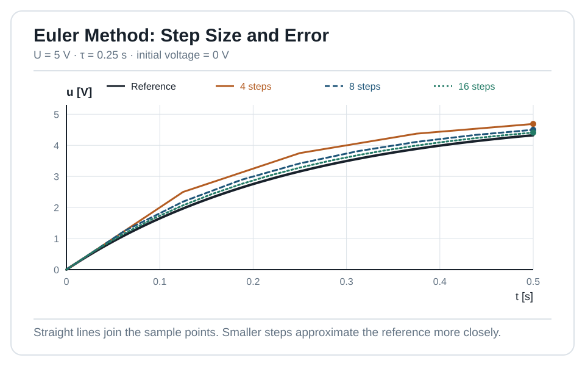

# M2-L7 – Computational Experiments and Programming {#L7}

**Course area:** M2 – Bachelor: Mathematical, Physical and Computational Foundations

**Level:** Bachelor

**Prerequisites:** [Derivatives and differential equations](M2-L3.md), loops and basic Python expressions.

**Learning objective:** Solve a differential equation numerically using the explicit Euler method and check the calculation against the initial value, an equilibrium case and an analytical reference.

## What must be reproducible? {#S1}

A computational experiment consists of the physical model, the inputs, the numerical method and the evaluation criteria. Here, an ideal capacitor is connected through a resistor to a constant source voltage $U$. For $\tau=RC$, we have

$$
\frac{\mathrm d u}{\mathrm d t}=\frac{U-u}{\tau},\qquad
u(0)=u_0,\qquad
u_\mathrm{ref}(t)=U+(u_0-U)\exp(-t/\tau).
$$

The reference is the analytical solution of the same idealised model. We choose $U=5\,\mathrm V$, $\tau=0.25\,\mathrm s$, $u_0=0$ and a fixed comparison time $T=0.5\,\mathrm s$. All times are entered as numerical values in seconds and voltages in volts. This makes cause and effect traceable when a result changes with the step size.

## From model to program {#S2}

The explicit Euler step uses the slope at the beginning of each step:

$$
u_{n+1}=u_n+h\frac{U-u_n}{\tau}.
$$

The difference from equilibrium satisfies $u_{n+1}-U=(1-h/\tau)(u_n-U)$. For step sizes with $0<h<\tau$, the discrete solution approaches equilibrium without a change of sign. For $\tau<h<2\tau$, it alternately overshoots and undershoots equilibrium and still converges. At $h=2\tau$, the magnitude of the deviation stays constant. This behaviour arises from discretisation and is not an oscillation in the continuous capacitor model.

The following code uses only the Python standard library. The step size is determined by the fixed end time and number of steps. This avoids shifting the end time by rounding the number of steps.

```python
from math import exp, isclose


def euler_endpoint(u_start, supply, tau, duration, steps):
    h = duration / steps
    u = u_start
    for _ in range(steps):
        u += h * (supply - u) / tau
    return u


supply = 5.0       # V
tau = 0.25         # s
duration = 0.5     # s
u_start = 0.0      # V

reference = supply + (u_start - supply) * exp(-duration / tau)
print(f"Reference: {reference:.6f} V")

errors = []
for steps in (4, 8, 16):
    endpoint = euler_endpoint(u_start, supply, tau, duration, steps)
    error = abs(endpoint - reference)
    errors.append(error)
    print(f"h={duration / steps:.5f} s, u(T)={endpoint:.6f} V, "
          f"Error={error:.6f} V")

assert 0 < reference < supply
assert errors[0] > errors[1] > errors[2]
assert isclose(euler_endpoint(u_start, supply, tau, 0.0, 8), u_start)
assert isclose(euler_endpoint(supply, supply, tau, duration, 8), supply)
```

## Comparing the results {#S3}

The reference value at time $T$ is $4.323324\,\mathrm V$. With $h=0.125\,\mathrm s$, the result is $4.687500\,\mathrm V$, with $h=0.0625\,\mathrm s$ approximately $4.499435\,\mathrm V$, and with $h=0.03125\,\mathrm s$ approximately $4.409665\,\mathrm V$. The absolute errors are approximately $0.364176\,\mathrm V$, $0.176112\,\mathrm V$ and $0.086341\,\mathrm V$. The error is roughly halved when the step size is halved. In this example, that is consistent with a first-order global error.

The checks distinguish three cases. At an end time of zero, the initial value must be preserved. For $u_0=U$, the state must remain constant over time. For the transition between two different states, the end value is additionally compared with the analytical solution. All three tests refer to the chosen model. Comparison with real measurement data would be a further step.

{alt="RC charging curve as an analytical reference, with Euler sample points for four, eight and sixteen steps. The curves approach the reference as the step size decreases."}

The lines connect the discrete calculation points. The smaller the step size in this example, the closer the numerical solution lies to the analytical curve shown.

## Exercise and solution {#S4}

**Exercise.** Use just one Euler step for the observation time of $0.5\,\mathrm s$. Calculate the end value and explain why it is implausible for the idealised charging model.

**Solution.** The initial slope is $5\,\mathrm V/0.25\,\mathrm s=20\,\mathrm{V/s}$. A step of $0.5\,\mathrm s$ therefore leads to $10\,\mathrm V$. Starting from zero, the exact charging curve approaches the constant supply of $5\,\mathrm V$ monotonically from below. Overshooting it by $5\,\mathrm V$ therefore indicates an unsuitable numerical step. Here $h=2\tau$ and the deviation factor is $-1$.

## Model limitations and further study {#S5}

The code simulates an ideal storage element with one time constant. With several widely differing time constants, an explicit method may require particularly small steps. Agreement at one point in time replaces neither a check of the entire curve nor a validation of the model against independent observations. The [Study pathway](pages/study-path.md) places the computational methods in the context of the rest of the course.

## Sources {#S6}

- [OpenStax, Calculus Volume 2, § 4.2 – Direction Fields and Numerical Methods](https://openstax.org/books/calculus-volume-2/pages/4-2-direction-fields-and-numerical-methods) · Section 4.2 – explicit Euler method and comparison with analytical solutions. · Last accessed: 2026-11-25
- [OpenStax, University Physics Volume 2, § 10.5 – RC Circuits](https://openstax.org/books/university-physics-volume-2/pages/10-5-rc-circuits) · Section 10.5 – capacitor charging and time constant. · Last accessed: 2026-11-25
