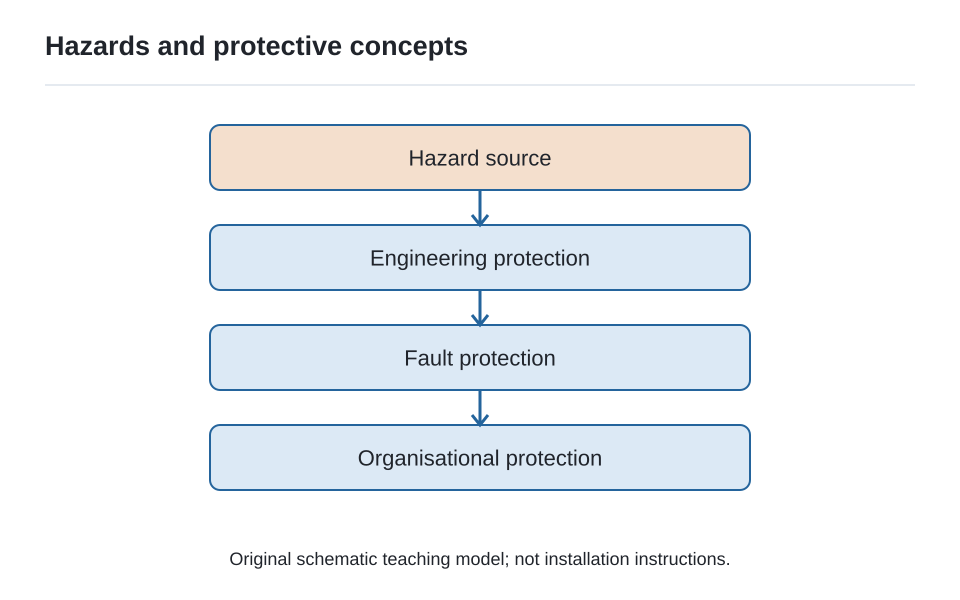

# M20-L1 – Hazards and protective concepts {#L1}

**Course area:** M20 – Bachelor: Electrical safety and installations

**Level:** Bachelor · Foundations

**Prerequisites:** [M19-L4](M19-L4.md).

**Learning objective:** Distinguish hazards, stored energy and independent layers of protection.

## Hazards and exposure {#S1}

Electrical energy can cause injury through current through the body, heating, arcs, fire or unexpected movement. A hazard is a potential cause of harm; risk also depends on exposure, likelihood and severity. Moisture, damaged insulation and conductive surroundings change the conditions. An extinguished indicator does not establish absence of energy: capacitors, batteries, backfeed and mechanical stores may retain energy.

## Layers of protection {#S2}

Design measures reduce the hazard at its source, for example through suitable insulation, safe enclosures and energy-limited systems. Fault protection aims to prevent a single fault from producing a hazardous state. Organisational rules, competence and verification supplement these layers. Personal protective equipment does not replace engineering measures. Multiple measures are robust only when common-cause failures are considered, such as heat damaging two insulation barriers at once.

*Figure: Original schematic teaching model; not installation instructions.*

## Calculation model: stored energy {#S3}

For an ideal capacitor, $W=\tfrac12 CU^2$. A hypothetical model with $C=100\,\mu\mathrm F$ and $U=20\,\mathrm V$ stores $W=0.020\,\mathrm J$. At the same capacitance and half the voltage, energy is 0.005 J. This illustrates quadratic voltage dependence. The value is not a touch-safety limit; effects also depend on the current path, discharge duration and other sources.

## Case analysis and limitations {#S4}

In a model case, damaged insulation and an incomplete maintenance record are observed. Rather than evaluating the equipment by trial operation, it is referred for competent assessment. Investigation of a real system requires knowledge of all energy sources, responsibilities and applicable rules. This module uses theoretical examples and simulations only; it does not qualify learners to work on electrical installations.

## Self-assessment {#S5}

### Exercises

1. How does capacitor energy change if voltage doubles?
2. Why are two barriers not automatically independent?
3. Why is an extinguished indicator insufficient?

::: {.lc-solutions data-lc-section="S5"}
1. It quadruples at constant C.
2. A common cause can compromise both.
3. Other sources and stored energy may remain.
:::

## Sources {#S6}

- [HSE – Introduction to electrical safety](https://www.hse.gov.uk/electricity/introduction.htm) · General hazards and risk reduction; HTML retrieved, lines 143–144 and hazard discussion · Last accessed: 2026-11-25 · Content verified: 2026-11-25
- [HSE – Work using electrically powered equipment](https://www.hse.gov.uk/ELECTRICITY/electricequip.htm) · RCD limitations, lines 97–99 · Last accessed: 2026-11-25 · Content verified: 2026-11-25
