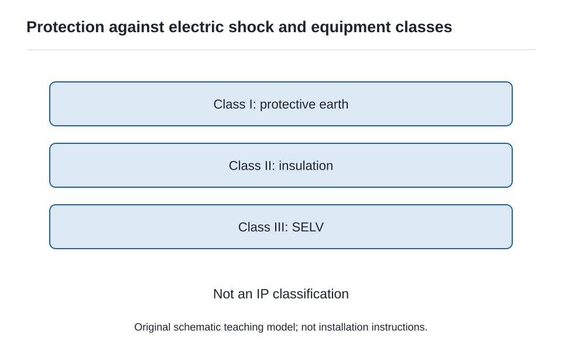

# M20-L2 – Protection against electric shock and equipment classes {#L2}

**Course area:** M20 – Bachelor: Electrical safety and installations

**Level:** Bachelor · Foundations

**Prerequisites:** [M20-L1](M20-L1.md).

**Learning objective:** Relate basic protection, fault protection and equipment protection classes.

## Normal and fault conditions {#S1}

Basic protection prevents access to hazardous live parts under normal conditions. Fault protection addresses a fault that could cause an accessible conductive enclosure to reach a hazardous potential. Additional protection supplements the protective concept but does not automatically replace either of the other layers. Shock protection must be assessed for actual environmental conditions; a rated voltage alone cannot establish acceptance.

## Equipment classes {#S2}

Class I combines basic insulation with a protective-conductor concept for accessible conductive parts and associated installation protection. Class II uses double or reinforced insulation and does not use a protective-earth connection for that protection. Class III relies on a safety extra-low voltage (SELV) supply and must not generate hazardous voltages beyond that range. Precise classification requires the applicable product standard. Protection classes must not be confused with IP enclosure ratings for access and ingress.

*Figure: Original schematic teaching model; not installation instructions.*

## Calculation model: abstract fault path {#S3}

In a purely resistive hypothetical network, $U=12\,\mathrm V$ and $R=120\,\Omega$ give $I=U/R=0.10$ A. Doubling the model resistance halves the current. The network does not represent a human body and permits neither estimation of body impedance nor assessment of permissible touch voltages. With alternating current, frequency and complex impedance may matter.

## Selection and evidence {#S4}

An equipment class is a design property, not a label that can be selected retrospectively. Damage to an enclosure can compromise protection even if equipment still functions. Product documentation, manufacturer information and competent verification must agree. IEC 61140 is a fundamental reference; its public abstract does not replace the full standard or application-specific product and installation standards.

## Self-assessment {#S5}

### Exercises

1. How does class I differ from class II?
2. Is an IP rating equivalent to a protection class?
3. What is the model current at 240 Ω?

::: {.lc-solutions data-lc-section="S5"}
1. Class I uses protective earthing; class II double or reinforced insulation.
2. No, they describe different properties.
3. 0.05 A.
:::

## Sources {#S6}

- [Schneider Electric – Electrical Installation Guide](https://www.electrical-installation.org/enwiki/Protection_against_electric_shock) · Basic and fault protection, lines 83–121; manufacturer technical guide, not normative text (review limited to documented scope) · Last accessed: 2026-11-25 · Content verified: 2026-11-25
- [Schneider Electric – Class II equipment](https://www.electrical-installation.org/enwiki/Class_II_equipment) · Supplementary insulation and protective conductor, lines 48–59 · Last accessed: 2026-11-25 · Content verified: 2026-11-25
- [IEC 61140:2016](https://webstore.iec.ch/en/publication/23997) · Public catalogue abstract only; full standard not reviewed (review limited to documented scope) · Last accessed: 2026-11-25 · Content verified: 2026-11-25
- [Schneider Electric – Extra Low Voltage](https://www.electrical-installation.org/enwiki/Extra_Low_Voltage_(ELV)) · SELV/PELV distinction, lines 78–108; secondary guide · Last accessed: 2026-11-25 · Content verified: 2026-11-25
