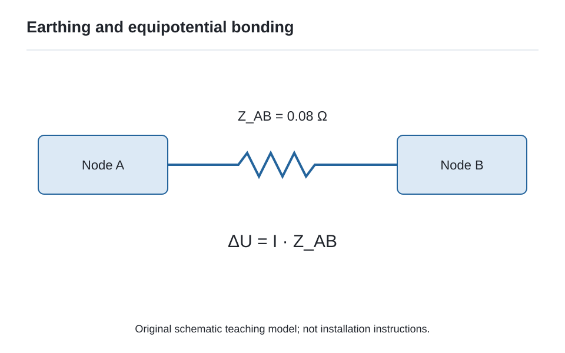

# M20-L3 – Earthing and equipotential bonding {#L3}

**Course area:** M20 – Bachelor: Electrical safety and installations

**Level:** Bachelor · Foundations

**Prerequisites:** [M20-L2](M20-L2.md).

**Learning objective:** Distinguish system earthing, protective earthing and potential differences in equivalent models.

## Earthing functions {#S1}

System earthing defines a reference between an electrical supply and earth and affects fault behaviour. Protective earthing concerns the safety of accessible conductive parts. Functional earthing may instead be required for signal quality or electromagnetic compatibility. These functions must be distinguished even when coordinated within one installation.

## Bonding and impedance {#S2}

Earth is not an ideal zero-potential node. Current through conductors and soil produces potential differences; inductive components also matter during rapid current changes. Protective equipotential bonding aims to limit hazardous potential differences between conductive parts. Low DC resistance alone does not guarantee adequate high-frequency behaviour or fault-current withstand.

*Figure: Original schematic teaching model; not installation instructions.*

## Calculation model: two nodes {#S3}

For abstract nodes A and B connected by impedance $Z_{AB}$, the linear AC model gives $\underline U_{AB}=\underline I\,Z_{AB}$. For a purely resistive model value of 0.08 Ω at 2 A, the voltage drop is 0.16 V. At the same current and 0.20 Ω it is 0.40 V. This model does not size protective conductors or earthing arrangements; in actual fault networks impedance also changes current distribution.

## System types and assessment {#S4}

TN, TT and IT systems differ in the relationship of the source and exposed conductive parts to earth. They consequently have different fault loops and protective concepts and cannot be substituted arbitrarily. Assessment requires the actual system type, source, fault cases, switching devices, conductors and environment. The US OSHA source explains bonding in its own application context; it is not a German installation standard.

## Self-assessment {#S5}

### Exercises

1. Why is earth not an ideal zero-potential node?
2. Calculate the model voltage drop at 3 A and 0.08 Ω.
3. Why is low DC resistance insufficient evidence on its own?

::: {.lc-solutions data-lc-section="S5"}
1. Current produces voltage drops across finite impedances.
2. 0.24 V.
3. Dynamic impedance, withstand capability and other protection requirements remain unresolved.
:::

## Sources {#S6}

- [HSE – Earthing](https://www.hse.gov.uk/comah/sragtech/techmeasearthing.htm) · System and equipment earthing, line 64 · Last accessed: 2026-11-25 · Content verified: 2026-11-25
- [OSHA – Protective Grounding and Bonding](https://www.osha.gov/etools/electric-power/hazardous-energy-control/protective-grounding-bonding) · Potential differences and equipotential zone, lines 62–70; US context, not local installation requirements · Last accessed: 2026-11-25 · Content verified: 2026-11-25
