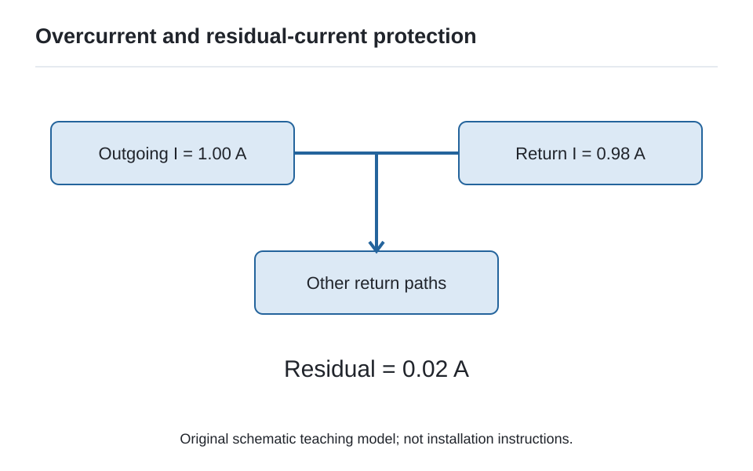

# M20-L4 – Overcurrent and residual-current protection {#L4}

**Course area:** M20 – Bachelor: Electrical safety and installations

**Level:** Bachelor · Foundations

**Prerequisites:** [M20-L3](M20-L3.md).

**Learning objective:** Distinguish overload, short circuit and residual current and interpret protective characteristics.

## Different fault quantities {#S1}

Overload is excessive current in an otherwise intended current path; a short circuit is an unintended low-impedance connection. Fuses and circuit breakers respond to overcurrent with characteristic time-current behaviour. Breaking capacity and thermal withstand are separate quantities. A protective device can only be assessed together with the network and equipment.

## Residual current {#S2}

A residual-current device senses the sum of currents in the live conductors passing through its sensor. In an ideal single-phase healthy circuit, outgoing and returning currents are equal and opposite. Current returning by another path produces an imbalance. An RCD does not detect every electrical fault; notably a load between live conductors without an imbalance may remain undetected. Not every RCD incorporates overcurrent protection.

*Figure: Original schematic teaching model; not installation instructions.*

## Calculation model: loss and current balance {#S3}

An abstract 0.5 Ω resistor dissipates $P=I^2R=2$ W at 2 A and 8 W at 4 A. In a separate simulation, outgoing and returning currents are 1.00 A and 0.98 A; the magnitude of their difference is 0.02 A. These are mathematical exercise values, not trip thresholds or selection instructions. Actual tripping depends on device type, waveform and duration, among other factors.

## Coordination and selectivity {#S4}

Selectivity aims to disconnect a fault as locally as possible without unnecessarily losing other installation sections. Characteristics, available fault currents and manufacturer coordination data must be considered together. Ordering devices by rated current alone does not guarantee selectivity. Verification is a competent engineering task; real fuse or RCD settings must not be derived from this learning model.

## Self-assessment {#S5}

### Exercises

1. How does dissipation change if current doubles?
2. What is the difference between 2.00 A and 1.99 A?
3. Can an RCD detect every overcurrent?

::: {.lc-solutions data-lc-section="S5"}
1. It quadruples at constant R.
2. 0.01 A.
3. No; an RCD monitors residual current, not necessarily overcurrent.
:::

## Sources {#S6}

- [HSE – Work using electrically powered equipment](https://www.hse.gov.uk/ELECTRICITY/electricequip.htm) · RCD limitations, lines 97–99 · Last accessed: 2026-11-25 · Content verified: 2026-11-25
- [OSHA – Subpart S Electrical Standard eTool](https://www.osha.gov/etools/subpart-s) · Coordination of protective devices, impedance and short-circuit ratings, line 81; US context · Last accessed: 2026-11-25 · Content verified: 2026-11-25
