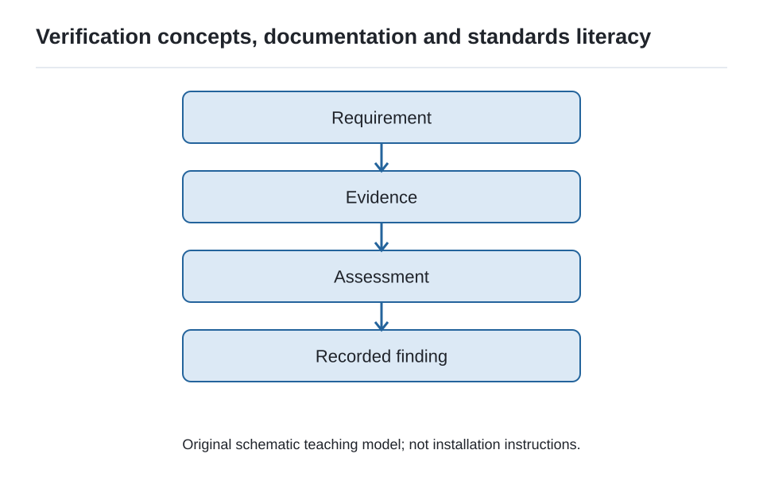

# M20-L5 – Verification concepts, documentation and standards literacy {#L5}

**Course area:** M20 – Bachelor: Electrical safety and installations

**Level:** Bachelor · Foundations

**Prerequisites:** [M20-L4](M20-L4.md).

**Learning objective:** Evaluate verification evidence, measurement uncertainty and the scope of technical rules.

## Verification and responsibility {#S1}

Verification establishes evidence against defined requirements rather than merely checking function. It must fit the equipment, environment, risk assessment and lifecycle stage. Exposure matters for recurring tests. Competent personnel assess findings; organisational responsibility and technical verification are distinct. Self-study replaces neither professional qualification nor appointment.

## Evidence and test report {#S2}

A defensible report identifies the object and configuration, applicable requirements and edition, test conditions, instruments, results, deviations, decision rule and responsible personnel. Visual observations, functional evidence and quantitative measurement are distinct evidence types. Missing evidence must be identified. A document giving only an overall status does not support traceable root-cause analysis.

*Figure: Original schematic teaching model; not installation instructions.*

## Calculation model: decision rule {#S3}

A hypothetical non-safety-related laboratory object has an agreed upper model limit of 10.0 Ω. A reading of 9.8 Ω with expanded uncertainty 0.4 Ω gives interval $[9.4,10.2]$ Ω. Under the conservative rule agreed here, acceptance requires $x+U\leq L$. The result cannot be unambiguously accepted; it is not automatically proof of a physical limit violation. This is a stipulated decision rule, not a general electrical safety limit.

## Standards literacy {#S4}

A standard number alone is insufficient: edition, amendments, national jurisdiction, product type, scope and contractual or legal references must be checked. IEC catalogue pages establish titles and scope, not all requirements. Technical guides and foreign occupational safety sources are useful explanations but are not automatically legal authority for a German installation. Actual verification requires competent personnel and the complete applicable documents.

## Self-assessment {#S5}

### Exercises

1. Why is a functional check insufficient?
2. Is 9.5 Ω ± 0.3 Ω acceptable under the model rule?
3. What is missing from a report without a standard edition?

::: {.lc-solutions data-lc-section="S5"}
1. It does not establish all protective requirements or fault behaviour.
2. Yes, 9.8 Ω is below 10.0 Ω.
3. The precise basis for the assessment is not traceable.
:::

## Sources {#S6}

- [DGUV – Gefahren durch Strom vermeiden](https://aug.dguv.de/arbeitssicherheit/sicherheitscheck-kleine-elektrogeraete/) · Qualified testing, records and intervals, lines 33–36 and 49–52 · Last accessed: 2026-11-25 · Content verified: 2026-11-25
- [DGUV Information 203-071](https://publikationen.dguv.de/regelwerk/dguv-informationen/787/wiederkehrende-pruefungen-elektrischer-anlagen-und-betriebsmittel-organisation-durch-den-unternehme?c=15) · Public description of recurring test organisation, line 113; not full publication · Last accessed: 2026-11-25 · Content verified: 2026-11-25
- [IEC 61140:2016](https://webstore.iec.ch/en/publication/23997) · Public catalogue abstract only; full standard not reviewed (review limited to documented scope) · Last accessed: 2026-11-25 · Content verified: 2026-11-25
