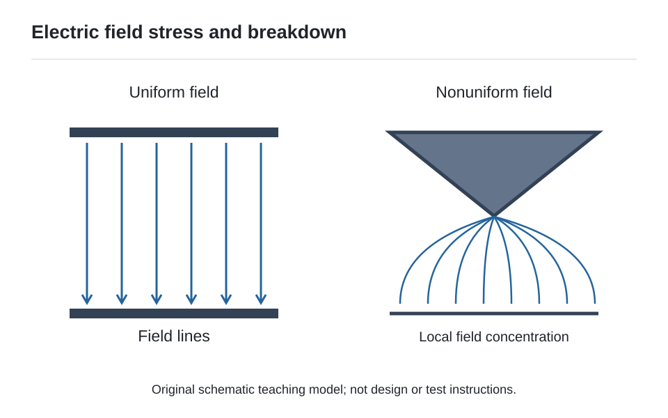

# M21-L1 – Electric field stress and breakdown {#L1}

**Course area:** M21 – Bachelor: High-voltage engineering and switchgear

**Level:** Bachelor · Foundations

**Prerequisites:** [M20-L5](M20-L5.md).

**Learning objective:** Distinguish local field strength and discharge mechanisms.

## Electric field {#S1}

For an ideal uniform parallel-plate field, $E=U/d$. More generally, an electrostatic field satisfies $\vec E=-\nabla\varphi$. Fringing, curvature and material interfaces change local stress. The mean field alone cannot characterise an insulation system. In an interface model without free surface charge, the normal electric displacement is continuous; a material with lower permittivity may therefore experience higher field stress.

## Discharge mechanisms {#S2}

In gases, accelerated charge carriers can ionise other particles. Avalanches and space charge modify the field and may develop into a conductive discharge path. Corona is a local gas discharge; partial discharge does not bridge the entire insulation. Flashover typically travels through the surrounding medium along a surface, whereas breakdown within a solid may leave a permanent conductive channel. The mechanisms depend on geometry, temperature, pressure and voltage waveform.

*Figure: Original schematic teaching model; not design or test instructions.*

## Calculation model: local field enhancement {#S3}

A dimensionless field factor $k=E_\mathrm{max}/E_\mathrm{mean}$ characterises a given simulation. For $E_\mathrm{mean}=0.20\,\mathrm{MV/m}$ and $k=2.5$, the result is $E_\mathrm{max}=0.50\,\mathrm{MV/m}$. Two models with equal mean field may have different maxima. The factor is not a universal material constant; the result does not establish a permissible operating voltage.

## Model limitations {#S4}

Dielectric strength is not an invariant tabulated quantity. Defects, statistical variation, surface condition and impulse duration affect the result. A simulation should examine mesh resolution where field gradients are high. An ideally sharp conductive edge may produce a mathematical singularity. Only virtual models are considered, not physical high-voltage experiments.

## Self-assessment {#S5}

### Exercises

1. What does k = 3 mean at constant mean field?
2. Why can a void in a solid be critical?
3. Is partial discharge equivalent to complete breakdown?

::: {.lc-solutions data-lc-section="S5"}
1. The local maximum is three times the mean.
2. Permittivity contrast and geometry can increase the local gas field.
3. No; it bridges only part of the insulation.
:::

## Sources {#S6}

- [OpenStax – Molecular Model of a Dielectric](https://openstax.org/books/university-physics-volume-2/pages/8-5-molecular-model-of-a-dielectric) · § 8.5; search extract only, dielectric strength and uniform-field model; full page review pending · Last accessed: 2026-11-25
- [IEC 60270:2025](https://webstore.iec.ch/en/publication/65087) · HTML 55–76; public scope of charge-based partial discharge measurement, not full standard (review limited to documented scope) · Last accessed: 2026-11-25 · Content verified: 2026-11-25
