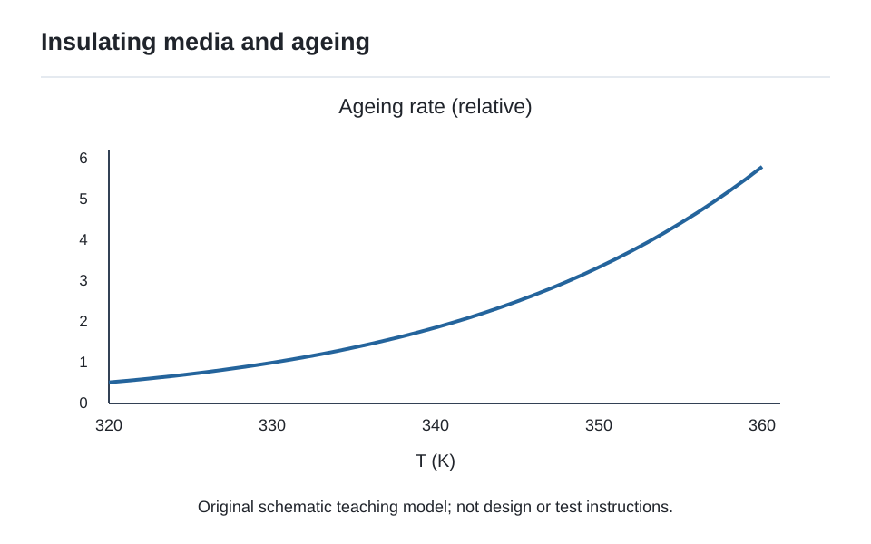

# M21-L2 – Insulating media and ageing {#L2}

**Course area:** M21 – Bachelor: High-voltage engineering and switchgear

**Level:** Bachelor · Foundations

**Prerequisites:** [M21-L1](M21-L1.md).

**Learning objective:** Compare insulation media by electrical, thermal and lifecycle properties.

## Media and functions {#S1}

Gases provide insulation and sometimes interruption media; liquids serve as both dielectrics and coolants. Solids carry mechanical loads and separate potentials. Composite systems combine functions: paper and oil in transformers, polymer and semiconducting layers in cables. A vacuum interrupter is not a material dielectric; the surrounding enclosure still requires insulation.

## Ageing mechanisms {#S2}

Thermal stress can degrade polymer chains, moisture changes conductivity and losses, mechanical stress creates cracks, and partial discharge can erode material locally. In oil-paper systems, liquid and solid insulation must be assessed separately: improving the liquid does not restore aged cellulose to its original condition.

*Figure: Original schematic teaching model; not design or test instructions.*

## Calculation model: temperature-dependent rate {#S3}

A simplified Arrhenius model describes a single reaction by $r=A\exp[-E_a/(k_B T)]$. For a hypothetical activation energy of $0.6\,\mathrm{eV}$ and $k_B=8.617\cdot10^{-5}\,\mathrm{eV/K}$, the rate ratio between 330 K and 350 K is $r_{350}/r_{330}\approx3.34$. This is a relative model rate, not a prediction of an actual installation’s remaining life.

## Selection and condition assessment {#S4}

Selection considers field stress, losses, thermal conductivity, fire behaviour, environmental impact, mechanical strength and maintainability. Diagnostic findings must be related to load history, temperature and material history. One favourable measurement cannot exclude other degradation mechanisms.

## Self-assessment {#S5}

### Exercises

1. What additional function can insulating liquid perform?
2. Why does oil treatment not rejuvenate paper?
3. What does the calculated rate ratio describe?

::: {.lc-solutions data-lc-section="S5"}
1. Heat transport.
2. Cellulose ageing is not reversed by oil treatment.
3. The relative speed of an assumed single reaction.
:::

## Sources {#S6}

- [Hitachi Energy – Component Upgrades](https://www.hitachienergy.com/products-and-solutions/transformers/transformer-service/upgrade-repair-and-extend/component-upgrade) · HTML 174–177; manufacturer example of thermal and moisture-related aging of oil-paper insulation (review limited to documented scope) · Last accessed: 2026-11-25 · Content verified: 2026-11-25
- [Hitachi Energy – Inspection and diagnostics](https://www.hitachienergy.com/products-and-solutions/transformers/transformer-service/assess-and-secure/inspection-and-diagnostics) · HTML 176–190; oil contamination and diagnostic indicators · Last accessed: 2026-11-25 · Content verified: 2026-11-25
