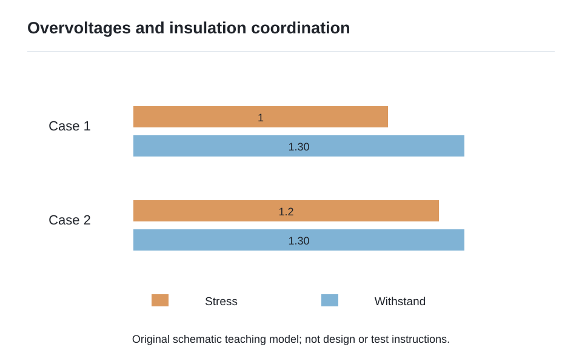

# M21-L3 – Overvoltages and insulation coordination {#L3}

**Course area:** M21 – Bachelor: High-voltage engineering and switchgear

**Level:** Bachelor · Foundations

**Prerequisites:** [M21-L2](M21-L2.md).

**Learning objective:** Explain overvoltage categories and the logical relationship between stress and withstand capability.

## Electrical stresses {#S1}

Besides continuous operating voltage, temporary overvoltages may arise from network faults and transient overvoltages from switching or lightning. Duration, waveform, polarity and repetition affect stress. RMS, peak and impulse voltage parameters must not be compared directly without definitions.

## Coordination principle {#S2}

Insulation coordination assigns appropriate withstand requirements to expected stresses, considering network topology, protective devices, environmental conditions and uncertainty. Surge arresters limit transient voltages through nonlinear behaviour; connections and dynamic response influence actual equipment voltage. IEC 60071-2 addresses insulation levels for three-phase systems, not personal safety.

*Figure: Original schematic teaching model; not design or test instructions.*

## Calculation model: normalised comparison {#S3}

For two dimensionless model cases, let withstand be $w=1.30$ and stress be $s_1=1.00$, $s_2=1.20$, all normalised to the same reference and waveform. The ratio $w/s$ decreases from 1.30 to 1.083. The calculated reserve decreases. These ratios are not IEC coordination factors and do not establish equipment selection.

## Statistics and limits {#S4}

In a statistical analysis, failure probability depends on overlap between stress and withstand distributions. A fixed ratio captures neither rare events nor variability. Actual coordination requires complete equipment and system data, applicable standard editions and competent assessment.

## Self-assessment {#S5}

### Exercises

1. Which three categories of voltage stress are distinguished?
2. Why is comparison of RMS and peak insufficient?
3. Why is a ratio above one not complete evidence?

::: {.lc-solutions data-lc-section="S5"}
1. Continuous operation, temporary and transient overvoltage.
2. They represent different quantities and potentially different waveforms.
3. Variability, time dependence, protection and normative requirements are missing.
:::

## Sources {#S6}

- [IEC 60071-2:2023](https://webstore.iec.ch/en/publication/64145) · HTML 60–68; public scope of insulation coordination; no full standard (review limited to documented scope) · Last accessed: 2026-11-25 · Content verified: 2026-11-25
- [IEC 60060-1:2025](https://webstore.iec.ch/en/publication/65088) · HTML 60–69; public scope of dielectric tests with AC, DC, impulse and combined voltages, not full standard (review limited to documented scope) · Last accessed: 2026-11-25 · Content verified: 2026-11-25
