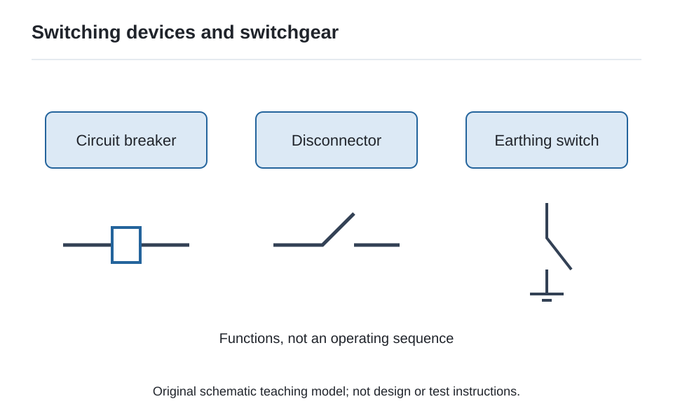

# M21-L4 – Switching devices and switchgear {#L4}

**Course area:** M21 – Bachelor: High-voltage engineering and switchgear

**Level:** Bachelor · Foundations

**Prerequisites:** [M21-L3](M21-L3.md).

**Learning objective:** Distinguish circuit breaker, disconnector and earthing switch functions.

## Functional distinctions {#S1}

A circuit breaker can switch operating currents and specified fault currents under defined conditions. A disconnector provides an isolating gap and has only limited specified switching duties. An earthing switch connects a designated part of the installation to earth; its actual switching and short-circuit withstand ratings are device-specific. A load-break switch is not automatically a circuit breaker.

## Arc and recovery voltage {#S2}

Opening a current-carrying contact can produce an arc. In AC systems, natural current zero is important for interruption. The voltage across the opening gap then rises again. Dielectric recovery must withstand the stress of transient recovery voltage. Vacuum and gas interruption principles differ in their physics.

*Figure: Original schematic teaching model; not design or test instructions.*

## Calculation model: stress duration {#S3}

In a purely mathematical model, a constant normalised current $i=2$ persists for normalised time $t=0.1$. Thus $\int i^2\,dt=0.4$ in normalised units. Doubling the duration gives 0.8. This illustrates a thermal stress indicator, not actual interruption capability; arc energy and recovery voltage require additional models.

## Switchgear architecture {#S4}

Air-insulated and gas-insulated installations differ particularly in insulation concept, space requirements and maintenance. Vacuum interruption and air insulation can be combined. Interlocks help prevent prohibited device states; they do not replace competent operation. The figure shows functions, not a switching sequence.

## Self-assessment {#S5}

### Exercises

1. Which device is intended for specified fault-current interruption?
2. What is recovery voltage?
3. Why is the thermal indicator insufficient?

::: {.lc-solutions data-lc-section="S5"}
1. A suitably rated circuit breaker.
2. The voltage appearing across the gap after interruption.
3. Electrical and dynamic interruption stresses are missing.
:::

## Sources {#S6}

- [IEC 62271-100:2021+AMD1:2024](https://webstore.iec.ch/en/publication/99635) · HTML 56–66; public scope of AC circuit breakers; no full standard (review limited to documented scope) · Last accessed: 2026-11-25 · Content verified: 2026-11-25
- [Hitachi Energy – Disconnectors](https://www.hitachienergy.com/products-and-solutions/disconnectors) · HTML 196–202; isolation and restricted switching duties · Last accessed: 2026-11-25 · Content verified: 2026-11-25
- [Siemens Energy – High-voltage circuit breakers](https://www.siemens-energy.com/global/en/home/products-services/product-offerings/circuit-breakers.html) · HTML 146–170; vacuum interruption and clean air; manufacturer examples, not universal performance claims (review limited to documented scope) · Last accessed: 2026-11-25 · Content verified: 2026-11-25
