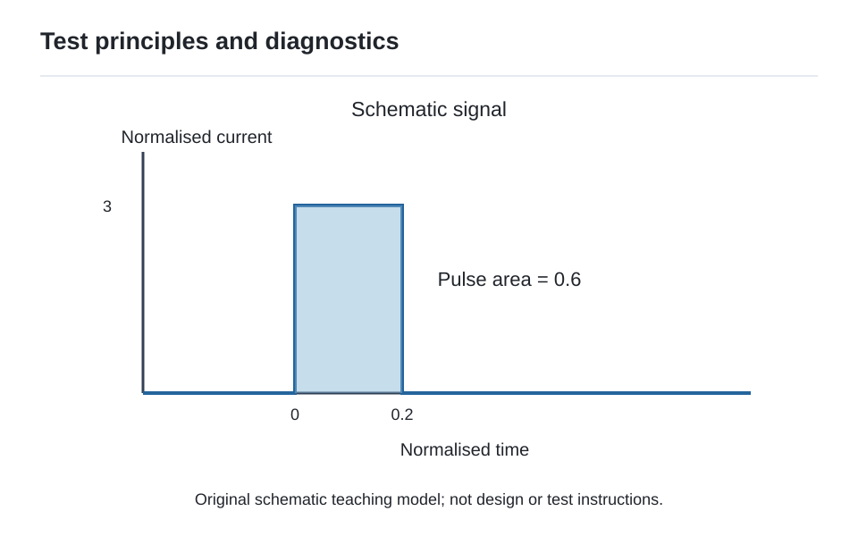

# M21-L5 – Test principles and diagnostics {#L5}

**Course area:** M21 – Bachelor: High-voltage engineering and switchgear

**Level:** Bachelor · Foundations

**Prerequisites:** [M21-L4](M21-L4.md).

**Learning objective:** Distinguish test objectives, partial discharge measurement and condition diagnostics.

## Test categories {#S1}

A dielectric test examines insulation suitability under defined conditions. AC, DC and impulse tests represent different stresses. Type tests characterise a product design, routine tests individual manufactured units; condition diagnostics track lifecycle changes. Actual requirements depend on the product and standard.

## Partial discharge diagnostics {#S2}

Partial discharge produces a short current pulse. Apparent charge is the equivalent charge quantity that would produce the same indication at the measurement terminals; it is not directly the physical charge in the defect. Interference, transfer path and calibration affect the reading. Phase-resolved patterns may indicate discharge types but do not establish the cause by themselves.

*Figure: Original schematic teaching model; not design or test instructions.*

## Calculation model: pulse area {#S3}

A hypothetical rectangular signal pulse with normalised amplitude 3 and width 0.2 has area 0.6. Doubling the width at constant amplitude doubles the area. For an ideal current model, $q=\int i(t)\,dt$. The model illustrates integration but does not replace calibration or standard-compliant partial discharge measurement.

## Findings and uncertainty {#S4}

Condition diagnostics combine measurements under comparable conditions, uncertainty, operational changes and independent indicators. In transformers, for example, electrical and chemical findings complement each other without a single indicator describing the entire insulation system. High-voltage testing requires specialised facilities and competent personnel. Here only data models are evaluated.

## Self-assessment {#S5}

### Exercises

1. Why is apparent charge not the defect charge?
2. What is the model pulse area at amplitude 3 and width 0.4?
3. Why are comparable test conditions important?

::: {.lc-solutions data-lc-section="S5"}
1. The transfer path from the defect to the terminals affects the signal.
2. 1.2 in normalised units.
3. This distinguishes actual changes from effects of varying conditions.
:::

## Sources {#S6}

- [IEC 60060-1:2025](https://webstore.iec.ch/en/publication/65088) · HTML 60–69; public scope of dielectric tests with AC, DC, impulse and combined voltages, not full standard (review limited to documented scope) · Last accessed: 2026-11-25 · Content verified: 2026-11-25
- [IEC 60270:2025](https://webstore.iec.ch/en/publication/65087) · HTML 55–76; public scope of charge-based partial discharge measurement, not full standard (review limited to documented scope) · Last accessed: 2026-11-25 · Content verified: 2026-11-25
- [Hitachi Energy – Inspection and diagnostics](https://www.hitachienergy.com/products-and-solutions/transformers/transformer-service/assess-and-secure/inspection-and-diagnostics) · HTML 176–190; oil contamination and diagnostic indicators · Last accessed: 2026-11-25 · Content verified: 2026-11-25
