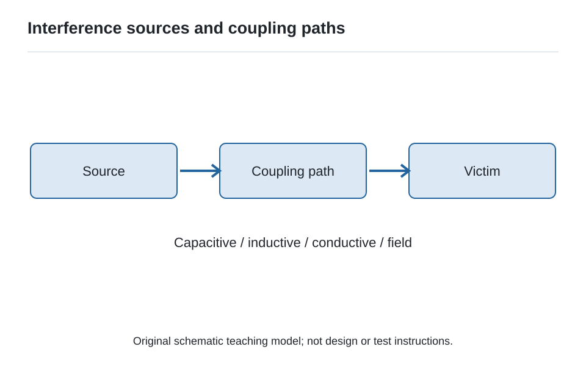

# M22-L1 – Interference sources and coupling paths {#L1}

**Course area:** M22 – Bachelor: Electromagnetic compatibility

**Level:** Bachelor · Foundations

**Prerequisites:** [M21-L5](M21-L5.md).

**Learning objective:** Distinguish source, coupling path and victim using physical models.

## EMC as a system property {#S1}

Electromagnetic compatibility requires equipment to function in its intended environment without causing unacceptable interference to other systems. Emissions and immunity are distinct properties. A variable-frequency drive may generate interference currents through switching transitions, while a nearby sensor responds to small error voltages. Spectrum, geometry, impedance and operating state matter. Switching frequency alone is not decisive: short rise times also generate high-frequency spectral components.

## Four coupling models {#S2}

Conductive coupling occurs through common impedances: $u_s=Z_s i_s$ in the sinusoidal model. Capacitive coupling with constant coupling capacitance obeys $i_C=C_k\,\mathrm{d}u/\mathrm{d}t$. Inductive coupling with constant mutual inductance $M$ produces a voltage of magnitude $|u_M|=|M\,\mathrm{d}i/\mathrm{d}t|$. Radiative coupling describes transfer through electromagnetic fields; lumped models are often insufficient for electrically large structures. Several mechanisms can act simultaneously.

*Figure: Original schematic teaching model; not design or test instructions.*

## Worked example {#S3}

A hypothetical 5 pF coupling capacitance connects two circuit nodes. A 20 V change in 100 ns gives $i_C=5\cdot10^{-12}\cdot20/(100\cdot10^{-9})=1\,\mathrm{mA}$ for a linear transition. A 20 nH mutual inductance with a 2 A current change in 100 ns produces 0.4 V of induced voltage. These quantities describe different model paths and cannot be added directly.

## Analysis and limitations {#S4}

In a virtual diagnosis, first identify the temporal relationship between interference and malfunction. Model potential current loops, voltage differences and field coupling separately. Varying one model parameter at a time tests a hypothesis. Interference may have multiple paths, so eliminating one does not guarantee compatibility.

## Self-assessment {#S5}

### Exercises

1. What is the capacitive current if transition duration is halved?
2. What coupling occurs in a shared return conductor?
3. Why are circuit and field models not always interchangeable?

::: {.lc-solutions data-lc-section="S5"}
1. 2 mA at unchanged voltage swing and capacitance.
2. Common-impedance coupling.
3. Propagation delay and spatial field distribution matter in electrically large structures.
:::

## Sources {#S6}

- [Analog Devices – Proper Layout and Component Selection Controls EMI](https://www.analog.com/en/resources/technical-articles/proper-layout-and-component-selection-controls-emi.html) · HTML 78–96, 139–161; coupling, filtering and layout · Last accessed: 2026-11-25 · Content verified: 2026-11-25
- [Analog Devices – AN-139: Power Supply Layout and EMI](https://www.analog.com/en/resources/app-notes/an-139.html) · HTML 127–162; return paths and parasitics · Last accessed: 2026-11-25 · Content verified: 2026-11-25
