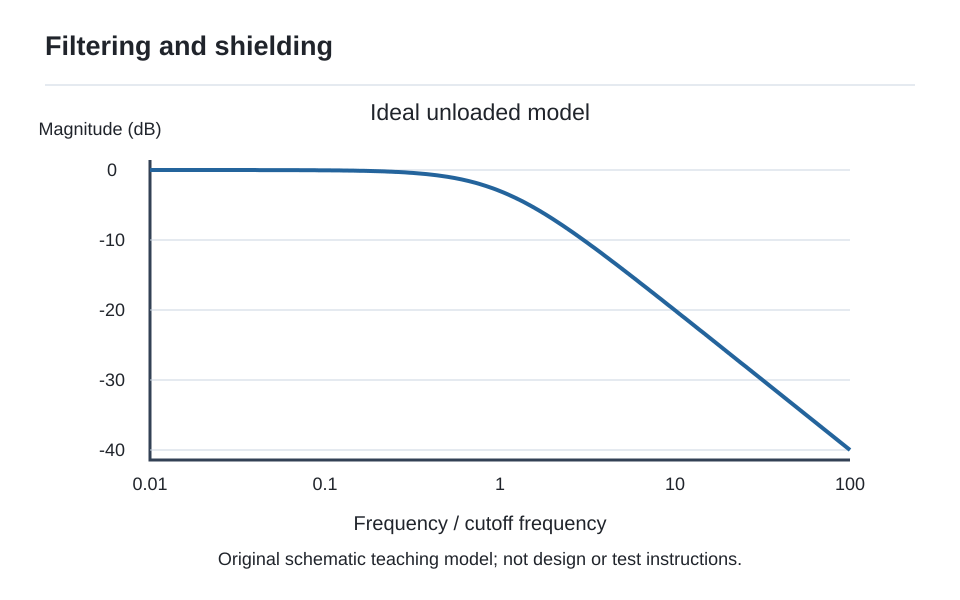

# M22-L2 – Filtering and shielding {#L2}

**Course area:** M22 – Bachelor: Electromagnetic compatibility

**Level:** Bachelor · Foundations

**Prerequisites:** [M22-L1](M22-L1.md).

**Learning objective:** Distinguish differential-mode and common-mode interference and quantify filter response.

## Modal decomposition {#S1}

For two conductors with current arrows oriented in the same direction, $i_{CM}=(i_1+i_2)/2$ and $i_{DM}=(i_1-i_2)/2$. Differential-mode currents flow in opposite directions; common-mode components need another return path, for example through parasitic capacitance to the enclosure. Ideally, a common-mode choke presents high impedance to common-mode currents while magnetic effects of normal differential-mode current largely cancel. Leakage inductance and saturation limit this ideal.

## Filters and shields {#S2}

An ideal unloaded RC low-pass filter has transfer function $H(j\omega)=1/(1+j\omega RC)$. Real filters require consideration of source and load impedances, component parasitics and resonances. Shields affect electric and magnetic fields differently. Conductive enclosures can provide shielding through surface currents and charge redistribution; apertures, seams and connections may limit effectiveness. Low-frequency magnetic fields are often difficult to shield using thin nonmagnetic conductors.

*Figure: Original schematic teaching model; not design or test instructions.*

## Worked example {#S3}

For $R=100\,\Omega$ and $C=100\,\mathrm{nF}$, $f_c=1/(2\pi RC)=15.9\,\mathrm{kHz}$. At $f=10f_c$, $|H|=1/\sqrt{101}\approx0.0995$ and $20\log_{10}|H|\approx-20.04\,\mathrm{dB}$. This attenuation applies only to the ideal high-impedance load model. Real EMC filter insertion loss cannot be inferred from cutoff frequency alone.

## Design trade-offs {#S4}

A filter can interact with a regulated converter; its output impedance and the load input impedance influence stability and resonance. Shielding and filtering must be considered together with return paths and enclosure boundaries. Example values are for learning only, not for specifying mains filters or safety-critical capacitors.

## Self-assessment {#S5}

### Exercises

1. Two conductors carry +3 A and −1 A: determine CM and DM.
2. What is the magnitude at cutoff?
3. Why can an enclosure seam be problematic?

::: {.lc-solutions data-lc-section="S5"}
1. CM = 1 A; DM = 2 A.
2. 1/√2 or about −3.01 dB.
3. It can interrupt shield currents and allow electromagnetic coupling.
:::

## Sources {#S6}

- [Analog Devices – Proper Layout and Component Selection Controls EMI](https://www.analog.com/en/resources/technical-articles/proper-layout-and-component-selection-controls-emi.html) · HTML 78–96, 139–161; coupling, filtering and layout · Last accessed: 2026-11-25 · Content verified: 2026-11-25
- [Analog Devices – AN-139: Power Supply Layout and EMI](https://www.analog.com/en/resources/app-notes/an-139.html) · HTML 127–162; return paths and parasitics · Last accessed: 2026-11-25 · Content verified: 2026-11-25
