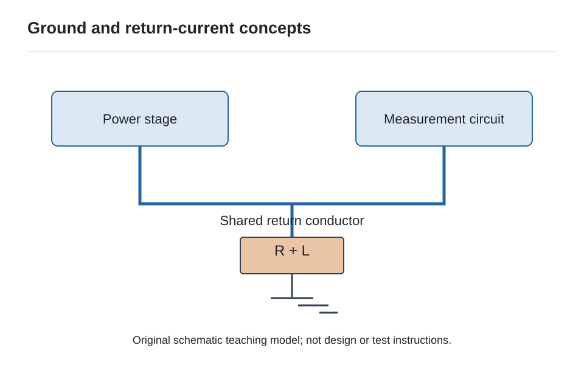

# M22-L3 – Ground and return-current concepts {#L3}

**Course area:** M22 – Bachelor: Electromagnetic compatibility

**Level:** Bachelor · Foundations

**Prerequisites:** [M22-L2](M22-L2.md).

**Learning objective:** Analyse return paths and common impedances at DC and AC.

## Circuit reference and protective earth {#S1}

A circuit ground is a chosen reference potential, not an ideal zero potential everywhere. Protective earth, enclosure and functional reference serve different purposes; their interconnection depends on the system design and relevant safety requirements. Return current always completes a circuit. For varying currents, total frequency-dependent impedance rather than DC resistance alone determines its distribution. A continuous reference plane can provide a close high-frequency return path in an appropriate geometry.

## Common impedance {#S2}

The voltage across a lumped return conductor with $R$ and $L$ is $u=Ri+L\,\mathrm{d}i/\mathrm{d}t$. If a power stage and measurement amplifier share a segment, its voltage drop appears as a signal-reference error. A gap in a reference plane can force the return current to detour, increasing loop area and coupling. Star connections can be useful at low frequencies but are not a universal high-frequency solution.

*Figure: Original schematic teaching model; not design or test instructions.*

## Worked example {#S3}

A model return conductor has 20 mΩ and 10 nH. During a linear ramp, current reaches 2 A after 100 ns. Just before the end of the ramp, $Ri=40\,\mathrm{mV}$ and $L\,\mathrm{d}i/\mathrm{d}t=200\,\mathrm{mV}$, totalling 240 mV for equal polarity. After the ramp, the idealised inductive contribution disappears. Even this small return conductor can significantly interfere with millivolt measurements.

## Virtual layout analysis {#S4}

A simulation can represent outgoing and return currents as closed loops. Compare shared segments, loop areas, layer transitions and local decoupling. Distinguish functional ground from protective functions: an interference problem never justifies removing a required protective-earth connection. This case study addresses hypothetical PCB models only.

## Self-assessment {#S5}

### Exercises

1. Which voltage remains at a constant 2 A?
2. What does a return-path detour change?
3. Why is star grounding not always optimal?

::: {.lc-solutions data-lc-section="S5"}
1. 40 mV in the model.
2. It can increase loop area and inductance.
3. At high frequencies, short low-inductance return paths and spatial geometry matter.
:::

## Sources {#S6}

- [Analog Devices – Staying Well Grounded](https://www.analog.com/en/resources/analog-dialogue/articles/staying-well-grounded.html) · HTML 37–48, 79–80, 119–122; grounding depends on system topology · Last accessed: 2026-11-25 · Content verified: 2026-11-25
- [Analog Devices – AN-139: Power Supply Layout and EMI](https://www.analog.com/en/resources/app-notes/an-139.html) · HTML 127–162; return paths and parasitics · Last accessed: 2026-11-25 · Content verified: 2026-11-25
