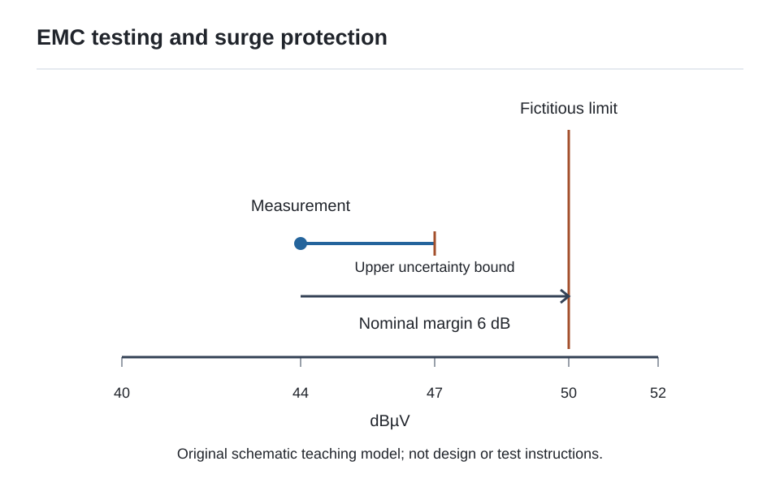

# M22-L4 – EMC testing and surge protection {#L4}

**Course area:** M22 – Bachelor: Electromagnetic compatibility

**Level:** Bachelor · Foundations

**Prerequisites:** [M22-L3](M22-L3.md).

**Learning objective:** Distinguish emission and immunity tests and assess measurement margins.

## Test objectives and setup {#S1}

Emission tests quantify conducted and radiated disturbance quantities under specified measurement conditions. Immunity tests evaluate function during specified disturbances. A test plan documents the equipment under test, operating states, cable configuration, measured quantities and performance criteria. Pre-compliance testing is a development diagnostic; it does not replace required conformity evidence.

## Transient stress {#S2}

Electrostatic discharge (ESD) and surge events have different time profiles and coupling paths. IEC 61000-4-2:2025 describes ESD immunity tests; IEC 61000-4-5:2014 with Amendment 1:2017 addresses surge tests. These basic standards do not prescribe universal test levels for every product. Protective components may divert transient currents or limit voltage; effectiveness depends on impedances, pulse energy, residual voltage and coordination. Protective components do not replace basic insulation.

*Figure: Original schematic teaching model; not design or test instructions.*

## Worked example: measurement margin {#S3}

A fictitious emission limit is 50 dBµV and a measurement is 44 dBµV. Nominal margin is 6 dB, corresponding to a voltage ratio of $10^{6/20}\approx2$. With an assumed expanded measurement uncertainty of 3 dB, the deliberately conservative learning model leaves 3 dB clearance when using the upper uncertainty bound. A real conformity decision requires the applicable decision rule; this example does not define a normative rule.

## Test report and limitations {#S4}

A traceable report links measurement traces to configuration, instrument settings, calibration status, uncertainty and assessment. Failures during immunity tests are classified using performance criteria, not emission limits. The standards named here were checked using their public scopes rather than full texts. Physical ESD and surge testing requires suitable facilities and qualified personnel; self-study uses datasets and simulations only.

## Self-assessment {#S5}

### Exercises

1. What is the nominal margin at 47 dBµV?
2. Why does passing an ESD test not establish low emissions?
3. What information makes a measurement report reproducible?

::: {.lc-solutions data-lc-section="S5"}
1. 3 dB against the same hypothetical limit.
2. ESD concerns immunity rather than emissions.
3. Among other things, operating state, configuration, settings, calibration and uncertainty.
:::

## Sources {#S6}

- [IEC 61000-4-2:2025](https://webstore.iec.ch/en/publication/68954) · HTML 54–77; public scope of ESD immunity test, not full standard (review limited to documented scope) · Last accessed: 2026-11-25 · Content verified: 2026-11-25
- [IEC 61000-4-5:2014+AMD1:2017](https://webstore.iec.ch/en/publication/61166) · HTML 54–70; public scope of surge immunity test, not full standard (review limited to documented scope) · Last accessed: 2026-11-25 · Content verified: 2026-11-25
