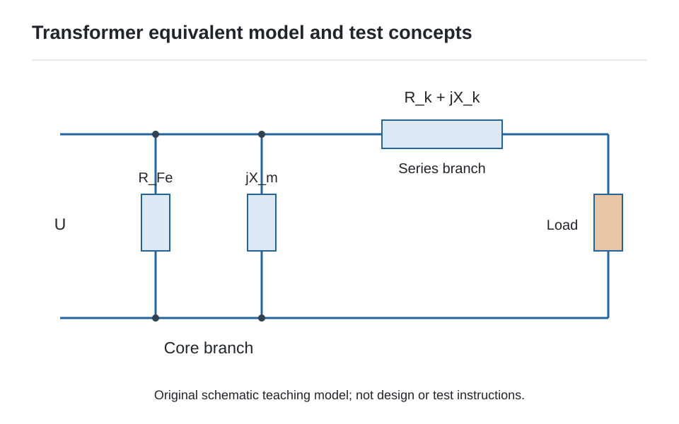

# M23-L1 – Transformer equivalent model and test concepts {#L1}

**Course area:** M23 – Bachelor: Electrical machines and transformers

**Level:** Bachelor · Foundations

**Prerequisites:** [M7-L3](M7-L3.md).

**Learning objective:** Identify approximate equivalent-circuit parameters from datasets and explain their limitations.

## From ideal to real transformer {#S1}

This extends M7-L3 to parameter identification. For a sinusoidal model with turns ratio $a=N_1/N_2$, ideally $U_1/U_2=a$ and, in magnitude, $I_1/I_2=1/a$. A secondary impedance appears on the primary as $Z_2\prime=a^2 Z_2$. Real devices exhibit winding losses, leakage flux and finite core permeability. The approximate model referred to one side contains $R_k+jX_k$ in series and $R_{Fe}$ in parallel with $jX_m$ at the input. The shunt branches represent core loss and magnetisation.

## Parameters from virtual measurement data {#S2}

All voltages and currents are RMS; the following relations are single-phase. For the open-circuit dataset, approximately $I_w=P_0/U_0$, $I_m=\sqrt{I_0^2-I_w^2}$, $R_{Fe}=U_0/I_w$ and $X_m=U_0/I_m$. Winding loss is neglected. From a short-circuit dataset, $Z_k=U_k/I_k$, $R_k=P_k/I_k^2$ and $X_k=\sqrt{Z_k^2-R_k^2}$ when the magnetising branch is negligible. Data referred to different sides must first be converted.

*Figure: Original schematic teaching model; not design or test instructions.*

## Worked example {#S3}

A fictitious open-circuit dataset contains 100 V, 0.5 A and 30 W. This gives $I_w=0.3$ A, $I_m=0.4$ A, $R_{Fe}=333.3\,\Omega$ and $X_m=250\,\Omega$. A second dataset referred to the same side contains 10 V, 5 A and 30 W. This gives $Z_k=2\,\Omega$, $R_k=1.2\,\Omega$ and $X_k=1.6\,\Omega$. The datasets identify different branches of the model.

## Validation and limitations {#S4}

The equivalent model estimates voltage change and losses under varying load. Saturation, inrush, frequency dependence and temperature-dependent winding resistance require further models. Implausible data such as active power exceeding apparent power must be resolved before estimating parameters. Self-study uses simulated datasets only; actual transformer tests belong in a supervised specialist laboratory.

## Self-assessment {#S5}

### Exercises

1. What is the primary-referred load for a=2 and a secondary load of 5 Ω?
2. Which branches does the open-circuit dataset describe?
3. Why is P greater than U I implausible in the sinusoidal single-phase model?

::: {.lc-solutions data-lc-section="S5"}
1. 20 Ω.
2. Core-loss and magnetising branches.
3. The magnitude of active power cannot exceed apparent power.
:::

## Sources {#S6}

- [NJIT ECE 342 – Power Transformer Open and Short Circuit Tests](https://ecelabs.njit.edu/ece342/lab3.php) · HTML lines 42–52, 69–81, 98–100; equivalent circuit and parameter identification · Last accessed: 2026-11-25 · Content verified: 2026-11-25
