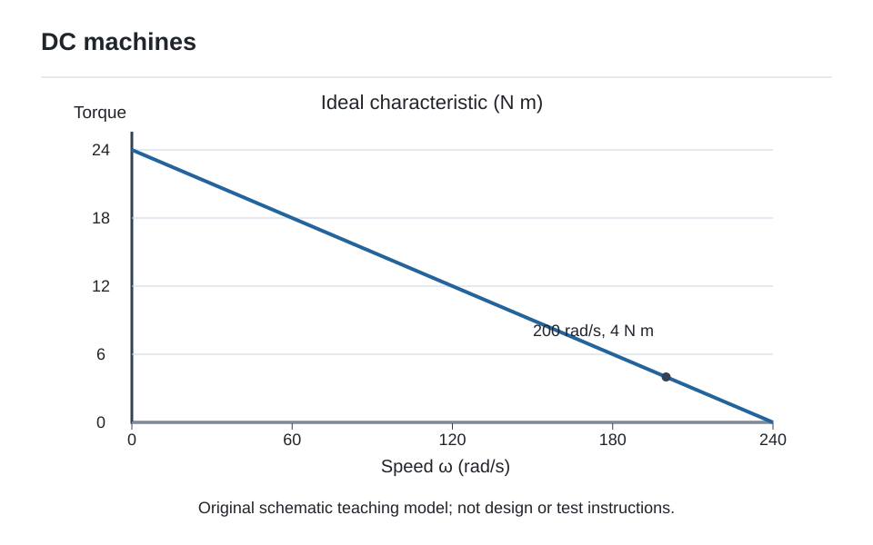

# M23-L2 – DC machines {#L2}

**Course area:** M23 – Bachelor: Electrical machines and transformers

**Level:** Bachelor · Foundations

**Prerequisites:** [M23-L1](M23-L1.md).

**Learning objective:** Calculate torque, back EMF and power flow of a separately excited DC machine.

## Construction and commutation {#S1}

In a conventional DC machine the stator produces the excitation field and the rotor carries the armature winding. Brushes and commutator transfer current and provide the appropriate current direction in rotor conductors. Mechanical commutation causes wear. Brushless electronically commutated motors, by contrast, are typically synchronous machines. Separate, shunt and series excitation differ in field connections.

## Steady-state model {#S2}

With constant excitation, negligible brush drop and motor sign convention, $E=k\omega$, $U=E+R_a I_a$ and $T_e=k I_a$. In SI, $k$ has the same numerical value in V s/rad and N m/A. Converted power is therefore $P_{em}=EI_a=T_e\omega$. Armature copper loss is $I_a^2 R_a$. Electromagnetic torque differs from available shaft torque when friction or other losses occur.

*Figure: Original schematic teaching model; not design or test instructions.*

## Worked example {#S3}

For $U=48$ V, $R_a=0.4\,\Omega$, $k=0.2$ V s/rad and $\omega=200$ rad/s, $E=40$ V, $I_a=20$ A and $T_e=4$ N m. Armature input is 960 W, armature loss 160 W and electromagnetic converted power 800 W. Field input and mechanical losses are excluded from this partial balance.

## Characteristic and operating limits {#S4}

The ideal torque-speed line is $T_e=k(U-k\omega)/R_a$. At positive $\omega$ and $E>U$, armature current becomes negative and electrical power flow may reverse, subject to suitable source or converter topology. A series-wound motor does not have constant excitation, so this straight line does not apply. Current, commutation, heating and mechanical speed limits constrain actual operating points.

## Self-assessment {#S5}

### Exercises

1. What is E at 150 rad/s in the example?
2. What is the resulting armature current?
3. What loss remains in the ideal armature resistance at I=0?

::: {.lc-solutions data-lc-section="S5"}
1. 30 V.
2. 45 A; a model value without current limiting.
3. 0 W.
:::

## Sources {#S6}

- [J. L. Kirtley, MIT 6.685 – DC (Commutator) and Permanent Magnet Machines](https://ocw.mit.edu/courses/6-685-electric-machines-fall-2013/2aec052d0c82b73a7b6c72d78f3a796d_MIT6_685F13_chapter6.pdf) · PDF text lines 130–174, 217–228; first page screenshot available; DC model and excitation · Last accessed: 2026-11-25 · Content verified: 2026-11-25
