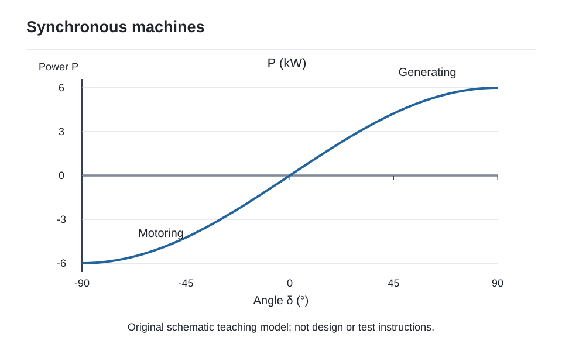

# M23-L3 – Synchronous machines {#L3}

**Course area:** M23 – Bachelor: Electrical machines and transformers

**Level:** Bachelor · Foundations

**Prerequisites:** [M23-L2](M23-L2.md).

**Learning objective:** Apply synchronous speed and power-angle model for a balanced round-rotor machine.

## Rotating field and excitation {#S1}

Three spatially displaced, symmetrically supplied stator windings produce a rotating field. A synchronous machine rotor follows that field in steady operation. For $p$ pole pairs and frequency $f$, $n_s=60f/p$ in rpm and $\omega_s=2\pi f/p$ in rad/s. Rotor excitation may be electrical or permanent-magnet based. Reluctance machines exploit direction-dependent magnetic properties.

## Simplified power-angle model {#S2}

For a balanced round-rotor generator neglecting stator resistance, per phase $E=V+jX_s I$. Here $E,V$ are RMS phasors, $I$ is positive towards the grid and $X_s$ is synchronous reactance. With $\delta=\arg(E)-\arg(V)$, three-phase active power is $P=3|E||V|\sin\delta/X_s$. A negative $\delta$ denotes motoring in this convention. A salient-pole or saturated machine generally requires a richer model.

*Figure: Original schematic teaching model; not design or test instructions.*

## Worked example {#S3}

At 50 Hz with two pole pairs, speed is 1500 rpm. With $|E|=|V|=100$ V per phase, $X_s=5\,\Omega$ and $\delta=30^\circ$, $P=3000$ W. Mechanical angular speed is about 157.08 rad/s; neglecting losses, this electrical output corresponds to a driving torque of about 19.1 N m. At $\delta=0$, active power vanishes in this idealised model.

## Stability and applications {#S4}

In the simple model active power rises with positive angle below 90°. The maximum alone is not an allowable operating limit: current, thermal design, excitation and dynamic stability matter. Synchronous machines are found in generators and controlled drives. Disturbance response requires a dynamic model with mechanical inertia and electrical states.

## Self-assessment {#S5}

### Exercises

1. What speed results from 50 Hz and three pole pairs?
2. What is P at 30° with doubled X_s?
3. Why is power angle not the mechanical rotor angle?

::: {.lc-solutions data-lc-section="S5"}
1. 1000 rpm.
2. 1500 W with other data unchanged.
3. Power angle concerns electrical phasors; electrical angular change is p times mechanical angular change.
:::

## Sources {#S6}

- [J. L. Kirtley, MIT 6.685 – Elementary Synchronous Machine Models](https://ocw.mit.edu/courses/6-685-electric-machines-fall-2013/a10eb941769a0f5fa6a7460a8a7bb201_MIT6_685F13_chapter4.pdf) · PDF text lines 299–378; balanced operation; screenshot failed · Last accessed: 2026-11-25 · Content verified: 2026-11-25
