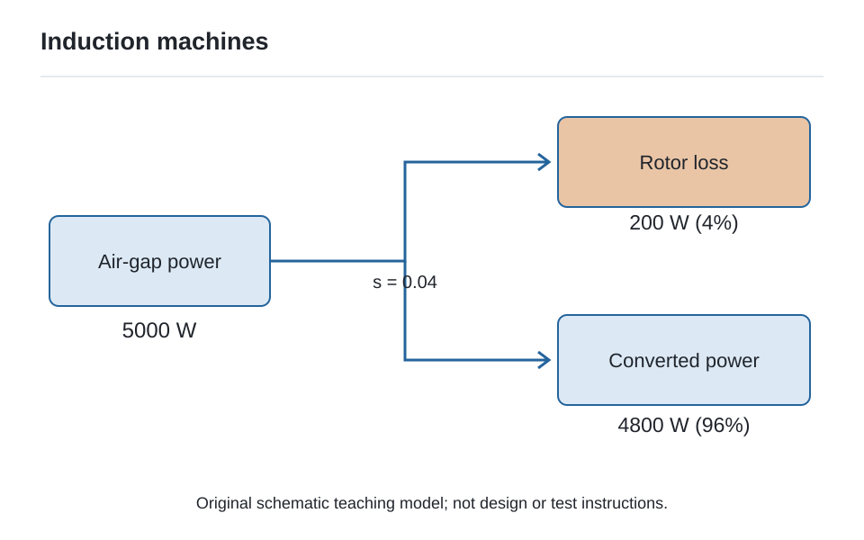

# M23-L4 – Induction machines {#L4}

**Course area:** M23 – Bachelor: Electrical machines and transformers

**Level:** Bachelor · Foundations

**Prerequisites:** [M23-L3](M23-L3.md).

**Learning objective:** Determine slip, rotor frequency and power balance of an induction machine.

## Induction and slip {#S1}

In a squirrel-cage rotor, currents arise from relative motion between stator field and rotor. With synchronous speed $n_s$ and rotor speed $n$, $s=(n_s-n)/n_s$. Rotor current frequency is $f_r=|s|f$. Motoring in the field direction corresponds to $0<s<1$; at $s=1$ the rotor is stationary and at $s=0$ the induced rotor voltage vanishes in the ideal cage model.

## Equivalent circuit and power {#S2}

The stator-referred rotor branch in the balanced steady-state model is $R_2\prime/s+jX_2\prime$ for $s\ne0$. In motoring operation, air-gap power is $P_\delta=3I_2\prime^2 R_2\prime/s$. Rotor copper loss is $P_{Cu2}=sP_\delta$, and converted mechanical power is $P_{em}=(1-s)P_\delta$. Shaft power remains after mechanical losses. Torque is $T_e=P_\delta/\omega_s$.

*Figure: Original schematic teaching model; not design or test instructions.*

## Worked example {#S3}

A four-pole 50 Hz motor rotates at 1440 rpm. Then $n_s=1500$ rpm, $s=0.04$ and $f_r=2$ Hz. With 5 kW air-gap power, rotor copper loss is 200 W and converted mechanical power 4.8 kW. Electromagnetic torque is about 31.8 N m. Stator losses precede and mechanical losses follow the air-gap model in the power balance.

## Characteristic and control {#S4}

As slip increases, torque initially rises, reaches breakdown torque and falls in the simplified model as slip continues increasing. Variable-frequency drives can change rotating-field speed; a constant voltage-to-frequency ratio approximately maintains flux over a suitable frequency range. At low frequency, stator-resistance voltage drop matters. Starting, cooling, current and torque are separate design limits.

## Self-assessment {#S5}

### Exercises

1. What is slip at 1470 rpm with synchronous speed 1500 rpm?
2. What is rotor loss at 5 kW air-gap power and 2% slip?
3. What does negative slip mean for positive rotation?

::: {.lc-solutions data-lc-section="S5"}
1. 0.02 or 2%.
2. 100 W.
3. The rotor runs above synchronous speed; generating operation is possible.
:::

## Sources {#S6}

- [J. L. Kirtley, MIT 6.061 – Analytic Design Evaluation of Induction Machines](https://www.ocw.mit.edu/courses/6-061-introduction-to-electric-power-systems-spring-2011/01f878366fe651f1b95e9ed7fc24c644_MIT6_061S11_ch10.pdf) · PDF text lines 517–539, 2357–2419; slip and air-gap power; screenshot failed · Last accessed: 2026-11-25 · Content verified: 2026-11-25
