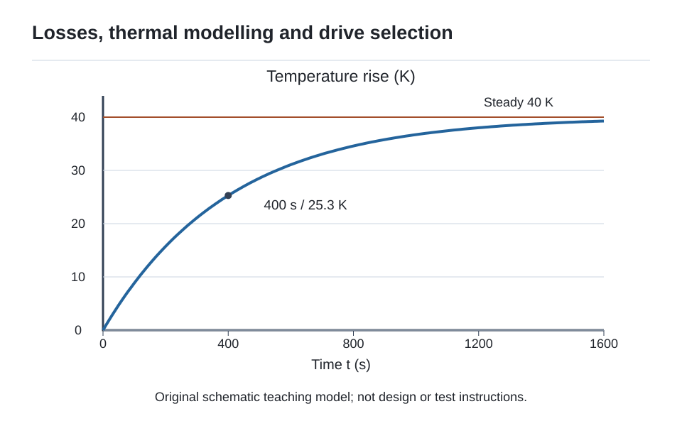

# M23-L5 – Losses, thermal modelling and drive selection {#L5}

**Course area:** M23 – Bachelor: Electrical machines and transformers

**Level:** Bachelor · Foundations

**Prerequisites:** [M23-L4](M23-L4.md).

**Learning objective:** Model efficiency and thermal loading and compare drives using a duty profile.

## Energy flow and loss types {#S1}

In steady motoring, $P_{in}=P_{shaft}+P_v$ and $\eta=P_{shaft}/P_{in}$. Winding, core, mechanical and additional load-dependent losses contribute to $P_v$. For a three-phase motor with equal phase resistances, $P_{Cu}=3I^2R$ for sinusoidal phase currents. The drive-system balance also includes the converter and, where applicable, gearbox. Efficiencies at the common operating point are multiplied, not added.

## Thermal equivalent model {#S2}

For a lumped model with thermal resistance $R_\theta$, thermal capacitance $C_\theta$ and temperature rise $\Delta T$, $C_\theta\,\mathrm d\Delta T/\mathrm dt=P_v-\Delta T/R_\theta$. With constant loss and initial ambient temperature, $\Delta T(t)=P_vR_\theta(1-e^{-t/\tau})$, $\tau=R_\theta C_\theta$. Local hot spots, variable cooling and temperature-dependent losses are excluded.

*Figure: Original schematic teaching model; not design or test instructions.*

## Worked example {#S3}

A model motor delivers 4.5 kW from 5 kW input, so $\eta=90\%$ and $P_v=500$ W. With $R_\theta=0.08$ K/W and $C_\theta=5000$ J/K, steady temperature rise is 40 K and $\tau=400$ s. After 400 s it is about 25.3 K. At 25°C ambient, the steady model temperature is 65°C, not necessarily the winding hot-spot temperature.

## Duty profile and selection {#S4}

For virtual selection, record torque, speed, acceleration, duty duration and cooling conditions as a time profile. Mechanical power demand follows from $P=T\omega$. Compare electrical energy input over the whole cycle while checking peak torque, thermal limits and potential regeneration. Rated efficiency or rated power alone is insufficient. Real selection and installation require manufacturer data, safety assessment and applicable requirements; the historical DOE guide is used here only for technical background.

## Self-assessment {#S5}

### Exercises

1. What is loss at 6 kW input and 5.4 kW shaft output?
2. What is steady temperature rise at 600 W and 0.08 K/W?
3. What is overall efficiency with 90% motor and 95% converter efficiency?

::: {.lc-solutions data-lc-section="S5"}
1. 600 W.
2. 48 K.
3. 85.5% at the common operating point.
:::

## Sources {#S6}

- [US DOE – Premium Efficiency Motor Selection and Application Guide](https://www.energy.gov/sites/default/files/2014/04/f15/amo_motors_handbook_web.pdf) · PDF text lines 1145–1156; loss categories; screenshot failed; historical guide, not current regulation · Last accessed: 2026-11-25 · Content verified: 2026-11-25
- [US DOE – Motor Systems](https://www.energy.gov/cmei/ito/motor-systems) · HTML lines 74–91; system efficiency resources and cases · Last accessed: 2026-11-25 · Content verified: 2026-11-25
