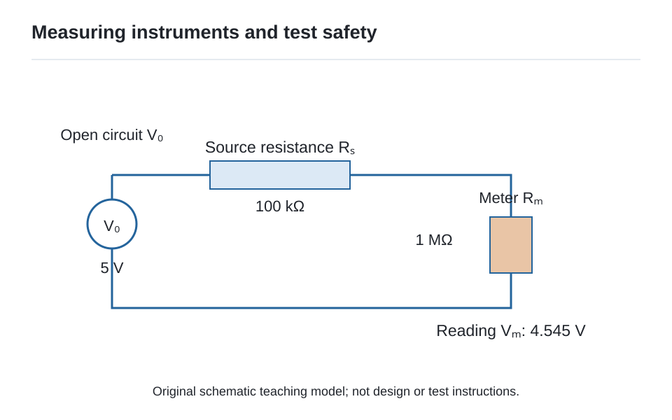

# M24-L1 – Measuring instruments and test safety {#L1}

**Course area:** M24 – Bachelor: Electrical engineering test and laboratory practice

**Level:** Bachelor · Foundations

**Prerequisites:** [M20-L5](M20-L5.md).

**Learning objective:** Classify instruments and quantify loading and uncertainty in a computational model.

## Measurement task and safety boundary {#S1}

A measurement connects a measurand, method, instrument, environmental conditions and result. A multimeter can measure voltage, current or resistance; an oscilloscope captures time-varying signals; a power analyser measures electrical power. Input impedance, bandwidth, resolution, permitted application and calibration status are distinct selection criteria. Physical electrical testing requires competent personnel, risk assessment and suitable equipment. All tasks below are virtual models only; do not perform measurements on mains, high voltage or stored energy.

## Instrument loading {#S2}

A real voltmeter affects the circuit. For a Thévenin source with open-circuit voltage $V_0$, internal resistance $R_s$ and meter input resistance $R_m$, $V_m=V_0R_m/(R_s+R_m)$. The relative loading error with respect to $V_0$ is $-R_s/(R_s+R_m)$. For alternating quantities, use frequency-dependent impedance rather than pure resistance. High display resolution eliminates neither loading nor calibration deviations.

*Figure: Original schematic teaching model; not design or test instructions.*

## Worked example {#S3}

In the virtual model, $V_0=5$ V, $R_s=100$ kΩ and $R_m=1$ MΩ. The idealised reading is 4.545 V; loading error is −9.09%. At 10 MΩ the values are 4.950 V and −0.990%. A known effect may be corrected in the model; uncertainty in that correction remains part of the result.

## Uncertainty and traceability {#S4}

For independent repeated measurements, uncertainty of the mean can be estimated as $s/\sqrt{n}$ (type A). Type B uses information such as calibration or resolution. For an assumed rectangular distribution with half-width $a$, $u=a/\sqrt{3}$. For uncorrelated contributions of equal dimension and unit sensitivity, $u_c=\sqrt{u_A^2+u_B^2}$. For 0.01 V and 0.02 V, $u_c=0.02236$ V and at $k=2$ expanded uncertainty is $U=0.04472$ V. The factor alone guarantees no particular coverage probability. Traceability requires a documented calibration chain including uncertainties; it does not mean error-free results.

## Self-assessment {#S5}

### Exercises

1. What is the loading error for R_m=R_s?
2. What is u for a rectangular half-width of 0.03 V?
3. Why does greater resolution not necessarily improve trueness?

::: {.lc-solutions data-lc-section="S5"}
1. −50%.
2. 0.01732 V.
3. Systematic effects and traceability remain independent of display resolution.
:::

## Sources {#S6}

- [HSE – Work on electrical equipment, machinery or installations](https://www.hse.gov.uk/Electricity/withequip.htm) · HTML lines 65–87: planning, secure energy isolation, competence; UK guidance, not German legal authority · Last accessed: 2026-11-25 · Content verified: 2026-11-25
- [HSE – Electrical inspection and testing](https://www.hse.gov.uk/electricity/information/testing.htm) · HTML lines 47–60: guidance by testing context; no full standard claimed (review limited to documented scope) · Last accessed: 2026-11-25 · Content verified: 2026-11-25
- [NIST TN 1297 – Classification of Components of Uncertainty](https://www.nist.gov/pml/nist-technical-note-1297/nist-tn-1297-2-classification-components-uncertainty) · HTML lines 147–157: type A/B, standard uncertainty and covariance · Last accessed: 2026-11-25 · Content verified: 2026-11-25
- [NIST TN 1297 – Law of Propagation of Uncertainty](https://www.nist.gov/pml/nist-technical-note-1297/nist-tn-1297-appendix-law-propagation-uncertainty) · HTML lines 150–178: first-order propagation, mean and rectangular distribution · Last accessed: 2026-11-25 · Content verified: 2026-11-25
- [NIST TN 1297 – Expanded Uncertainty](https://www.nist.gov/pml/nist-technical-note-1297/nist-tn-1297-6-expanded-uncertainty) · HTML lines 139–140: coverage factor and expanded uncertainty · Last accessed: 2026-11-25 · Content verified: 2026-11-25
