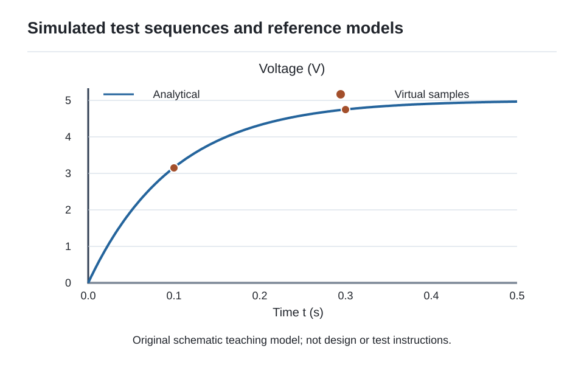

# M24-L2 – Simulated test sequences and reference models {#L2}

**Course area:** M24 – Bachelor: Electrical engineering test and laboratory practice

**Level:** Bachelor · Foundations

**Prerequisites:** [M24-L1](M24-L1.md).

**Learning objective:** Assess a virtual test model against an independent analytic reference and document deviations.

## From model to test {#S1}

Verification asks whether the mathematical or numerical model is solved as specified. Validation asks whether the model represents reality adequately for its intended purpose. An analytical comparison supports verification but cannot replace validation against appropriate measurement data. A virtual experiment is reproducible when model version, parameters, initial state, calculation method and evaluation are recorded.

## Reference: RC step response {#S2}

An ideal RC low-pass with an initially uncharged capacitor and a voltage step $V_s$ has response $v_C(t)=V_s(1-e^{-t/(RC)})$ for $t\ge 0$. The time constant is $\tau=RC$. For 1 kΩ, 100 µF and 5 V, $\tau=0.1$ s. After one time constant the voltage is about 3.1606 V; after three it is 4.7511 V. In a transient simulation these values are compared with numerical results at identical times.

*Figure: Original schematic teaching model; not design or test instructions.*

## Worked example: deviation {#S3}

A fictional numerical data set gives 3.150 V at 0.1 s and 4.748 V at 0.3 s. Residual $r=v_{num}-v_{ref}$ is −10.6 mV and −3.1 mV respectively. With a tolerance of 20 mV predefined for this teaching model, both samples fall within the limit. This proves neither the full curve nor agreement with a physical component. These values are deliberately constructed exercises, not results of an executed SPICE test.

## Numerical quality {#S4}

A DC operating point describes a steady state; transient analysis describes evolution in time. A time-step study repeats the computation using finer steps. Convergence, initial conditions and model parameters must be distinguished from component tolerances. Further test cases include initial value, asymptotic final value, parameter changes and energy stored in the ideal capacitor. Changes to criteria after seeing results must be separately justified.

## Self-assessment {#S5}

### Exercises

1. What fraction of the final value is reached after one time constant?
2. What is τ if capacitance doubles?
3. What energy is stored at the final state for 100 µF and 5 V?

::: {.lc-solutions data-lc-section="S5"}
1. 63.21% of the final value.
2. 0.2 s.
3. 1.25 mJ using E=CV²/2.
:::

## Sources {#S6}

- [ngspice – Control language tutorial](https://ngspice.sourceforge.io/ngspice-control-language-tutorial.html) · HTML lines 55–57, 185–215: simulation commands, operating points and output vectors; tutorial, not evidence of local execution · Last accessed: 2026-11-25 · Content verified: 2026-11-25
