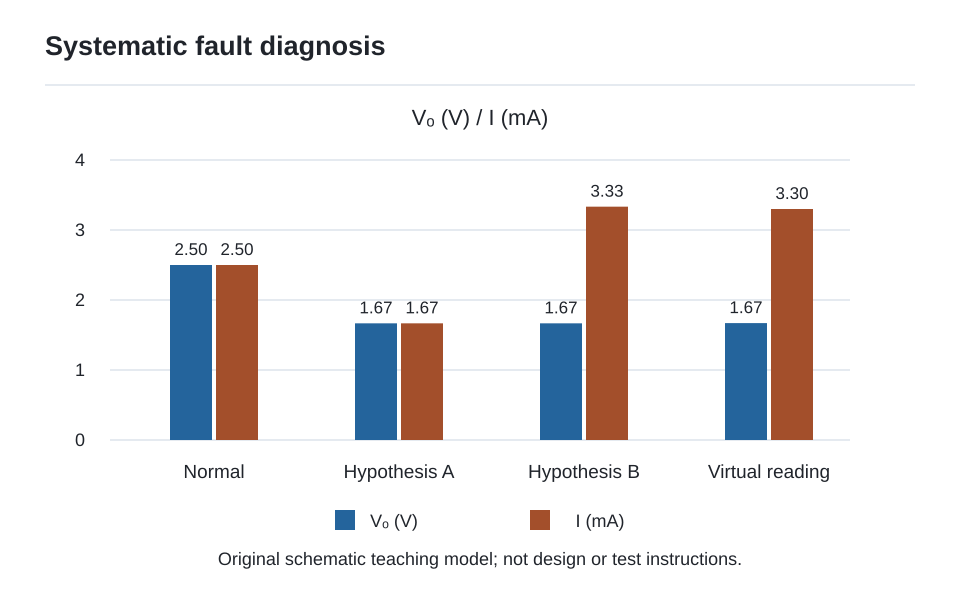

# M24-L3 – Systematic fault diagnosis {#L3}

**Course area:** M24 – Bachelor: Electrical engineering test and laboratory practice

**Level:** Bachelor · Foundations

**Prerequisites:** [M24-L2](M24-L2.md).

**Learning objective:** Derive competing fault hypotheses from virtual observations and select discriminating model checks.

## Symptom, cause and hypothesis {#S1}

A symptom is an observed deviation; a cause is the underlying mechanism. Several causes can produce the same symptom. Systematic diagnosis therefore separates observations, possible faults, predicted effects and discriminating test criteria. All examples are simulations with no physical installation. Intervention in electrical equipment is outside this self-study course.

## Fault signatures in a voltage divider {#S2}

For an ideal 5 V source with $R_1=R_2=1$ kΩ, $V_o=5R_2/(R_1+R_2)=2.5$ V and $I=2.5$ mA. Hypothesis A: $R_1$ increases to 2 kΩ, yielding $V_o=1.667$ V and $I=1.667$ mA. Hypothesis B: $R_2$ decreases to 0.5 kΩ, yielding the same $V_o=1.667$ V but $I=3.333$ mA. Output voltage alone cannot distinguish the two faults. Model current supplies an additional independent observable.

*Figure: Original schematic teaching model; not design or test instructions.*

## Worked example: residuals {#S3}

A fictional data set contains $V_o=1.67$ V and $I=3.30$ mA. Current residuals are approximately +1.63 mA relative to A and −0.033 mA relative to B. With a hypothetical acceptance limit of 0.1 mA, B fits better; this does not establish a physical cause. Other hypotheses, including source changes or combined faults, remain possible. Voltage and current residuals in different units must not be added without suitable scaling.

## Diagnostic quality {#S4}

A fault matrix maps hypotheses to predicted observations. If signatures are identical or differences are smaller than model and measurement uncertainty, the fault cannot be uniquely identified with the available data. In a virtual laboratory, parameters may be varied individually to investigate sensitivity and ambiguity. A diagnostic report also records rejected hypotheses, missing data and the next safe, technically justified check. For physical installations this decision belongs exclusively to responsible competent personnel.

## Self-assessment {#S5}

### Exercises

1. What is output voltage with R₁=R₂=2 kΩ?
2. What current results in that case?
3. Why is a single voltage residual insufficient?

::: {.lc-solutions data-lc-section="S5"}
1. 2.5 V.
2. 1.25 mA.
3. Different parameter combinations can produce the same output value.
:::

## Sources {#S6}

- [ngspice – Control language tutorial](https://ngspice.sourceforge.io/ngspice-control-language-tutorial.html) · HTML lines 55–57, 185–215: simulation commands, operating points and output vectors; tutorial, not evidence of local execution · Last accessed: 2026-11-25 · Content verified: 2026-11-25
- [NIST TN 1297 – Law of Propagation of Uncertainty](https://www.nist.gov/pml/nist-technical-note-1297/nist-tn-1297-appendix-law-propagation-uncertainty) · HTML lines 150–178: first-order propagation, mean and rectangular distribution · Last accessed: 2026-11-25 · Content verified: 2026-11-25
- [HSE – Work on electrical equipment, machinery or installations](https://www.hse.gov.uk/Electricity/withequip.htm) · HTML lines 65–87: planning, secure energy isolation, competence; UK guidance, not German legal authority · Last accessed: 2026-11-25 · Content verified: 2026-11-25
