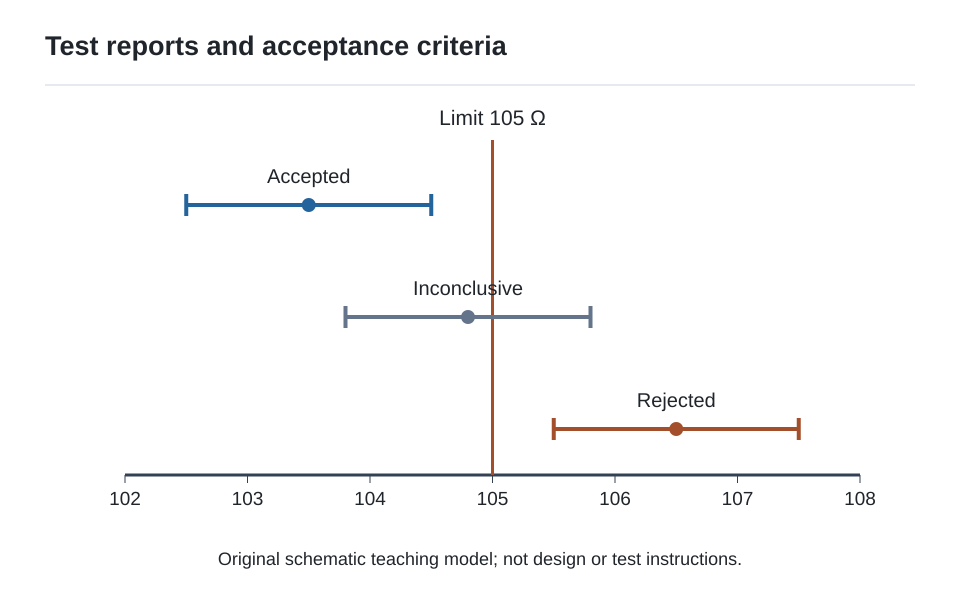

# M24-L4 – Test reports and acceptance criteria {#L4}

**Course area:** M24 – Bachelor: Electrical engineering test and laboratory practice

**Level:** Bachelor · Foundations

**Prerequisites:** [M24-L3](M24-L3.md).

**Learning objective:** Assess a virtual test result with uncertainty, a predetermined decision rule and a traceable report.

## Test report and evidence chain {#S1}

A traceable report identifies the test item and version, objective, measurand, method, reference, conditions, raw data, evaluation, uncertainty, decision rule, result and limitations. For simulated data, origin must be explicitly marked as synthetic or calculated. A report documents the characteristic examined; it does not constitute comprehensive safety approval.

## Decision rule and guard band {#S2}

For a virtual component with upper tolerance limit $T$, the following illustrative three-way rule is selected in advance: accept if $y+U\le T$; reject if $y-U>T$; otherwise inconclusive. Here $y$ is the result and $U$ expanded uncertainty. The rule uses a guard band of $U$ from the upper limit. Other rules may account differently for risks of false acceptance and rejection. This teaching rule is not a universal normative requirement.

*Figure: Original schematic teaching model; not design or test instructions.*

## Worked example {#S3}

For a fictional resistance model, let $T=105$ Ω and $U=1$ Ω at documented $k=2$. For $y=103.5$ Ω, the upper interval bound is 104.5 Ω: accepted. For $y=104.8$ Ω, the interval covers 103.8 to 105.8 Ω: inconclusive. For $y=106.5$ Ω, even the lower bound is 105.5 Ω: rejected. All three decisions apply only to the specified characteristic and defined rule.

## Example documented decision {#S4}

Item: virtual resistance model R-01, version 1. Result: 104.8 Ω; expanded uncertainty 1 Ω, k=2, fictional data basis. Specification: upper limit 105 Ω, no lower limit in this exercise. Rule: interval wholly below or at limit for acceptance, wholly above for rejection. Status: inconclusive. Next action: examine uncertainty sources in the model and, if appropriate, arrange a previously agreed repeat test with a documented method. Raw data and previous results are retained. Physical acceptance requires separate identification of applicable regulations, standards and responsibilities.

## Self-assessment {#S5}

### Exercises

1. What is the decision for y=104 Ω and U=1 Ω?
2. What is the decision for y=106 Ω and U=1 Ω?
3. Why must the rule be fixed before the test?

::: {.lc-solutions data-lc-section="S5"}
1. Accepted because y+U=105 Ω.
2. Inconclusive because y−U=105 Ω, not greater.
3. To avoid post-hoc adjustment and make risks traceable.
:::

## Sources {#S6}

- [Eurachem/CITAC – Use of uncertainty information in compliance assessment (2021)](https://www.eurachem.org/index.php/publications/guides/uncertcompliance) · HTML lines 40–54, 70–73: decision rule, guard band and inconclusive results; guide summary only · Last accessed: 2026-11-25 · Content verified: 2026-11-25
- [NIST TN 1297 – Expanded Uncertainty](https://www.nist.gov/pml/nist-technical-note-1297/nist-tn-1297-6-expanded-uncertainty) · HTML lines 139–140: coverage factor and expanded uncertainty · Last accessed: 2026-11-25 · Content verified: 2026-11-25
- [NIST TN 1297 – Law of Propagation of Uncertainty](https://www.nist.gov/pml/nist-technical-note-1297/nist-tn-1297-appendix-law-propagation-uncertainty) · HTML lines 150–178: first-order propagation, mean and rectangular distribution · Last accessed: 2026-11-25 · Content verified: 2026-11-25
