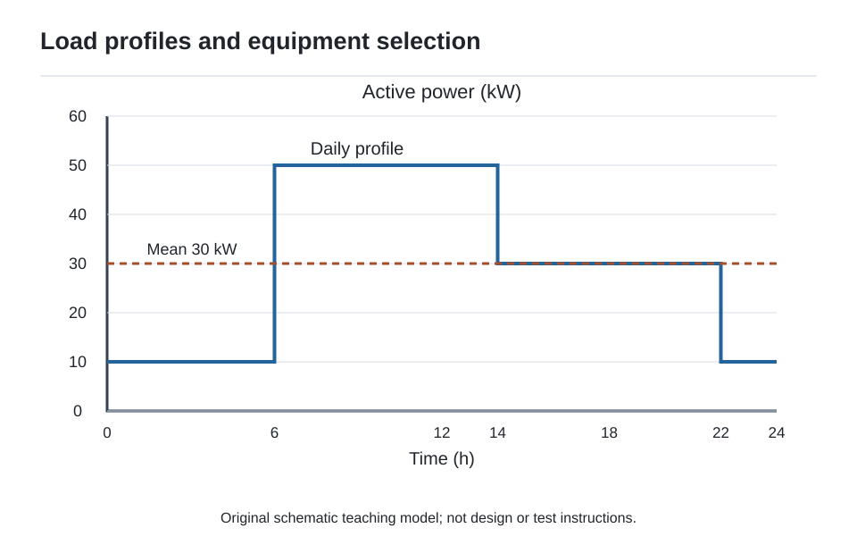

# M25-L1 – Load profiles and equipment selection {#L1}

**Course area:** M25 – Bachelor: Plant design and energy economics

**Level:** Bachelor · Foundations

**Prerequisites:** [M24-L4](M24-L4.md).

**Learning objective:** Evaluate time-dependent loads and distinguish capacity demand from energy use and equipment constraints in a simplified model.

## Power and energy {#S1}

A load profile $P(t)$ describes active power demand over time. For piecewise constant values, $E=\sum_i P_i\Delta t_i$. Mean power is $\bar P=E/T$, and load factor is $f_L=\bar P/P_{max}$ for the same observation interval. High peak demand can require substantial capacity despite low energy consumption. Temporal resolution matters: quarter-hour averages cannot reveal brief starting peaks.

## Example of a virtual operating day {#S2}

A fictional plant requires 10 kW from midnight to 6 am, 50 kW from 6 am to 2 pm, 30 kW from 2 pm to 10 pm, and 10 kW thereafter. Thus $E=6\cdot10+8\cdot50+8\cdot30+2\cdot10=720$ kWh, $\bar P=30$ kW and $f_L=0.60$. The highest interval-average demand is 50 kW. Short peaks are not represented. A uniform 30 kW profile would have the same daily energy but lower peak demand.

*Figure: Original schematic teaching model; not design or test instructions.*

## Coincidence and apparent power {#S3}

For two loads with individual maxima of 40 and 30 kW and a combined maximum of 50 kW, coincidence factor is $k_s=50/70\approx0.714$. Its reciprocal is the diversity factor in the definition used here; terminology varies across publications. For a balanced sinusoidal three-phase load with $\cos\varphi=0.8$, 50 kW corresponds to apparent power $S=P/\cos\varphi=62.5$ kVA. At 400 V line-to-line voltage, the model current is $I=S/(\sqrt3 U)\approx90.2$ A. With harmonics, power factor cannot generally be identified with displacement factor.

## From load to equipment {#S4}

A capacity estimate is only one input. Equipment also needs evaluation for thermal loading, starting, voltage, short-circuit stress, environmental conditions, redundancy and headroom. Scenarios for shift changes, expansion and outages prevent blind extrapolation of averages. This example does not size an actual transformer or conductor. Binding design requires verified data, applicable rules and competent personnel.

## Self-assessment {#S5}

### Exercises

1. How much energy does a constant 30 kW load consume in 24 h?
2. What is the load factor if daily energy is unchanged and peak demand rises to 60 kW?
3. What apparent power corresponds to 50 kW at unity power factor?

::: {.lc-solutions data-lc-section="S5"}
1. 720 kWh.
2. 30/60 = 0.5.
3. 50 kVA.
:::

## Sources {#S6}

- [EIA – Load factor](https://www.eia.gov/tools/glossary/index.php?id=Load_factor) · HTML line 237: ratio of average to peak load · Last accessed: 2026-11-25 · Content verified: 2026-11-25
- [Schneider Electric – Estimation of actual maximum kVA demand](https://www.electrical-installation.org/enwiki/Estimation_of_actual_maximum_kVA_demand) · HTML lines 45–57: coincidence factor and limits of generic assumptions; manufacturer guidance (review limited to documented scope) · Last accessed: 2026-11-25 · Content verified: 2026-11-25
- [Schneider Electric – Electrical installation design methodology](https://www.electrical-installation.org/enwiki/Electrical_installation_design_methodology) · HTML lines 42–72: demand, operating modes, expansion and distribution architecture; manufacturer guidance (review limited to documented scope) · Last accessed: 2026-11-25 · Content verified: 2026-11-25
