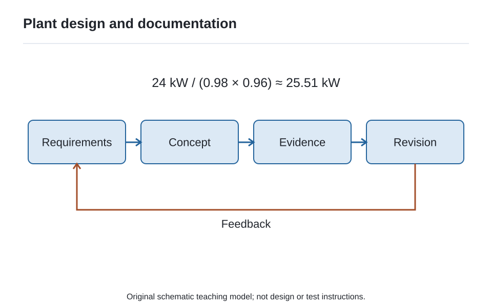

# M25-L2 – Plant design and documentation {#L2}

**Course area:** M25 – Bachelor: Plant design and energy economics

**Level:** Bachelor · Foundations

**Prerequisites:** [M25-L1](M25-L1.md).

**Learning objective:** Structure design phases, interfaces and evidence for an electrical installation using a virtual project.

## Requirements and system boundary {#S1}

Begin with service requirements and operating states, not a list of equipment. A requirements matrix records loads, availability, environment, interfaces, expansion, safety objectives and acceptance criteria. A single-line diagram abstracts functional energy paths; it replaces neither wiring diagrams nor protection studies. Load lists, equipment tags, data sheets and calculations must refer to the same revision.

## Design as an iterative process {#S2}

Requirements inform a concept; alternatives are compared, models evaluated and evidence assigned. Detailed design considers voltage quality, thermal limits, protection coordination and fault conditions together. Inconsistencies trigger revision of an earlier phase. Each change is assessed for its effect on dependent documents. Approval of a design document does not constitute authorization to operate an actual installation.

*Figure: Original schematic teaching model; not design or test instructions.*

## Worked example: energy path {#S3}

A fictional energy path has two stages with efficiencies $\eta_1=0.98$ and $\eta_2=0.96$ at the selected operating point. For 24 kW of useful output, $\eta_{total}=0.9408$ and $P_{in}=24/0.9408\approx25.51$ kW. Approximately 1.51 kW is lost. Constant efficiencies and no other loads are assumed. Varying loads require efficiency curves and a time-dependent balance. Changes in efficiency must be propagated to the energy balance and thermal model.

## Evidence and change management {#S4}

A traceable design register links requirement ID, calculation revision, assumptions, result, responsible role and verification status. For example, the fictional goal of total losses below 2 kW at the selected operating point can be linked to the calculation above. Other operating states remain unverified. Outstanding evidence is marked explicitly. Actual installations require separate assessment of local rules, network operator requirements, manufacturer documentation, competent inspection and acceptance.

## Self-assessment {#S5}

### Exercises

1. What is the overall efficiency for two stages of 95% each?
2. What input power is needed for 18.05 kW output at that efficiency?
3. Why must document revisions be linked?

::: {.lc-solutions data-lc-section="S5"}
1. 90.25%.
2. 20 kW.
3. To keep evidence and assumptions associated with the same installation configuration.
:::

## Sources {#S6}

- [Schneider Electric – Electrical installation design methodology](https://www.electrical-installation.org/enwiki/Electrical_installation_design_methodology) · HTML lines 42–72: demand, operating modes, expansion and distribution architecture; manufacturer guidance (review limited to documented scope) · Last accessed: 2026-11-25 · Content verified: 2026-11-25
- [Schneider Electric – Conductor sizing: methodology and definition](https://www.electrical-installation.org/enwiki/Conductor_sizing:_methodology_and_definition) · HTML lines 45–79: simultaneous constraints on conductors and protection; manufacturer guidance, not normative approval (review limited to documented scope) · Last accessed: 2026-11-25 · Content verified: 2026-11-25
