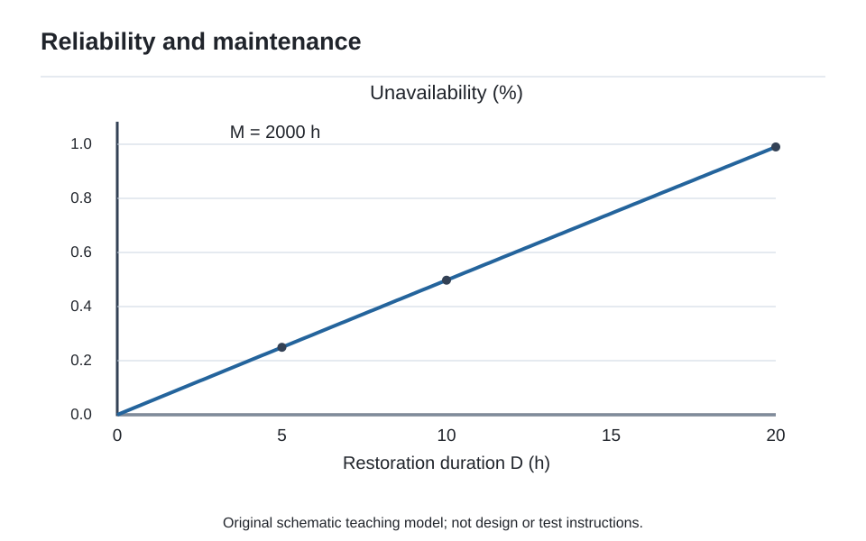

# M25-L3 – Reliability and maintenance {#L3}

**Course area:** M25 – Bachelor: Plant design and energy economics

**Level:** Bachelor · Foundations

**Prerequisites:** [M25-L2](M25-L2.md).

**Learning objective:** Assess failure occurrence, availability and maintenance strategies in a transparent model.

## Reliability and availability {#S1}

Reliability $R(t)$ is the probability of performing a required function without failure over an interval. An exponential lifetime model with constant failure rate $\lambda$ gives $R(t)=e^{-\lambda t}$. Availability instead describes the fraction of operational time or the probability of being operational at a point in time. Repair may improve availability but cannot undo a failure that has already occurred.

## Worked example: operating data {#S2}

A fictional repairable system has 10,000 operating hours and five recorded failures. Under a constant event-rate model, $\hat\lambda=5/10000=0.0005$ per operating hour, and estimated mean operating duration between failures is $M=2000$ h. If mean restoration duration is $D=10$ h, the simple stationary alternating model gives $A=M/(M+D)=2000/2010\approx99.50\%$. It assumes representative means and alternating up and down periods. Planned outages and logistics delays are not separately included here.

*Figure: Original schematic teaching model; not design or test instructions.*

## Maintenance strategies and limitations {#S3}

Reactive maintenance follows failure; preventive work follows planned intervals; condition-based work uses observed conditions; predictive approaches estimate future degradation. Reliability-centred maintenance links the choice of strategies to functional criticality and failure consequences. A statistical estimate from five events is uncertain; ageing or changing operating conditions may invalidate a constant rate.

## Decision and feedback {#S4}

If restoration duration in the teaching model falls to 5 h, $A$ rises to $2000/2005\approx99.75\%$. Expected unavailability approximately halves. This is not a guarantee for any individual interval. A maintenance plan connects failure mode, consequences, observable precursors, responsibility and effectiveness evidence. Safety-related decisions must not rely on economic indicators alone. Work on physical electrical installations is reserved for competent personnel.

## Self-assessment {#S5}

### Exercises

1. What is M for 6000 operating hours and three failures?
2. What availability results from M=2000 h and D=20 h?
3. Why does high availability not automatically mean high reliability?

::: {.lc-solutions data-lc-section="S5"}
1. 2000 h.
2. 2000/2020 ≈ 99.01%.
3. Frequent, rapidly repaired failures may give high availability despite low reliability.
:::

## Sources {#S6}

- [US DOE – Operations and Maintenance Challenges and Solutions](https://www.energy.gov/cmei/femp/operations-and-maintenance-challenges-and-solutions) · HTML lines 11–27: maintenance strategies, reliability and performance indicators · Last accessed: 2026-11-25 · Content verified: 2026-11-25
- [NIST – Constant repair rate (HPP/exponential) model](https://www.itl.nist.gov/div898/handbook/apr/section4/apr451.htm) · HTML lines 8–30: MTBF estimator, constant-rate assumption and confidence limits · Last accessed: 2026-11-25 · Content verified: 2026-11-25
