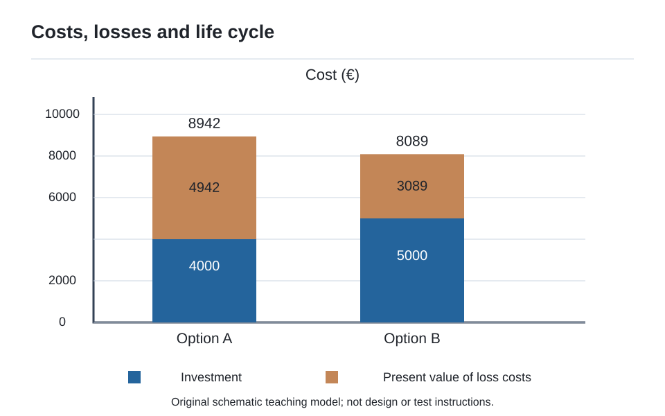

# M25-L4 – Costs, losses and life cycle {#L4}

**Course area:** M25 – Bachelor: Plant design and energy economics

**Level:** Bachelor · Foundations

**Prerequisites:** [M25-L3](M25-L3.md).

**Learning objective:** Compare alternatives with equal useful service using loss energy, discounted costs and sensitivity analysis.

## System boundary and cost categories {#S1}

Economic evaluation links technical performance to time-dependent costs. Investment, energy, maintenance, replacement, outage costs and residual value may be relevant, depending on the system boundary. Demand charges may accompany energy charges. Alternatives should be compared at equivalent useful service, lifetime and reliability requirements. The following prices and power values are invented teaching data, not market data.

## Worked example: loss energy {#S2}

Two fictional devices perform the same task. A costs €4,000, B €5,000. At 4000 operating hours annually, mean losses are 0.8 and 0.5 kW, respectively. Loss energy is 3200 and 2000 kWh/year; at a constant €0.20/kWh, annual loss costs are €640 and €400. Savings are €240/year. Simple undiscounted payback of the extra €1000 investment is $1000/240\approx4.17$ years. Other costs are assumed equal.

*Figure: Original schematic teaching model; not design or test instructions.*

## Present value over ten years {#S3}

For annual end-of-year payments, the present-value factor is $F=(1-(1+r)^{-N})/r$ for $r>0$. At $r=0$, $F=N$. For ten years and a 5% real discount rate, $F\approx7.7217$. A costs $4000+640F\approx8942$ euros, B $5000+400F\approx8089$ euros. B saves approximately €853 in present value; shared costs and equal residual values are omitted. Constant real prices require a consistent real discount rate.

## Sensitivity and decision {#S4}

The break-even constant energy price is $1000/(1200F)\approx0.108$ euros/kWh. Below it, B is not justified in this model on loss reduction alone. Fewer operating hours, different price paths or unequal maintenance costs shift the threshold. Technical and safety minimum requirements must be satisfied independently of cost. Financial life-cycle costing is not a full environmental life-cycle assessment.

## Self-assessment {#S5}

### Exercises

1. How much annual energy does B save at 2000 operating hours?
2. What is simple payback at €0.20/kWh in that case?
3. What is the present-value factor with no discounting over ten years?

::: {.lc-solutions data-lc-section="S5"}
1. 600 kWh.
2. 1000/120 ≈ 8.33 years.
3. 10.
:::

## Sources {#S6}

- [US DOE – Building Life Cycle Cost Programs](https://www.energy.gov/cmei/femp/building-life-cycle-cost-programs) · HTML lines 31–39: discount factors and energy price escalation; US federal context · Last accessed: 2026-11-25 · Content verified: 2026-11-25
- [US DOE – Purchasing Energy-Efficient Light Bulbs](https://www.energy.gov/cmei/femp/purchasing-energy-efficient-light-bulbs) · HTML lines 43–51, 64–66: discounted energy costs versus incremental investment; example methodology only · Last accessed: 2026-11-25 · Content verified: 2026-11-25
