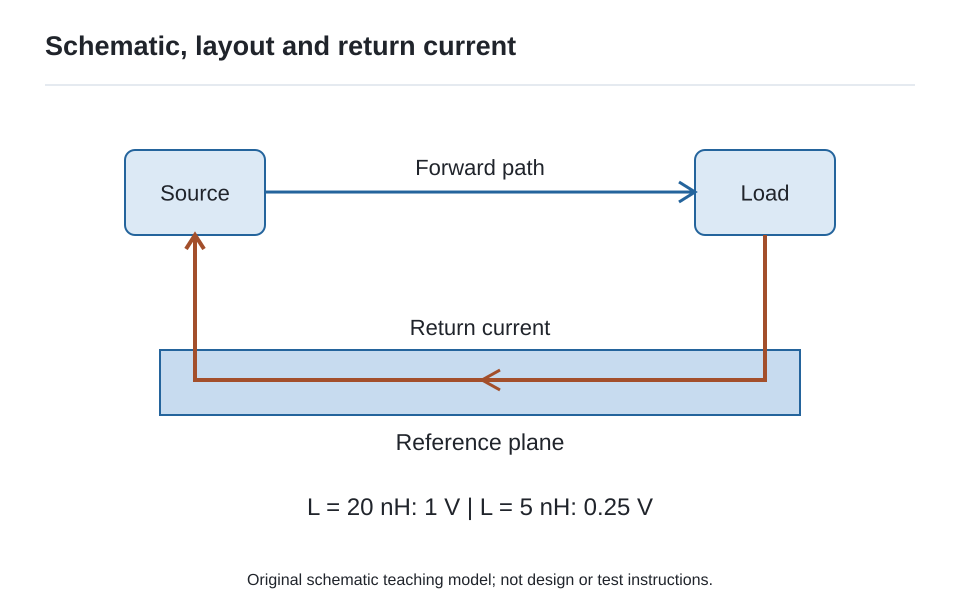

# M26-L1 – Schematic, layout and return current {#L1}

**Course area:** M26 – Bachelor: Electronic hardware and PCB design

**Level:** Bachelor · Foundations

**Prerequisites:** [M25-L4](M25-L4.md).

**Learning objective:** Translate circuit topology into a physical PCB structure and estimate parasitic effects.

## From net to geometry {#S1}

A schematic describes electrical nodes and component functions, not the physical extent of conductors. Layout maps symbol pins to package pads, places components and routes connections on copper layers. A stackup contains conductive planes and dielectric layers; vias connect layers. Net comparison detects some mapping errors but says nothing about loop inductance or heat removal.

## Worked example: parasitic inductance {#S2}

Assume a simplified current loop with $L=20$ nH. A linear rise of 0.5 A in 10 ns produces $v_L=L\,\mathrm{d}i/\mathrm{d}t=1$ V. With 5 nH it is 0.25 V. This is the inductive voltage component; polarity follows the chosen reference direction. The numbers are model parameters, not measured trace properties. The diagram shows a nearby reference plane and closed current path.

*Figure: Original schematic teaching model; not design or test instructions.*

## Return current and decoupling {#S3}

For fast transitions on a trace above a close, continuous reference plane, the return current is concentrated mainly near that trace. A discontinuity may lengthen its path. Large current loops often increase magnetic coupling. A local decoupling capacitor supplies charge for transient loads; connection inductance, ESR and actual impedance versus frequency limit its effectiveness. A ground plane is not an ideal zero-potential node.

## Design decisions {#S4}

Define functional blocks and connectors, identify sensitive measurement nodes and rapidly changing currents, and check the return path for every signal. Consider the enclosure, mechanical constraints, stackup and component documentation. Splitting analogue and digital planes indiscriminately is not automatically beneficial. Design rules check modelled geometry; electrical function requires separate evidence. The teaching model does not approve a physical assembly.

## Self-assessment {#S5}

### Exercises

1. What voltage results with L=10 nH for the same current change?
2. What changes if rise time doubles?
3. Why is the return path part of layout design?

::: {.lc-solutions data-lc-section="S5"}
1. 0.5 V.
2. Inductive voltage halves for a linear current ramp.
3. It closes the circuit and affects loop impedance and coupling.
:::

## Sources {#S6}

- [Analog Devices – Mixed-Signal PCB Layout](https://www.analog.com/en/resources/analog-dialogue/articles/what-are-the-basic-guidelines-for-layout-design-of-mixed-signal-pcbs.html) · HTML 75–89: frequency-dependent return paths and reference planes; application guidance · Last accessed: 2026-11-25 · Content verified: 2026-11-25
- [KiCad 9.0 – Getting Started](https://docs.kicad.org/9.0/en/getting_started_in_kicad/getting_started_in_kicad.html) · HTML 296–306, 384–406: stackup, constraints, DRC, fabrication and drill outputs · Last accessed: 2026-11-25 · Content verified: 2026-11-25
