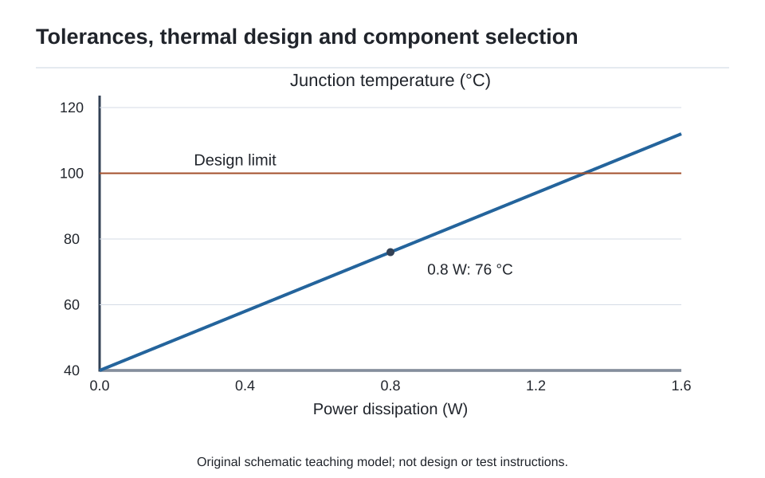

# M26-L2 – Tolerances, thermal design and component selection {#L2}

**Course area:** M26 – Bachelor: Electronic hardware and PCB design

**Level:** Bachelor · Foundations

**Prerequisites:** [M26-L1](M26-L1.md).

**Learning objective:** Determine voltage-divider limits and steady-state heating using explicit model assumptions.

## Interpreting component data {#S1}

Nominal values are not guaranteed actual values. Tolerance, temperature coefficient, ageing, supply and load alter circuit quantities. Absolute maximum ratings are stress limits, not recommended operating points. A design needs functional limits with margin and a model of its environment. Correlations may change which combinations of deviations are possible.

## Worked example: voltage divider {#S2}

An unloaded divider uses two resistors $R_1=R_2=10$ kΩ, each with ±1% tolerance, and an exact 5 V input. $V_o=5R_2/(R_1+R_2)$ gives 2.5 V nominally. The minimum occurs at $R_1=10.1$ kΩ and $R_2=9.9$ kΩ: 2.475 V. Swapping the extreme values gives a maximum of 2.525 V. The range is ±25 mV; additional input and load errors are excluded. A 10 kΩ load in parallel with R2 reduces the nominal voltage to approximately 1.667 V.

*Figure: Original schematic teaching model; not design or test instructions.*

## Steady-state thermal model {#S3}

A component dissipating $P=0.8$ W with assumed effective thermal resistance $\theta_{JA}=45$ K/W reaches $T_J=T_A+P\theta_{JA}=76$ °C at $T_A=40$ °C in the steady-state linear model. An invented design limit of 100 °C leaves 24 K margin. At 1.4 W the result is 103 °C. The model omits temperature transients and heating from neighbours. Datasheet $\theta_{JA}$ values depend on test board and environment and cannot be transferred uncritically to other assemblies.

## Selection and verification {#S4}

Review functional corners, power dissipation, package, availability and appropriate cooling together. Worst-case analysis examines permitted extreme combinations; statistical methods require distribution assumptions and do not automatically cover every limit. Temperature measurements and an assembly-specific thermal model complement the calculation. All numbers are fictional teaching values, not component approval.

## Self-assessment {#S5}

### Exercises

1. What is T_J at 0.6 W under the same assumptions?
2. What dissipation reaches 100 °C in the model?
3. Why does a nominal simulation not prove tolerance compliance?

::: {.lc-solutions data-lc-section="S5"}
1. 67 °C.
2. (100−40)/45 ≈ 1.33 W.
3. It does not investigate permitted parameter deviations.
:::

## Sources {#S6}

- [Analog Devices – Resistor Divider Tool](https://www.analog.com/en/resources/analog-dialogue/articles/how-to-improve-power-supply-output-regulation-accuracy-with-the-ltpowercad-resistor-divider-tool.html) · HTML 66–67: resistor tolerance and output-voltage error · Last accessed: 2026-11-25 · Content verified: 2026-11-25
- [Analog Devices – Absolute Maximum Ratings and Thermal Resistances](https://www.analog.com/en/resources/technical-articles/data-sheet-intricacies-absolute-maximum-ratings-and-thermal-resistances.html) · HTML 61–98: thermal resistance and dependence on test environment · Last accessed: 2026-11-25 · Content verified: 2026-11-25
