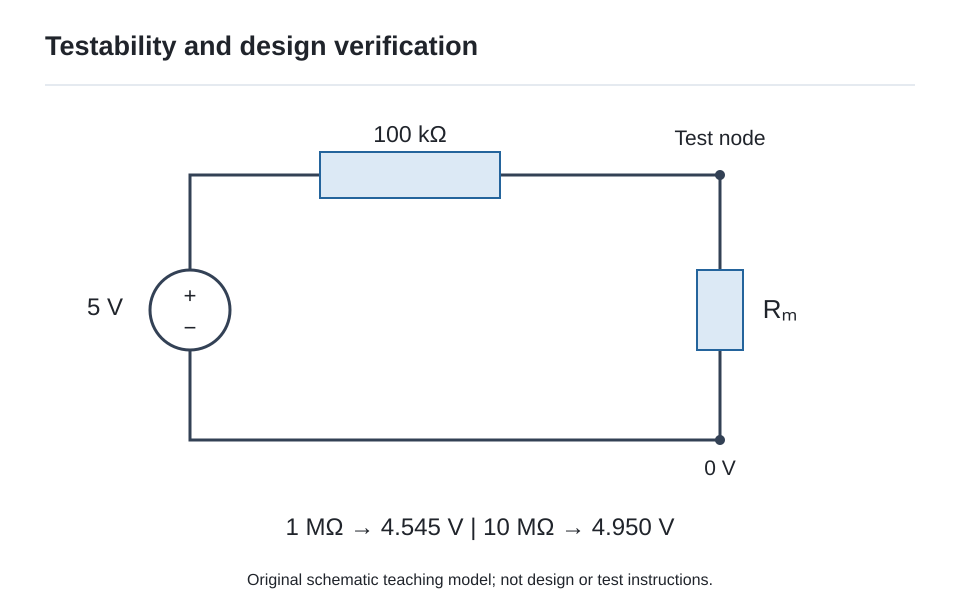

# M26-L3 – Testability and design verification {#L3}

**Course area:** M26 – Bachelor: Electronic hardware and PCB design

**Level:** Bachelor · Foundations

**Prerequisites:** [M26-L2](M26-L2.md).

**Learning objective:** Derive test requirements and quantify the effect of a measurement arrangement.

## Testable requirements {#S1}

A verifiable requirement defines a measured quantity, operating conditions, limits and a decision criterion. Verification assesses conformity to specified requirements; validation assesses suitability for intended use. Schematic review, layout review, simulation and prototype measurements provide different evidence. Accessible test points, defined reference nodes and reproducible configurations aid diagnosis, although a test point can add capacitance.

## Worked example: measurement loading {#S2}

A virtual node has an open-circuit voltage of 5 V and Thevenin resistance $R_s=100$ kΩ. A meter with $R_m=1$ MΩ reads $V_m=5R_m/(R_s+R_m)\approx4.545$ V in the DC model, a relative error of −9.09%. With 10 MΩ, the result is 4.950 V and −0.99%. Assuming 15 pF of input capacitance in the second case, the time constant is $(R_s\parallel R_m)C\approx1.485$ µs; the −3 dB cutoff relative to the DC level is about 107 kHz. The figure shows the purely resistive case.

*Figure: Original schematic teaching model; not design or test instructions.*

## Verification matrix {#S3}

For a fictional 2.5 V output with an allowed ±50 mV, plan tests at minimum and maximum supply, temperature and load. A reading of 2.545 V with expanded uncertainty of 10 mV does not unambiguously establish compliance with the 2.550 V upper limit; a conservative interval rule requires the entire uncertainty interval to lie within tolerance. Acceptance rules must be agreed before testing. This teaching case is not a universal normative decision procedure.

## Evidence and fault isolation {#S4}

Record requirement ID, revision, model or test environment, reading, uncertainty and result. Distinguish circuit faults from measurement setup faults. A design-rule check may report geometric conflicts but cannot certify complete functionality. Practical tests at hazardous voltages are outside this self-study task; all examples are considered analytically.

## Self-assessment {#S5}

### Exercises

1. What would an ideal infinitely high impedance DC meter read?
2. How does the time constant change if input capacitance doubles?
3. Why must the acceptance rule be established before the test?

::: {.lc-solutions data-lc-section="S5"}
1. 5 V.
2. It doubles in the same model.
3. So the result is reproducible and the rule is not changed after seeing it.
:::

## Sources {#S6}

- [Tektronix – How Oscilloscope Probes Affect Your Measurement](https://www.tek.com/en/documents/application-note/how-oscilloscope-probes-affect-your-measurement) · HTML 281–302, 328–338: resistive and capacitive loading · Last accessed: 2026-11-25 · Content verified: 2026-11-25
- [KiCad 9.0 – Getting Started](https://docs.kicad.org/9.0/en/getting_started_in_kicad/getting_started_in_kicad.html) · HTML 296–306, 384–406: stackup, constraints, DRC, fabrication and drill outputs · Last accessed: 2026-11-25 · Content verified: 2026-11-25
