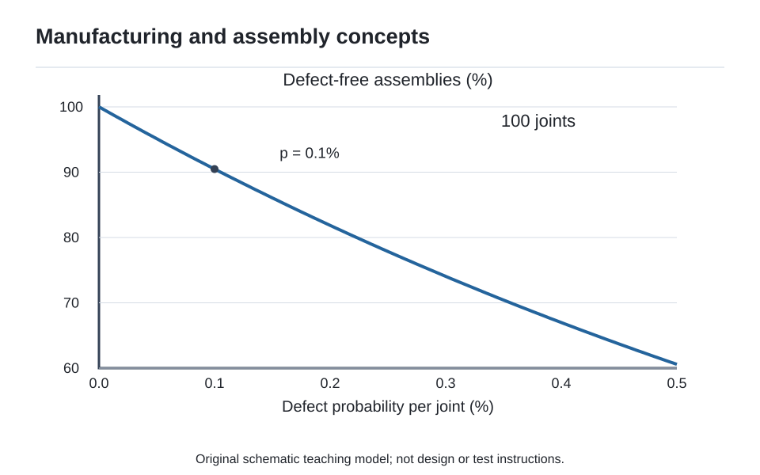

# M26-L4 – Manufacturing and assembly concepts {#L4}

**Course area:** M26 – Bachelor: Electronic hardware and PCB design

**Level:** Bachelor · Foundations

**Prerequisites:** [M26-L3](M26-L3.md).

**Learning objective:** Distinguish fabrication data from assembly processes and evaluate simple yield models.

## PCB fabrication and assembly {#S1}

The bare PCB provides mechanical and electrical support. Copper patterning, layer interconnection, drilling, surface finish and solder mask are part of fabrication. Assembly places parts on prepared lands; surface mounting typically involves paste deposition, placement and reflow. Through-hole assembly uses leads inserted into holes. Methods and process windows depend on materials, packages and production equipment.

## Worked example: simplified yield {#S2}

A virtual assembly has 100 statistically independent solder joints, each with defect probability $p=0.001$. The probability of no defective joint is $Y=(1-p)^{100}=0.999^{100}\approx0.9048$. Of 1000 assemblies, approximately 905 are expected to be free of this defect. With $p=0.0002$, $Y\approx0.9802$. The model is not actual manufacturing statistics; common process causes can violate independence, and other defect types are omitted.

*Figure: Original schematic teaching model; not design or test instructions.*

## Manufacturing-ready data {#S3}

A revision-controlled handoff includes layer and outline data, drill data, stackup, bill of materials, placement coordinates and assembly instructions. Gerber describes individual layer artwork, not the complete electrical design. Cross-checking pin-1 location, orientation, package dimensions and BOM variants prevents systematic errors. Fabricator constraints on trace width, spacing and holes must be represented in the design rules for the particular project.

## Process inspection and feedback {#S4}

Optical inspection captures visible geometry and placement features; hidden joints may require additional imaging or electrical methods. Electrical functional tests, inspection and process data complement rather than replace one another. Analysis connects defect type, process step and corrective action. Reflow parameters and allowable defects are product-specific; the lesson provides no process approval or universal normative limits.

## Self-assessment {#S5}

### Exercises

1. What is Y for 50 joints and p=0.001?
2. Which assumption is particularly doubtful for a shared oven fault?
3. What data supplement Gerber for assembly?

::: {.lc-solutions data-lc-section="S5"}
1. 0.999^50 ≈ 95.12%.
2. Statistical independence of solder-joint defects.
3. Among others, bill of materials, coordinates, orientation and assembly instructions.
:::

## Sources {#S6}

- [KiCad 9.0 – Getting Started](https://docs.kicad.org/9.0/en/getting_started_in_kicad/getting_started_in_kicad.html) · HTML 296–306, 384–406: stackup, constraints, DRC, fabrication and drill outputs · Last accessed: 2026-11-25 · Content verified: 2026-11-25
- [Analog Devices – SMT Assembly and PCB Design Guidelines for QFN](https://www.analog.com/en/resources/app-notes/smt-assembly-and-pcb-design-guidelines-for-maxims-standard-wirebonded-quad-flatpack.html) · HTML 27–36, 77–105, 128–160: package-specific assembly, solder paste and inspection limitations · Last accessed: 2026-11-25 · Content verified: 2026-11-25
