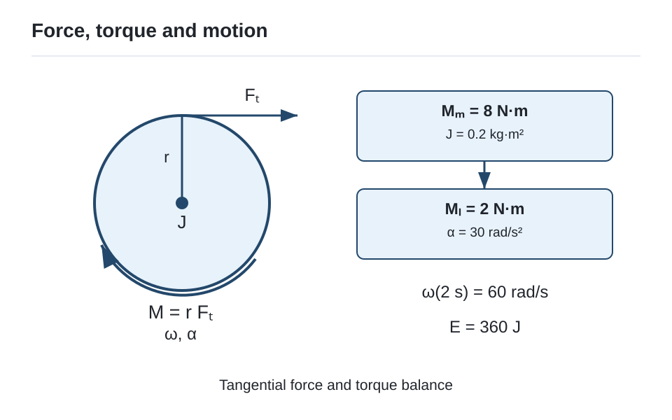

# M27-L1 – Force, torque and motion {#L1}

**Course area:** M27 – Bachelor: Mechanics and heat in electrical systems

**Level:** Bachelor · Foundations

**Prerequisites:** [M23-L5](M23-L5.md).

**Learning objective:** Balance forces and torques on a shaft, calculate acceleration, energy and power, and assess a gear ratio.

## Force and rotational equivalent model {#S1}

An electric machine supplies electromagnetic torque rather than imposing a speed directly. A rigid body with a fixed rotation axis responds according to its inertia. A tangential force $F_t$ at radius $r$ produces torque $M=rF_t$. More generally, $\vec M=\vec r\times\vec F$. A radial force alone creates no torque about the axis, although it can load a bearing, for example.

Angular velocity $\omega$ in rad/s is related to rotational speed $n$ in rpm by $\omega=2\pi n/60$. Angular acceleration is $\alpha=d\omega/dt$. The moment of inertia $J$ in kg·m² describes the mass distribution about the axis. For a uniform solid disc, $J=mr^2/2$. The moments of inertia of rigidly connected bodies add when referred to the same axis.

## Torque balance and worked example {#S2}

Choose a positive direction and assign signs to all torques. With motor and load torques $M_m,M_L$ and viscous friction $b\omega$, positive rotation obeys:

$$
J\frac{d\omega}{dt}=M_m-M_L-b\omega
$$

A fictitious drive has $J=0.2\,\mathrm{kg\,m^2}$, $M_m=8\,\mathrm{N\,m}$ and $M_L=2\,\mathrm{N\,m}$. Initially neglect friction. Then $\alpha=30\,\mathrm{rad/s^2}$. Starting from rest, the drive reaches 60 rad/s (approximately 573 rpm) after 2 s. Its rotational energy is $E=J\omega^2/2=360\,\mathrm J$.

*Figure: Original schematic teaching model with fictitious numerical values.*

## Work, power and gears {#S3}

Instantaneous mechanical shaft power is $P=M\omega$. At the end of the example the motor supplies 480 W, the load absorbs 120 W, and the difference of 360 W increases rotational energy at that instant. Over the entire acceleration, $\theta=\alpha t^2/2=60\,\mathrm{rad}$; the net work $6\,\mathrm{N\,m}\cdot60\,\mathrm{rad}=360\,\mathrm J$ confirms the energy balance.

For ideal gearing with $g=\omega_m/\omega_L$ and the same direction of rotation, a load inertia $J_L$ referred to the motor side is $J_L/g^2$, as kinetic energy must be preserved. For $g=4$ and $J_L=0.8\,\mathrm{kg\,m^2}$ this gives $0.05\,\mathrm{kg\,m^2}$. Actual gears exhibit efficiency losses, backlash and additional inertia.

## Model limitations and design {#S4}

With constant load torque and linear friction, speed approaches equilibrium if the motor maintains constant torque and $b>0$. A model without friction or a speed limit instead predicts unlimited acceleration. This is not a real drive characteristic. Torque, current and permissible speed limits must come from the actual system. Flexible shafts require additional states for torsion and vibration. Investigate these effects in a model first, not on unguarded rotating equipment.

## Self-assessment {#S5}

### Exercises

1. What acceleration results from J=0.3 kg·m² and a net torque of 6 N·m?
2. What rotational energy does this inertia store at 40 rad/s?
3. What is the reflected load inertia for J_L=1.8 kg·m² and g=3?

::: {.lc-solutions data-lc-section="S5"}
1. 20 rad/s².
2. 240 J.
3. 0.2 kg·m².
:::

**Further reading:** [M27-L2](M27-L2.md)

## Sources {#S6}

- [OpenStax – University Physics Volume 1, § 10.7 Newton’s Second Law for Rotation](https://openstax.org/books/university-physics-volume-1/pages/10-7-newtons-second-law-for-rotation) · HTML 29–53: torque balance and moment of inertia · Last accessed: 2026-11-25 · Content verified: 2026-11-25
- [OpenStax – University Physics Volume 1, § 10.8 Work and Power for Rotational Motion](https://openstax.org/books/university-physics-volume-1/pages/10-8-work-and-power-for-rotational-motion) · HTML 53–86: work and rotational energy · Last accessed: 2026-11-25 · Content verified: 2026-11-25
