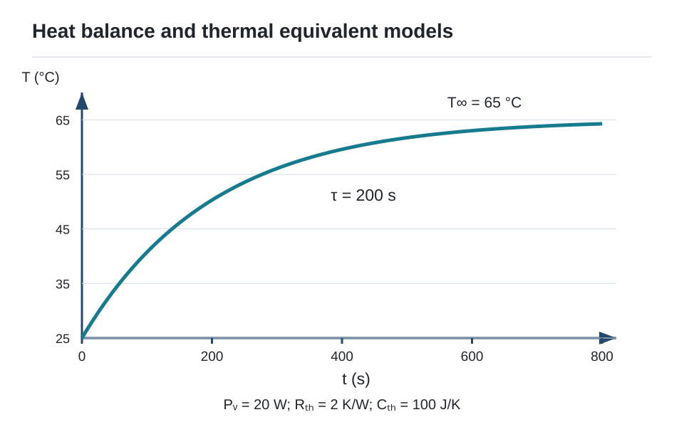

# M27-L2 – Heat balance and thermal equivalent models {#L2}

**Course area:** M27 – Bachelor: Mechanics and heat in electrical systems

**Level:** Bachelor · Foundations

**Prerequisites:** [M27-L1](M27-L1.md).

**Learning objective:** Distinguish loss power, thermal resistance and thermal capacitance, and solve a first-order thermal model.

## Heat sources and heat paths {#S1}

Copper losses $I^2R$, magnetic losses, switching losses and friction convert part of the supplied energy into internal energy. Loss power $P_v$ is a rate in watts; temperature alone is not energy. Conduction through solids, convection at surfaces and radiation transfer energy to the surroundings. For a flat layer of thickness $d$, area $A$ and thermal conductivity $k$, steady-state thermal resistance is $R_\mathrm{th}=d/(kA)$ in K/W, assuming one-dimensional heat flow. Series layer resistances add; for parallel heat paths, conductances add. Contact resistance and convection can dominate.

## Thermal RC model and worked example {#S2}

Represent an approximately isothermal assembly by temperature $T$, thermal capacitance $C_\mathrm{th}=mc$ in J/K and constant thermal resistance to ambient temperature $T_a$. The balance is:

$$
C_\mathrm{th}\frac{dT}{dt}=P_v-\frac{T-T_a}{R_\mathrm{th}}
$$

For constant $P_v,T_a$ and initial temperature $T(0)=T_a$, the solution is

$$
T(t)=T_a+P_vR_\mathrm{th}(1-e^{-t/\tau}),\qquad \tau=R_\mathrm{th}C_\mathrm{th}.
$$

A fictitious assembly has $P_v=20\,\mathrm W$, $R_\mathrm{th}=2\,\mathrm{K/W}$, $C_\mathrm{th}=100\,\mathrm{J/K}$ and $T_a=25\,{}^\circ\mathrm C$. Its time constant is 200 s and its steady-state temperature is 65 °C. After 200 s it is about 50.3 °C; after 600 s about 63.0 °C.

*Figure: Original schematic teaching model with fictitious numerical values.*

## Parameters and cooling {#S3}

After switching off losses, cooling in the same model follows $T(t)=T_a+(T_0-T_a)e^{-t/\tau}$. Starting from 65 °C, the excess temperature after 200 s is 14.7 K. Thermal resistance can be inferred from steady temperature rise and known loss power. The time constant can be estimated from the response to a power step; then $C_\mathrm{th}=\tau/R_\mathrm{th}$. Both parameters belong to a specified operating point and thermal boundary. If losses depend on temperature, the equation is generally nonlinear.

## Limits of the thermal analogy {#S4}

Thermal capacitance stores internal energy; thermal resistance describes energy flow, not electric charge. A semiconductor junction, case and heat sink often have different temperatures, requiring several nodes. Data-sheet thermal resistances apply under specified boundary conditions and must not be transferred to another mounting arrangement without validation. The teaching model establishes neither protection against contact nor an allowable component temperature. Actual design requires suitable measurements, uncertainty evaluation and specifications.

## Self-assessment {#S5}

### Exercises

1. Find the time constant for R_th=3 K/W and C_th=80 J/K.
2. With 10 W and 25 °C ambient, what is the steady temperature?
3. What is the temperature after one time constant, starting at 25 °C?

::: {.lc-solutions data-lc-section="S5"}
1. 240 s.
2. 55 °C.
3. About 44.0 °C.
:::

**Further reading:** [M27-L3](M27-L3.md)

## Sources {#S6}

- [OpenStax – University Physics Volume 2, § 1.4 Heat Transfer, Specific Heat, and Calorimetry](https://openstax.org/books/university-physics-volume-2/pages/1-4-heat-transfer-specific-heat-and-calorimetry) · HTML 156–179: energy conservation and heat capacity · Last accessed: 2026-11-25 · Content verified: 2026-11-25
- [OpenStax – University Physics Volume 2, § 1.6 Mechanisms of Heat Transfer](https://openstax.org/books/university-physics-volume-2/pages/1-6-mechanisms-of-heat-transfer) · HTML 55–65: steady heat conduction · Last accessed: 2026-11-25 · Content verified: 2026-11-25
