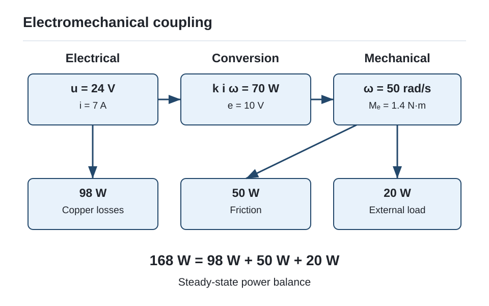

# M27-L3 – Electromechanical coupling {#L3}

**Course area:** M27 – Bachelor: Mechanics and heat in electrical systems

**Level:** Bachelor · Foundations

**Prerequisites:** [M27-L2](M27-L2.md).

**Learning objective:** Couple the electrical and mechanical models of a DC machine, determine steady states and evaluate the power balance.

## Two coupled energy domains {#S1}

An idealised DC motor with constant excitation flux has armature inductance $L$, armature resistance $R$ and mechanical inertia $J$. Armature current $i$ produces torque $M_e=k_t i$. Motion induces back emf $e=k_e\omega$, opposing the applied voltage during motoring. With consistent SI units and ideal lossless conversion, the constants are numerically equal ($k_t=k_e=k$), although their units are written according to the electrical or mechanical equation.

## Differential equations and steady state {#S2}

For a fixed positive direction, linear friction $b\omega$ and signed load torque $M_L$:

$$
L\frac{di}{dt}=u-Ri-k\omega
$$

$$
J\frac{d\omega}{dt}=ki-b\omega-M_L
$$

The states $i$ and $\omega$ cannot change instantaneously for finite inductance and inertia. In steady state their derivatives vanish. Eliminating $i$ gives $\omega=(ku-RM_L)/(Rb+k^2)$, followed by $i=(u-k\omega)/R$. For a fictitious example, let $u=24\,\mathrm V$, $R=2\,\Omega$, $k=0.2$, $b=0.02\,\mathrm{N\,m\,s/rad}$ and $M_L=0.4\,\mathrm{N\,m}$. The resulting speed is 50 rad/s, current 7 A and $M_e=1.4\,\mathrm{N\,m}$; friction torque is 1 N·m.

*Figure: Original schematic teaching model with fictitious numerical values.*

## Power balance and feedback {#S3}

Multiply the electrical equation by $i$ and the mechanical equation by $\omega$. The coupling power $ki\omega$ cancels when adding the balances:

$$
ui=Ri^2+b\omega^2+M_L\omega+\frac{d}{dt}\left(\frac{Li^2}{2}+\frac{J\omega^2}{2}\right).
$$

In the example 168 W is absorbed. Armature resistance dissipates 98 W, modelled friction dissipates 50 W, and the external load receives 20 W. If load torque increases while voltage remains unchanged, steady speed falls; back emf decreases and current rises. When $ki\omega$ is negative, conversion power flows in the opposite direction. Whether energy can actually be returned to the source depends on the connected power electronics.

## Dynamics and limitations {#S4}

With $L=0.1\,\mathrm H$, $J=0.05\,\mathrm{kg\,m^2}$ and the other parameters above, the homogeneous linear model has system matrix $A=[[-20,-2],[4,-0.4]]$ in current and angular-velocity coordinates. The characteristic equation is $s^2+20.4s+16=0$; both eigenvalues are negative. This establishes asymptotic stability for this fixed model operating point, not safety of a real machine. Saturation, temperature-dependent resistance, converter limits, commutation and flexible loads are omitted. A stalled motor can incur large losses even with zero mechanical output. These calculations are purely virtual.

## Self-assessment {#S5}

### Exercises

1. Find back emf and torque at 50 rad/s, 7 A and k=0.2.
2. Find input power and copper losses at 24 V, 7 A and 2 Ω.
3. What steady speed results in the example if M_L=0.8 N·m?

::: {.lc-solutions data-lc-section="S5"}
1. 10 V and 1.4 N·m.
2. 168 W and 98 W.
3. 40 rad/s (current 8 A).
:::

## Sources {#S6}

- [MathWorks – Linear (LTI) Models](https://www.mathworks.com/help/control/getstart/linear-lti-models.html) · HTML 40–85: idealised DC motor equations and state space · Last accessed: 2026-11-25 · Content verified: 2026-11-25
- [OpenStax – University Physics Volume 2, § 13.6 Electric Generators and Back Emf](https://openstax.org/books/university-physics-volume-2/pages/13-6-electric-generators-and-back-emf) · HTML 103–121: back emf, motor loading and losses · Last accessed: 2026-11-25 · Content verified: 2026-11-25
