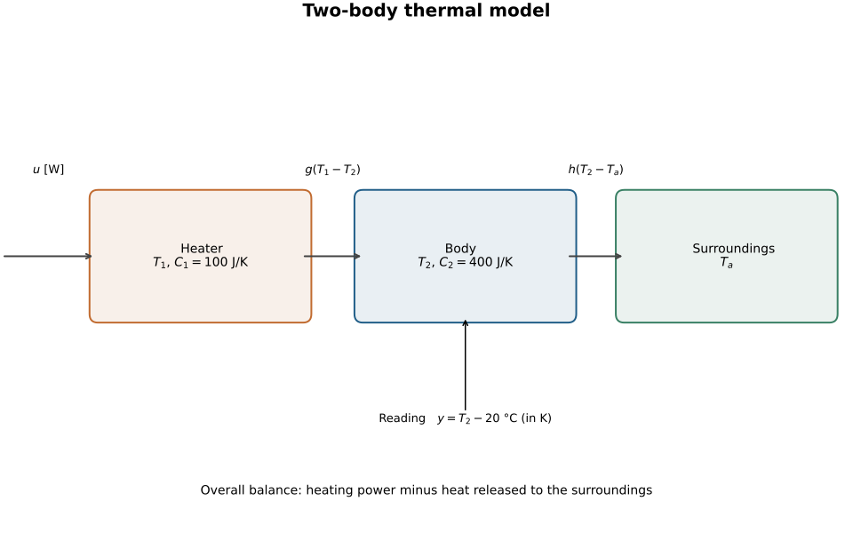

# M28-L1 – From Experiment to State-Space Model: Differential Equations, Operating Point and Linearisation {#L1}

**Course area:** M28 – Bachelor–Master Bridge: Transition to Control and State-Space Methods

**Level:** Bachelor · Bachelor–Master Bridge

**Prerequisites:** [M12-L2](M12-L2.md), [M13-L1](M13-L1.md), [M2-L2](M2-L2.md).

**Learning objective:** Derive a state-space model from a physical balance equation and linearise it about an operating point.

## Diagnostic Self-Test {#S1}

Answer the questions without aids first. Only then check the answers.

1. What is the unit of thermal capacitance? **Answer:** J/K.
2. How do you determine a steady state from $\dot x=f(x,u)$? **Answer:** Solve $f(x_0,u_0)=0$.
3. What does a negative real eigenvalue mean? **Answer:** The corresponding free mode decays exponentially.
4. Must the number of measurement channels equal the number of states? **Answer:** No.

If you are not yet confident in balance equations or eigenvalue calculations, revisit [M12-L2](M12-L2.md) and the systems of linear equations in [M2-L2](M2-L2.md). The bridge is intended to assess your current level, not to introduce all the concepts for the first time.

## From the Experimental Setup to the Energy Balance {#S2}

An electric heater at temperature $T_1$ transfers heat to a body at temperature $T_2$. The body releases heat to the surroundings at $T_a$. Both temperatures are assumed to be spatially uniform within their respective bodies. The heating power $u$ is already the power converted into heat. With thermal capacitances $C_1,C_2$ and thermal conductances $g,h$,

$$C_1\dot T_1=u-g(T_1-T_2),\qquad C_2\dot T_2=g(T_1-T_2)-h(T_2-T_a).$$

Adding the two equations gives $C_1\dot T_1+C_2\dot T_2=u-h(T_2-T_a)$. The internal heat flow cancels out. This is an independent check of the model structure. With $C_1=100$ J/K, $C_2=400$ J/K, $g=2$ W/K and $h=1$ W/K, the teaching experiment has two energy storage elements. A single measured temperature is insufficient to predict the subsequent evolution without further initial information.

{alt="Heat flow between the heater, body and surroundings; state variables and power flow path."}

## State-Space Representation and Operating Point {#S3}

Let $x_1,x_2$ denote temperature differences in K relative to 20 °C; the surroundings are described by $d=T_a-20\,^{\circ}\mathrm C$. The output is $y=x_2$. Then

$$\dot x=Ax+Bu+Ed,\quad y=Cx,$$

$$A=\begin{pmatrix}-.02&.02\\.005&-.0075\end{pmatrix},\quad B=\begin{pmatrix}.01\\0\end{pmatrix},\quad E=\begin{pmatrix}0\\.0025\end{pmatrix},\quad C=\begin{pmatrix}0&1\end{pmatrix}.$$

$A$ has units of 1/s; $B$ maps W to K/s. The output matrix is dimensionless here. At $u_0=10$ W, $d_0=0$, the values are $x_{20}=10$ K and $x_{10}=15$ K. The absolute temperatures on the Celsius scale are thus 30 and 35 °C. At equilibrium, the heat flow through each conductance equals the heating power.

## Nonlinear Extension and Local Linearisation {#S4}

Radiative losses can add a term $q_{rad}=k(T_2^4-T_a^4)$, where both temperatures are absolute values in kelvin and $k$ is given in W/K$^4$. Around a steady operating point $z_0,v_0$, a general model $\dot z=f(z,v)$ with output $y=m(z,v)$ is approximated by

$$\delta\dot z=A\delta z+B\delta v,\quad A=\left.\frac{\partial f}{\partial z}\right|_0,\quad B=\left.\frac{\partial f}{\partial v}\right|_0,$$

and correspondingly $\delta y=C\delta z+D\delta v$. At the operating point, the radiative term has a differential conductance of $4kT_{20}^3$. For $k=2\cdot10^{-9}$ W/K$^4$ and $T_{20}=303{.}15$ K, it is approximately 0.223 W/K. It is not identical to the ratio of total heat flow to absolute temperature. Large temperature changes or changing heat transfer conditions may require a new linearisation. The operating point must be recalculated from the extended model; the previously calculated point applies only to the linear model.

In the experiment, separate power steps and temperature trajectories help estimate parameters. A good fit to a single trajectory does not prove that the parameters are unique. An additional measurement of heater temperature or a different input excitation may improve the ability to distinguish them.

## Exercises with Solutions {#S5}

1. Determine both steady-state temperature differences for $u=8$ W and $d=-2$ K. **Solution:** $x_2=6$ K, $x_1=10$ K.
2. What effect does doubling $C_2$ have on the steady-state operating point? **Solution:** None if the conductances remain unchanged; the dynamics change.
3. How does the derivative of the radiative loss change when the absolute temperature doubles? **Solution:** A factor of eight.
4. Why is a spatially uniform temperature an assumption? **Solution:** Real bodies have gradients and further storage elements; the model order must suit the task.

## Sources {#S6}

- [Åström and Murray – Feedback Systems, 2nd edition, chapters 2, 5–12](https://fbswiki.org/wiki/index.php/Feedback_Systems%3A_An_Introduction_for_Scientists_and_Engineers) · Chapter index 3 and 6: state-space models and linearization; chapter PDFs not reviewed. · Last accessed: 2026-11-25
- [MIT OpenCourseWare – 16.30 Feedback Control Systems](https://ocw.mit.edu/courses/16-30-feedback-control-systems-fall-2010/) · Lectures 5–7: state-space model introduction and properties; linked notes not opened. · Last accessed: 2026-11-25
