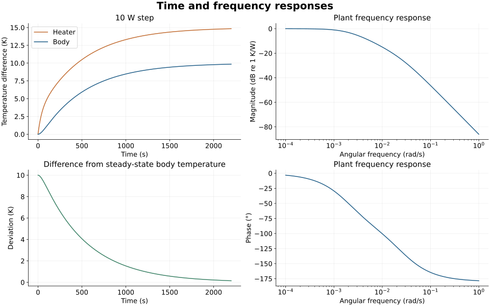

# M28-L2 – System Response and Stability: Laplace Transform, Poles and Frequency Response {#L2}

**Course area:** M28 – Bachelor–Master Bridge: Transition to Control and State-Space Methods

**Level:** Bachelor · Bachelor–Master Bridge

**Prerequisites:** [M28-L1](M28-L1.md), [M5-L2](M5-L2.md).

**Learning objective:** Explain stability and time-domain behaviour in terms of eigenvalues and the transfer function.

## Free and Forced Response {#S1}

For the linear time-invariant model from [M28-L1](M28-L1.md), with $d=0$,

$$x(t)=e^{At}x(0)+\int_0^t e^{A(t-\tau)}Bu(\tau)\,d\tau.$$

The first term describes the effect of the initial states. The second describes the effect of the input. Asymptotic internal stability of a finite-dimensional continuous-time LTI system requires all eigenvalues of $A$ to have strictly negative real parts. For this model they are approximately $-0{.}025542$ and $-0{.}001958$ s$^{-1}$. Their time constants are 39.15 and 510.85 s. The slower mode is important in determining how the body's temperature settles.

## Laplace Transform and Transfer Function {#S2}

From $sX-x(0)=AX+BU$, with zero initial states,

$$G(s)=C(sI-A)^{-1}B+D=\frac{0{.}00005}{s^2+0{.}0275s+0{.}00005}.$$

$G(0)=1$ K/W. The effect of the surroundings has its own transfer function

$$G_d(s)=\frac{0{.}0025(s+0{.}02)}{s^2+0{.}0275s+0{.}00005},$$

and $G_d(0)=1$ K/K. The zero in the second path changes its time-domain behaviour. The output response to a step in power of magnitude $U_0$ is $Y(s)=G(s)U_0/s$. The model has two real, negative poles without pole-zero cancellation in the power input path. In other realisations, hidden unstable states may be present despite an apparently well-behaved transfer function; internal stability must therefore be checked separately.

## Frequency Response {#S3}

For a sinusoidal power input in steady state at angular frequency $\omega$, the response is described by $G(j\omega)$. The magnitude and phase are

$$|G(j\omega)|=\frac{0{.}00005}{\sqrt{(0{.}00005-\omega^2)^2+(0{.}0275\omega)^2}},\quad \varphi=-\operatorname{atan2}(0{.}0275\omega,0{.}00005-\omega^2).$$

A Bode plot uses a logarithmic frequency scale and $20\log_{10}(|G|/G_{ref})$, with $G_{ref}=1$ K/W. At high frequencies the magnitude falls asymptotically by 40 dB per decade and the phase approaches -180°. At $\omega=0{.}01$ rad/s, the magnitude is approximately 0.179 K/W and the phase is -100.3°. The corresponding frequency is $f=\omega/(2\pi)$, not $\omega$ Hz.

{alt="Step response of both temperatures, and magnitude and phase response of the plant."}

## Concepts of Stability and Limitations {#S4}

A stable thermal body may assume a different equilibrium value for each permissible constant input. Stability is not the same as accurate setpoint tracking. BIBO stability (bounded input, bounded output) concerns input-output behaviour. In a minimal rational realisation without unstable hidden modes, both stability statements agree. A pure integrator has a pole at zero: a constant step input produces an indefinitely growing response.

The slow thermal mode requires a sufficiently long measurement period. A measurement lasting only 100 s shows a transient response but reveals little about the steady-state gain. The frequency response applies to the linear plant and a sinusoidal excitation around a permissible operating point; negative absolute heating power is not available.

## Exercises with Solutions {#S5}

1. Determine the steady-state output for 6 W of power and $d=-1$ K. **Solution:** 5 K.
2. What happens with a pole at $+0{.}002$ s$^{-1}$? **Solution:** A free mode grows with a time constant of 500 s.
3. By how much does the magnitude of an ideal two-pole system fall asymptotically when the frequency increases tenfold? **Solution:** A factor of 100 in magnitude, or -40 dB.
4. Estimate the time until the slow mode has fallen to 2%. **Solution:** $-\ln(0{.}02)/0{.}001958\approx1998$ s; this is not the exact settling time of the complete response.

## Sources {#S6}

- [Åström and Murray – Feedback Systems, 2nd edition, chapters 2, 5–12](https://fbswiki.org/wiki/index.php/Feedback_Systems%3A_An_Introduction_for_Scientists_and_Engineers) · Chapter index 5, 9 and 10: stability, Laplace transforms and frequency analysis. · Last accessed: 2026-11-25
- [MIT OpenCourseWare – 16.30 Feedback Control Systems](https://ocw.mit.edu/courses/16-30-feedback-control-systems-fall-2010/) · Lectures 2–4, 6 and 8: pole/response methods and transfer models; linked notes not opened. · Last accessed: 2026-11-25
