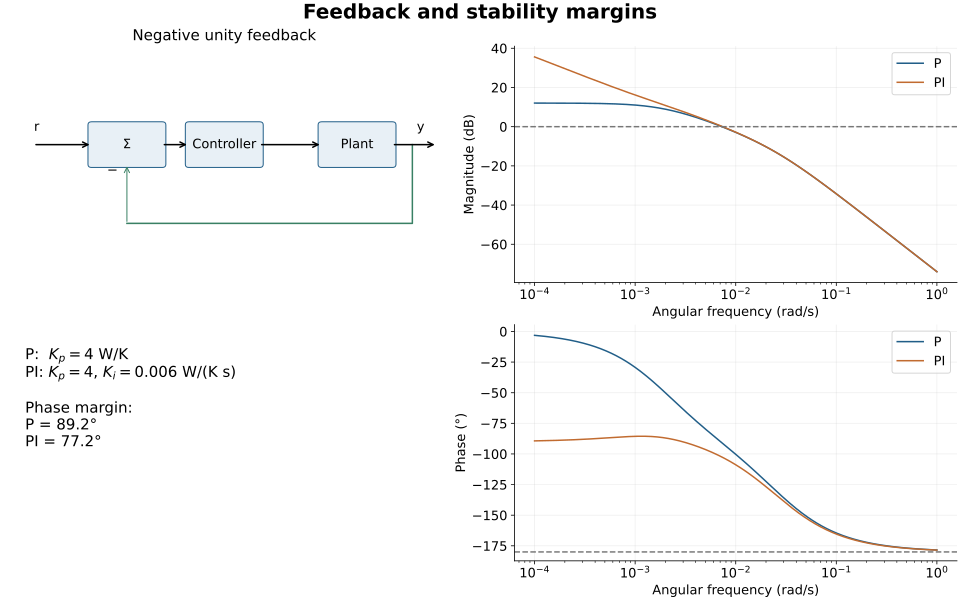

# M28-L3 – Feedback and Controller Design: PID, Stability Margins and Tracking {#L3}

**Course area:** M28 – Bachelor–Master Bridge: Transition to Control and State-Space Methods

**Level:** Bachelor · Bachelor–Master Bridge

**Prerequisites:** [M13-L2](M13-L2.md), [M28-L2](M28-L2.md).

**Learning objective:** Distinguish P, PI and PID structures and assess tracking and phase margin.

## Control Loop and Error {#S1}

The setpoint $r$ and measured output $y$ define the error $e=r-y$. With negative unity feedback, a linear plant $G$ and a controller $R$, the loop transfer function is $L=RG$. The closed-loop setpoint transfer function is

$$T(s)=\frac{L(s)}{1+L(s)},\qquad S(s)=\frac{1}{1+L(s)},\qquad T+S=1.$$

A disturbance added at the plant output acts through $S$, whereas the ambient temperature input of the thermal model acts through $SG_d$. With ideal measurement feedback, sensor noise affects the actual temperature through $-T$. These equations hold only in linear, unsaturated operation. Feedforward control can additionally provide the nominal steady-state power.

## P, PI and PID {#S2}

A common parallel structure with implementable derivative filtering is

$$R(s)=K_p+\frac{K_i}{s}+\frac{K_ds}{1+\tau_f s},\qquad \tau_f>0.$$

Here $K_p$ has units of W/K, $K_i$ W/(K s), and $K_d$ W s/K. P responds immediately, I accumulates persistent errors, and D can respond to rapid changes. Applying D to the measured value rather than the setpoint avoids derivative kick following a setpoint step; this is then a structure with separate setpoint and feedback paths. D amplifies high-frequency noise, which makes filtering important.

For the thermal model, $K_p=4$ W/K is chosen initially. With feedforward power $u_{ff}=10$ W at $r=10$ K, the steady-state model gives $y=u+d$. Thus, for $d=-3$ K, the remaining steady-state error is $e=3/(1+4)=0{.}6$ K. With a stable PI controller and $K_i=0{.}006$ W/(K s), the steady-state error under a constant disturbance vanishes, provided sufficient heating power is available. This is the basis of setpoint tracking in the practical assessment.

## Stability and Margins {#S3}

For the P controller, the denominator of the closed-loop transfer function is $s^2+0{.}0275s+0{.}00025$. For the PI controller, it is

$$s^3+0{.}0275s^2+0{.}00025s+0{.}0000003.$$

For the cubic polynomial $s^3+a_2s^2+a_1s+a_0$, the Routh–Hurwitz criterion requires positive coefficients and $a_2a_1>a_0$. Here the product $6{.}875\cdot10^{-6}$ exceeds $3\cdot10^{-7}$. The poles are approximately $-0{.}01305\pm j0{.}00656$ and $-0{.}001406$ s$^{-1}$.

At the gain crossover frequency $|L(j\omega_c)|=1$, the phase margin is $180^\circ+\arg L(j\omega_c)$ (with the phase unwrapped continuously around -180°). For the P controller, $\omega_c\approx0{.}007272$ rad/s and the phase margin is 89.2°; for the PI controller the values are $0{.}007418$ rad/s and 77.2°. The gain margin describes the relative change in gain at the -180° phase crossover. Neither model has a finite such crossover at positive frequency; the idealised gain margin is infinite. This does not establish stability for arbitrary real delays or arbitrary controller models. With multiple crossovers or unstable open-loop poles, a complete Nyquist analysis and internal stability analysis are required.

{alt="Block diagram of a temperature control loop and Bode plots of the open-loop P and PI systems."}

## Saturation and Anti-Windup {#S4}

The heater can supply only $0\le u\le30$ W. During a large error, the requested power may be higher. Without limiting the integrator state, it continues to grow despite the unchanged actual control signal (windup). Simple conditional integration allows the integrator to continue only if the unsaturated control signal is within the permissible range or the sign of the error drives the control signal back into that range. The sampled control logic in [M28-L5](M28-L5.md) uses this approach.

If a setpoint is unattainable, no controller can overcome the physical power limit. The design therefore combines stability, control effort, steady-state error, overshoot and robustness. The stated margins apply exclusively to the nominal continuous-time small-signal loop.

## Exercises with Solutions {#S5}

1. What steady-state error remains with a P controller, 10 W of feedforward power and $d=-5$ K? **Solution:** 1 K.
2. Is a Tustin or Euler discretisation equivalent to the continuous-time controller for an arbitrarily large sampling interval? **Solution:** No; sampling and the hold element change the dynamics.
3. Check $K_i=0{.}2$ with $K_p=4$. **Solution:** $a_0=10^{-5}$, greater than $a_2a_1$; the ideal continuous-time loop is unstable.
4. What steady-state control signal is required for $r=10$ K and $d=-3$ K? **Solution:** 13 W in the nominal model.

## Sources {#S6}

- [Åström and Murray – Feedback Systems, 2nd edition, chapters 2, 5–12](https://fbswiki.org/wiki/index.php/Feedback_Systems%3A_An_Introduction_for_Scientists_and_Engineers) · Chapter index 10 and 11: stability margins and PID control. · Last accessed: 2026-11-25
- [MIT OpenCourseWare – 16.30 Feedback Control Systems](https://ocw.mit.edu/courses/16-30-feedback-control-systems-fall-2010/) · Lectures 2–4: root locus and frequency-domain controller design; PID details need separate evidence; linked notes not opened. · Last accessed: 2026-11-25
