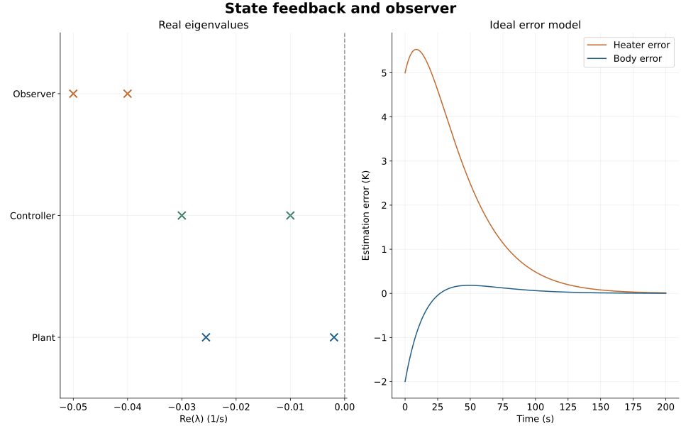

# M28-L4 – Controllability and Observability: State Feedback and Observers {#L4}

**Course area:** M28 – Bachelor–Master Bridge: Transition to Control and State-Space Methods

**Level:** Bachelor · Bachelor–Master Bridge

**Prerequisites:** [M28-L1](M28-L1.md) to [M28-L3](M28-L3.md).

**Learning objective:** Perform rank tests, assign poles using state feedback and justify the use of an observer.

## Controllability {#S1}

For $\dot x=Ax+Bu$ with $n$ states, the Kalman controllability matrix is

$$\mathcal R=[B\ AB\ \cdots\ A^{n-1}B].$$

It has full row rank if and only if the continuous-time LTI system without actuator limits is fully controllable. For the two-body model,

$$\mathcal R=\begin{pmatrix}0.01&-0.0002\\0&0.00005\end{pmatrix},\qquad \det\mathcal R=5\cdot10^{-7}.$$

The matrix is therefore nonsingular. If the bodies are disconnected ($g=0$), this property is lost as long as only the first body is heated. Rank is a structural property; weak coupling, actuator limits and the choice of units affect the practical difficulty of controlling the system. A determinant alone is not a scale-independent quality measure.

## Observability {#S2}

With only the body temperature measured, $C=(0\ 1)$, the observability matrix is

$$\mathcal O=\begin{pmatrix}C\\CA\end{pmatrix}=\begin{pmatrix}0&1\\0.005&-0.0075\end{pmatrix},\qquad \det\mathcal O=-0.005.$$

In the ideal model, both initial states can be determined from the measurement history and known inputs. This does not mean that individual noisy measurements accurately indicate the heater temperature. The formal relationship $x_1=(\dot y+0.0075y-0.0025d)/0.005$ requires a derivative and amplifies measurement noise. The dynamic observer avoids direct numerical differentiation.

## State Feedback {#S3}

With $u=-Kx+Nr$, the closed-loop system matrix is $A-BK$. For desired poles at $-0.01$ and $-0.03$ s$^{-1}$, the characteristic polynomial must be $s^2+0.04s+0.0003$. Comparing coefficients gives $K=(1.25\ 3.125)$ W/K. The feedforward gain for unity steady-state tracking without a disturbance is

$$N=-[C(A-BK)^{-1}B]^{-1}=6\ \mathrm{W/K}.$$

For $r=10$ K and $x=0$, the desired actuator input would already be 60 W, beyond the 30 W limit. Pole placement alone is therefore insufficient for the large step; here it describes the linear behaviour near a suitable operating point. Feedforward control without an integrator also does not reject arbitrary constant disturbances.

## Observer {#S4}

A Luenberger observer with known $u,d$ is given by

$$\dot{\hat x}=A\hat x+Bu+Ed+L_o(y-C\hat x).$$

For $\tilde x=x-\hat x$, it follows that $\dot{\tilde x}=(A-L_o C)\tilde x$. With desired observer poles of -0.04 and -0.05 s$^{-1}$, we obtain $L_o=(0.14\ 0.0625)^T$ s$^{-1}$. The error dynamics are faster than the control dynamics. The observer corrects its estimate based on the difference between the measured and predicted output. An unmodelled ambient influence or sensor offset introduces an additional driving term into the error dynamics; fast poles can increase sensitivity to noise.

{alt="Open-loop and controlled eigenvalues and error response of a Luenberger observer."}

Under ideal LTI conditions and with $u=-K\hat x+Nr$, the combined system has the poles of $A-BK$ and $A-L_oC$ (separation principle). This follows from the block-triangular dynamics in the coordinates $(x,\tilde x)$. In the presence of saturation, the observer must receive the input actually applied. The union of the linear poles then no longer describes the entire nonlinear control loop.

## Exercises with Solutions {#S5}

1. Is it necessary to measure both states for observability? **Solution:** No, as the rank test with one channel shows.
2. How do controllability and observability change when $g=0$? **Solution:** Both matrices lose full rank in this case.
3. Calculate the feedforward power for $r=2$ K, $x=0$. **Solution:** 12 W.
4. What happens if the ambient temperature is unknown to the observer? **Solution:** The error dynamics additionally contain $E(d-\hat d)$; the error need not converge to zero.

## Sources {#S6}

- [Åström and Murray – Feedback Systems, 2nd edition, Chapters 2, 5–12](https://fbswiki.org/wiki/index.php/Feedback_Systems%3A_An_Introduction_for_Scientists_and_Engineers) · Chapter index 7 and 8: state feedback, observability and estimation. · Last accessed: 2026-11-25
- [MIT OpenCourseWare – 16.30 Feedback Control Systems](https://ocw.mit.edu/courses/16-30-feedback-control-systems-fall-2010/) · Lectures 10–15: controllability, feedback, pole placement and estimators; linked notes not opened. · Last accessed: 2026-11-25
