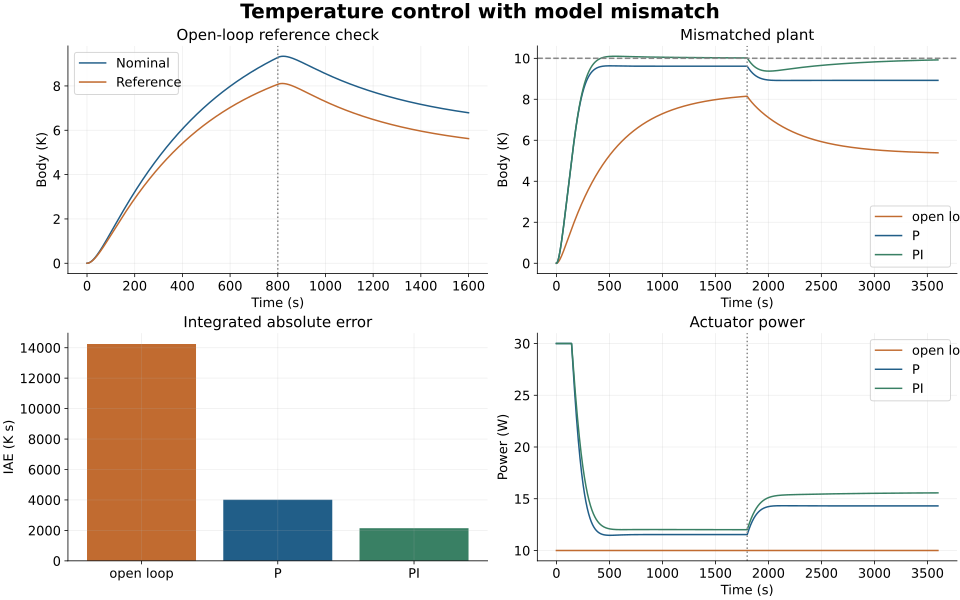

# M28-L5 – Practical Assignment: Simulating a Temperature Control Loop and Checking the Model against Reference Data {#L5}

**Course area:** M28 – Bachelor–Master Bridge: Transition to Control and State-Space Methods

**Level:** Bachelor · Bachelor–Master Bridge

**Prerequisites:** [M28-L1](M28-L1.md) to [M28-L4](M28-L4.md).

**Learning objective:** Document a reproducible control simulation with an independent reference calculation, model mismatch and a comparison of sampling intervals.

## Assignment and Data Basis {#S1}

For the two-body model, the body temperature is to be raised from 20 to 30 °C. After 1800 s, the ambient temperature drops from 20 to 17 °C. The experiment lasts 3600 s, and both states start at zero K deviation. Heating power is limited to between 0 and 30 W. Open-loop control (10 W), P control with feedforward (10 W, $K_p=4$ W/K), and PI control with the same feedforward and $K_i=0.006$ W/(K s) are compared. The nominal values come from [M28-L1](M28-L1.md). A second, synthetic reference plant has $h=1.2$ W/K and $C_2=440$ J/K. All other parameters remain the same. The parameters were chosen for teaching purposes; they are not measured device data.

First, both plants are excited in open loop with 12 W for 800 s and then 6 W until 1600 s. The first interval is intended for model assessment, the second as an additional test interval. No parameters are fitted to these data. The reference data are synthetic calculations from a different parameterisation; independent physical validation is therefore not possible. In addition, a second mathematical solution method checks the nominal calculation.

## Calculation Method and Program {#S2}

For an input $v=(u,d)^T$ that is constant during a sampling interval, the linear model can be propagated exactly in time. With $B_v=(B,E)$,

$$\begin{pmatrix}A_d&B_d\\0&I\end{pmatrix}=\exp\left(\Delta t\begin{pmatrix}A&B_v\\0&0\end{pmatrix}\right),\qquad x_{k+1}=A_dx_k+B_dv_k.$$

This is an exact zero-order-hold (ZOH) plant mapping apart from numerical rounding errors. The controller is implemented with $\Delta t=1$ s. The actuator input is calculated at the beginning of each interval and held constant. The integrator is then advanced using a conditional Euler update. The digital loop therefore does not correspond exactly to the continuous-time design. The sampling interval comparisons capture the effect of this discretisation, not an error in the analytical ZOH solution.

The program requires Python, NumPy and SciPy. It generates all data without external files.

```python
import numpy as np
from scipy.linalg import expm
from scipy.signal import place_poles
from scipy.integrate import solve_ivp

def plant(g=2., h=1., c1=100., c2=400.):
    A=np.array([[-g/c1,g/c1],[g/c2,-(g+h)/c2]])
    B=np.array([[1/c1,0],[0,h/c2]])
    return A,B

def zoh(A,B,dt):
    M=np.block([[A,B],[np.zeros((2,4))]])
    E=expm(M*dt)
    return E[:2,:2],E[:2,2:]

def open_loop(A,B,dt=1.):
    t=np.arange(0,1600+dt,dt); x=np.zeros((len(t),2))
    ad,bd=zoh(A,B,dt)
    for k in range(len(t)-1):
        u=12. if t[k]<800 else 6.
        x[k+1]=ad@x[k]+bd@np.array([u,0.])
    return t,x

def run(mode,dt=1.,actual=False):
    A,B=plant(h=1.2,c2=440.) if actual else plant()
    ad,bd=zoh(A,B,dt)
    t=np.arange(0,3600+dt,dt); x=np.zeros((len(t),2)); u=np.zeros(len(t)-1)
    integ=0.
    for k in range(len(u)):
        e=10.-x[k,1]
        v=10. if mode=='open' else 10.+4.*e+(integ if mode=='PI' else 0.)
        u[k]=np.clip(v,0.,30.)
        if mode=='PI' and (0.<v<30. or (v>=30. and e<0.) or (v<=0. and e>0.)):
            integ+=.006*e*dt
        d=-3. if t[k]>=1800 else 0.
        x[k+1]=ad@x[k]+bd@np.array([u[k],d])
    return t,x,u

def metrics(t,x,u):
    return np.max(x[:,1]),10.-x[-1,1],np.sum(abs(10.-x[:-1,1]))*(t[1]-t[0]),np.sum(u)*(t[1]-t[0])/3600

if __name__=='__main__':
    A,B=plant(); C=np.array([[0.,1.]])
    K=place_poles(A,B[:,:1],[-.01,-.03]).gain_matrix
    L=place_poles(A.T,C.T,[-.04,-.05]).gain_matrix.T
    print('poles',np.linalg.eigvals(A),'K',K,'L',L.ravel())
    t,x=open_loop(A,B); _,ref=open_loop(*plant(h=1.2,c2=440.))
    for sl in [t<=800,t>800]:
        print('reference RMSE',np.sqrt(np.mean((x[sl,1]-ref[sl,1])**2)))
    ode=solve_ivp(lambda t,x:A@x+B@np.array([12.,0.]),[0,800],[0.,0.],rtol=1e-10,atol=1e-12,t_eval=t[t<=800])
    print('ODE check',np.max(abs(ode.y.T-x[t<=800])))
    assert np.max(abs(ode.y.T-x[t<=800]))<1e-7
    for actual in (False,True):
        for mode in ('open','P','PI'):
            t,x,u=run(mode,actual=actual); print(actual,mode,*metrics(t,x,u)); assert np.all((u>=0)&(u<=30))
    for dt in (2.,1.,.5):
        print('step',dt,*metrics(*run('PI',dt,True)))
```

## Results and Interpretation {#S3}

$\mathrm{IAE}=\int |r-y|\,dt$ is evaluated on the grid as a left-endpoint rectangular sum in K s. Consumption $\sum_k u_k\Delta t/3600$ is expressed in Wh; it is the modelled heating energy, not the electricity consumption of a complete real device. The signed final error is $10-x_2(3600)$.

| Plant | Controller | Max. $x_2$ (K) | Final error (K) | IAE (K s) | Heating energy (Wh) |
| --- | --- | ---: | ---: | ---: | ---: |
| nominal | open loop | 9.681 | 2.923 | 9442.9 | 10.000 |
| nominal | P | 10.032 | 0.600 | 2465.1 | 12.297 |
| nominal | PI | 10.412 | 0.057 | 2099.9 | 12.643 |
| mismatched | open loop | 8.151 | 4.612 | 14244.6 | 10.000 |
| mismatched | P | 9.633 | 1.077 | 4015.1 | 14.000 |
| mismatched | PI | 10.100 | 0.078 | 2142.6 | 14.837 |

{alt="Comparison of open-loop, P and PI control for nominal and mismatched plants, together with model and reference responses."}

For the mismatched plant, the setpoint after the disturbance step requires a steady-state power of $1.2(10+3)=15.6$ W. The P controller has an analytical final error there of $e=(15.6-10)/(4+1.2)=1.0769$ K. This result confirms the simulation. The PI controller approaches the setpoint even with model mismatch; the remaining 0.078 K at the finite end of the experiment is not evidence of a steady-state error. Open-loop control uses less energy but maintains the setpoint much less accurately. A meaningful comparison must include both aspects.

## Verification Steps and Reproducibility {#S4}

The RMSE of the body temperature between the nominal and mismatched open-loop plants is 0.727 K in the first interval up to and including 800 s, and 1.228 K in the second interval after 800 s. These figures indicate model mismatch, not measurement uncertainty. The nominal 12 W step response is calculated separately with `solve_ivp` (relative tolerance $10^{-10}$, absolute tolerance $10^{-12}$). The maximum state difference compared with ZOH is approximately $2.65\cdot10^{-10}$ K. Agreement between the solvers verifies the calculation but not the assumptions of the thermal model.

| Sampling interval (s) | Max. $x_2$ (K), mismatched PI | Final error (K) | IAE (K s) |
| ---: | ---: | ---: | ---: |
| 2 | 10.0975 | 0.07748 | 2145.10 |
| 1 | 10.1000 | 0.07755 | 2142.62 |
| 0.5 | 10.0989 | 0.07762 | 2140.38 |

The differences are small for this experiment. The three sampling intervals do not provide a general stability guarantee. Experimental validation would require at least time-stamped setpoint, measured output, ambient and actuator values, sensor uncertainty, known initial states, separate identification and test data, and predefined acceptance limits. The teaching experiment does not approve a real heating system for operation.

## Practical Assignment and Self-Assessment {#S5}

Prepare a short report containing: balances and model assumptions, two open-loop reference curves, closed-loop temperature and actuator-input responses, a results table, an analytical check and model limitations. Also vary the maximum heating power or the ambient temperature. Document which quantity was changed and use the same performance metrics. As evidence of readiness for the Bachelor–Master bridge, the model, simulation, interpretation and reproducibility should be traceable.

1. How much power would ideally be needed at steady state after the disturbance step for the nominal plant? **Solution:** 13 W.
2. What happens with a maximum of 12 W for the mismatched plant? **Solution:** 30 °C cannot be reached at an ambient temperature of 17 °C; at full power the temperature settles at only 27 °C.
3. Why is the second RMSE interval not an independent empirical validation? **Solution:** It uses the same synthetic reference model and no real measurement.
4. Name an acceptance criterion for a future laboratory experiment. **Solution hint:** For example, a maximum error after an agreed settling time for a defined disturbance step; specify the limit and measurement uncertainty before the experiment.

## Sources {#S6}

- [Åström and Murray – Feedback Systems, 2nd edition, Chapters 2, 5–12](https://fbswiki.org/wiki/index.php/Feedback_Systems%3A_An_Introduction_for_Scientists_and_Engineers) · Second edition, chapter 2: linear dynamic models, disturbance attenuation, reference tracking and robustness; contents only. · Last accessed: 2026-11-25
- [MIT OpenCourseWare – 16.30 Feedback Control Systems](https://ocw.mit.edu/courses/16-30-feedback-control-systems-fall-2010/) · Lectures 5–7 and 11–12: state models and feedback design; not validation of this virtual experiment; linked notes not opened. · Last accessed: 2026-11-25
