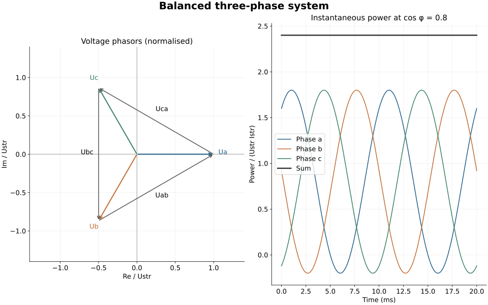

# M29-L1 – Three-Phase Calculations, Active and Reactive Power: Assessing Readiness with a Balanced Network {#L1}

**Course area:** M29 – Bachelor–Master Bridge: Transition to Power Electronics and Electrical Machines

**Level:** Bachelor · Bachelor–Master Bridge

**Prerequisites:** [M1-L6](M1-L6.md), [M1-L7](M1-L7.md), [M10-L2](M10-L2.md).

**Learning objective:** Express three-phase quantities and power balances reliably in terms of phase and line quantities.

## Diagnostic self-test {#S1}

First answer without aids: 1. In the usual 230/400 V system, is 400 V the phase-to-neutral voltage? 2. Is reactive power energy permanently consumed per unit time? 3. Is the neutral current zero for a balanced load? 4. What is the unit of apparent power?

**Answers:** 1. No, it is the line-to-line RMS voltage. 2. No, it describes periodic energy exchange in the sinusoidal model. 3. Yes, for balanced sinusoidal currents. 4. VA. If there are gaps in your knowledge, review the stated prerequisites.

## Phasors and connection types {#S2}

For positive phase sequence, let the RMS phasors be $U_a=U$, $U_b=Ue^{-j2\pi/3}$ and $U_c=Ue^{j2\pi/3}$. The line voltage follows by subtraction:

$$U_{ab}=U_a-U_b=\sqrt3 Ue^{j\pi/6}.$$

For a star connection, $U_{LL}=\sqrt3 U_{str}$ and $I_L=I_{str}$; for a delta connection, $U_{LL}=U_{str}$ and $I_L=\sqrt3 I_{str}$ (magnitudes in balanced operation in both cases). The original subscript str denotes a phase quantity. In delta, the line current is the difference between two phase currents. The connection type matters: with the same impedance per phase, delta on the same network draws three times the total power of star. This is not a recommendation to reconnect arbitrary windings.

{alt="Phase and line voltage phasors, instantaneous phase powers and their constant sum."}

## Complex power and constant instantaneous power {#S3}

Using the passive sign convention and RMS phasors, $\underline S=3\underline U_{str}\underline I_{str}^*=P+jQ$. Hence

$$P=\sqrt3 U_{LL} I_L\cos\varphi,\qquad Q=\sqrt3 U_{LL} I_L\sin\varphi,\qquad |S|=\sqrt{P^2+Q^2}.$$

For an inductive load, $\varphi>0$ and $Q>0$. From $u_a=\sqrt2U\cos(\omega t)$ and $i_a=\sqrt2I\cos(\omega t-\varphi)$ we obtain $p_a=UI[\cos\varphi+\cos(2\omega t-\varphi)]$. The phases, displaced by 120° each, yield terms at twice the frequency whose sum is zero. Total power is therefore constant in time. Imbalance or harmonics can produce pulsating total power.

## Worked example and power factor {#S4}

A balanced motor draws 12 A at 400 V with $\cos\varphi=0.8$ (inductive). This gives 8.314 kVA, 6.651 kW and 4.988 kvar. The phase voltage in star is 230.94 V; $|Z|=19.25$ ohms, $R=15.40$ ohms, $X=11.55$ ohms. Steady-state mechanical output power is less than active power. With an output of 5.6 kW, efficiency is 84.2%. Power factor and efficiency are different quantities.

When current is distorted, the total power factor $P/(\sqrt3 U_{LL}I_L)$ is not necessarily the cosine of the fundamental phase displacement. For sinusoidal voltage it is the product of the displacement factor and the ratio of fundamental RMS current to total RMS current. Current paths must be rated for the total RMS value.

## Exercises with solutions {#S5}

1. 400 V, 10 A, power factor 0.9 inductive: **Solution:** 6.235 kW, 3.020 kvar.
2. Identical impedance in star and delta: why does the current increase? **Solution:** Phase voltage and phase current each increase by a factor of $\sqrt3$; the delta line current increases by another factor of $\sqrt3$, giving a total factor of three.
3. Under what condition does $Q$ become negative? **Solution:** When current leads (capacitive), under the stated passive sign convention.
4. Why can an ideal DC link transfer power despite the motor's reactive power? **Solution:** Only the mean active power must be supplied on a net basis from the DC side of an ideal converter; reactive current nevertheless loads the semiconductors.

## Sources {#S6}

- [MIT OpenCourseWare – 6.061 Introduction to Electric Power Systems, Readings](https://ocw.mit.edu/courses/6-061-introduction-to-electric-power-systems-spring-2011/pages/readings/) · Chapter index 3: polyphase networks; chapter text not re-reviewed here. · Last accessed: 2026-11-25
